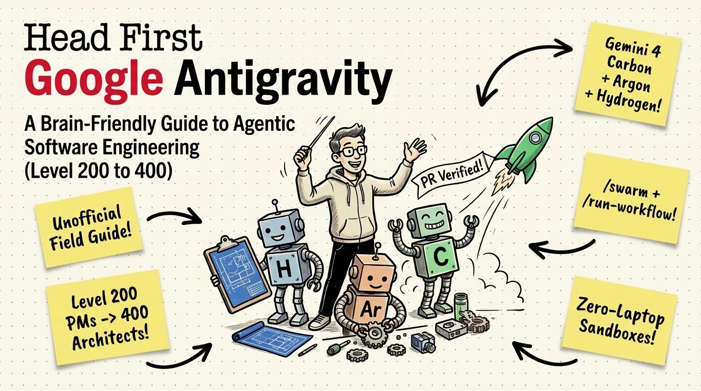
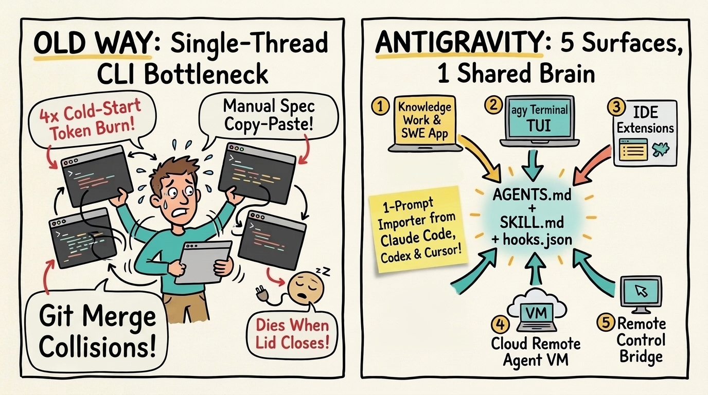
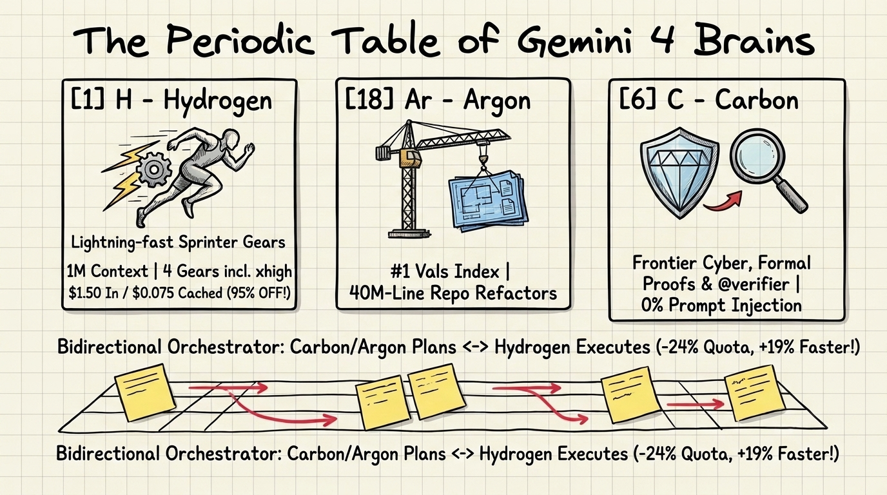
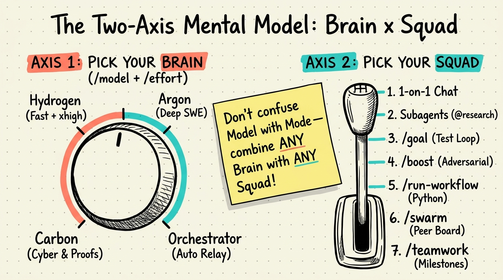
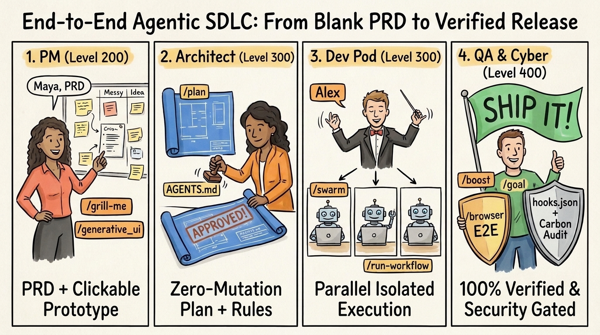
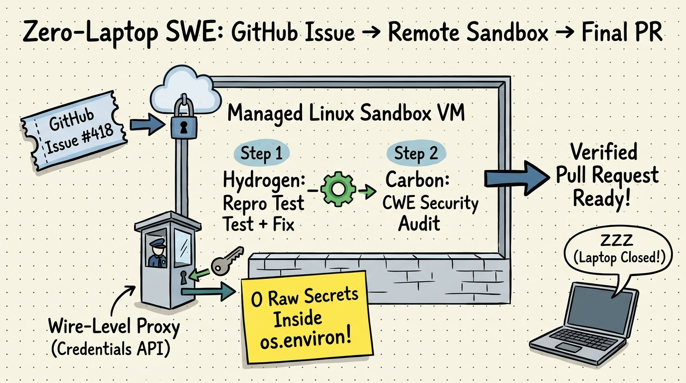
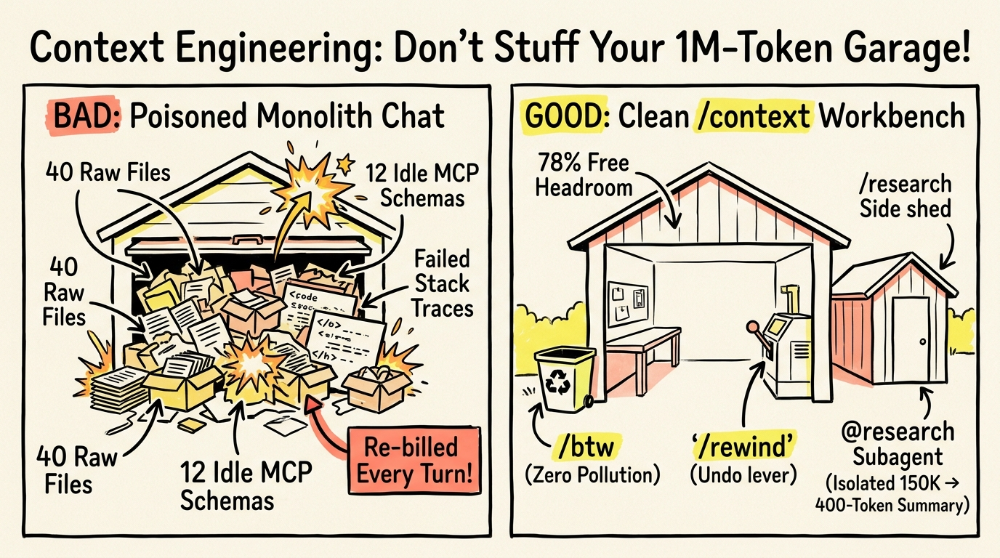
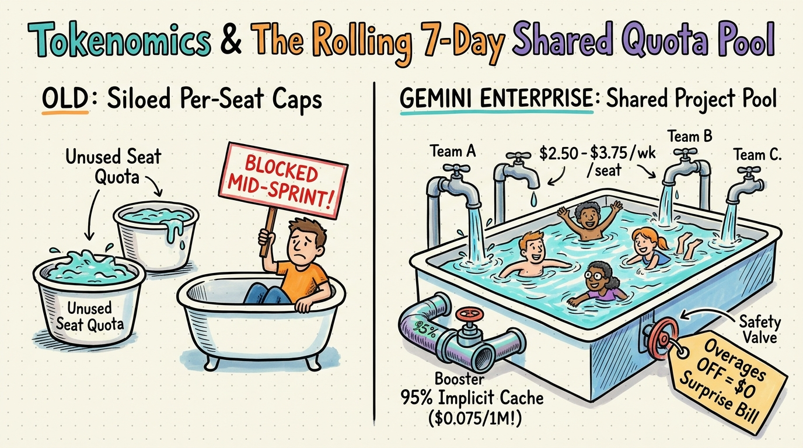
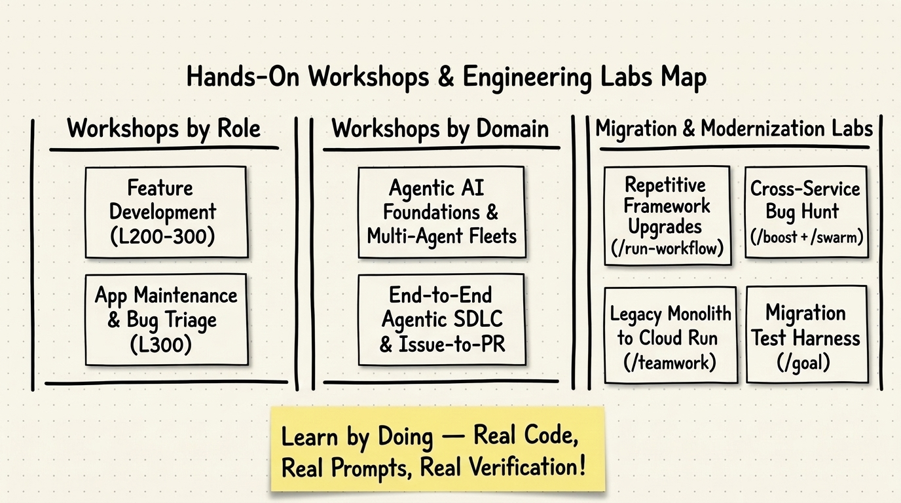

# Head First Google Antigravity: A Brain-Friendly Guide to Agentic Software Engineering (Level 200 → 400)



> [!IMPORTANT]
> **Unofficial Field Guide Disclaimer — Read This Before Your First Sip of Coffee!**
> This book, course, and hands-on lab repository is an **unofficial, community-authored guide** created for educational purposes. Every cartoon, story, mental model, and opinion reflects the **author's personal views**—not official Google, Google Cloud, or O'Reilly Media documentation. Because AI models, slash commands, pricing, and enterprise quotas move fast, **always check the official Google documentation for the final word**:
> - **[Google Antigravity Official Documentation](https://antigravity.google/docs)** *(Slash Commands, `/swarm`, `/run-workflow`, Remote Agents, CLI & Changelog)*
> - **[Google Cloud Gemini Enterprise Documentation](https://docs.cloud.google.com/gemini/enterprise/docs/overview)** *(IAM Governance, `BYOID/WIF` SSO, Pooled Quotas & Overages)*
> - **[Google AI & Vertex AI Official Pricing](https://ai.google.dev/pricing)** *(Authoritative Model Cards & Token Billing)*

---

## 🧠 Intro: How to Use This Book *(Your Brain on Agentic Coding)*

### Who is this book for?
If you can read a Git diff, write a product spec, or deploy a service—and you want to go from *"I occasionally prompt an AI in a sidebar"* to *"I orchestrate autonomous multi-agent swarms, zero-laptop cloud sandboxes, and enterprise-governed SDLC pipelines"*—**this book is for you.**

| Your Starting Seat | Your Level | What Happens to Your Workflow by Chapter 8 |
| :--- | :--- | :--- |
| **Product Managers, Designers & Analysts** *(like **Maya**)* | **`[Level 200]`** | You flip Antigravity into **Knowledge Work** layout, pull live Google Docs & Sheets, let `/grill-me` poke holes in your PRD *before* engineering sees it, and build clickable HTML prototypes in 90 seconds with `/generative_ui`. |
| **Daily Full-Stack, Backend & QA Engineers** *(like **Alex**)* | **`[Level 300]`** | You import all your Claude Code / Codex / Cursor configs in **one prompt**, master the **Two-Axis (`Brain × Squad`) Cockpit**, run parallel isolated-worktree builds in `/swarm`, crush Heisenbugs with `/boost`, and fan out 40-service codemods via `/run-workflow`. |
| **Principal Architects, SRE & Security/FinOps Leads** *(like **Priya** & **Sam**)* | **`[Level 400]`** | You wire **GitHub Issue → Locked Remote Sandbox → Carbon-Audited Pull Request** pipelines, enforce pure-Python `hooks.json` security gates outside the LLM, master `/context` hygiene, and stretch a **Rolling 7-Day Shared Quota Pool** `4x–10x` further using Gemini 4's **95% implicit cache**. |

### We know what your brain is thinking...
*"Why are there hand-drawn whiteboards, arguing robots, fridge magnets, and stories in an advanced Level 400 architecture guide?"*

Because **your brain is wired to ignore dry bullet lists.** To your evolutionary survival circuitry, a monotonic 50-row CLI flag table looks like tree bark—safe to forget immediately. When you encounter **visual contrast, an engineering disaster story at 4:45 PM on a Friday, two models arguing in a *Fireside Chat*, or a *Be the Orchestrator* puzzle**, multiple regions of your cortex fire together. **Neurons that fire together, wire together.**

### Map of the Book & Hands-On Curriculum
- **[Chapter 1 `[L200]`](#chapter-1-level-200--escape-from-single-thread-purgatory-5-surfaces-1-shared-brain)** — *Escape from Single-Thread Purgatory: Why Antigravity Leapfrogs CLI-Only & Cloud-Only Agents (+ 1-Prompt Migration)*
- **[Chapter 2 `[L200–300]`](#chapter-2-level-200300--meet-the-elements-gemini-4-hydrogen-argon-carbon--orchestrator)** — *Meet the Elements: Gemini 4 Hydrogen (`xhigh`), Argon, Carbon & Bidirectional `Orchestrator`*
- **[Chapter 3 `[L200–300]`](#chapter-3-level-200300--the-two-axis-cockpit-dont-confuse-the-brain-with-the-squad)** — *The Two-Axis Cockpit: Don't Confuse the Brain (`/model`) with the Squad (`/swarm`, `/run-workflow`, `/boost`, `/teamwork`)*
- **[Chapter 4 `[L200–400]`](#chapter-4-level-200400--a-day-in-the-life-at-pulsepay-the-end-to-end-agentic-sdlc)** — *A Day in the Life at PulsePay: End-to-End Agentic SDLC from Maya's PRD to Sam's Cyber Sign-Off*
- **[Chapter 5 `[L400]`](#chapter-5-level-400--look-ma-laptop-closed-github-issue--remote-sandbox--final-pr)** — *Look Ma, Laptop Closed! GitHub Issue → Remote Sandbox → Verified Pull Request*
- **[Chapter 6 `[L300–400]`](#chapter-6-level-300400--dont-stuff-your-1m-token-garage-context-engineering-mastery)** — *Don't Stuff Your 1M-Token Garage: Context Engineering, `/context`, `/btw` & `/rewind`*
- **[Chapter 7 `[L300–400]`](#chapter-7-level-300400--the-95-cache-turbo--the-7-day-olympic-pool-tokenomics--finops)** — *The 95% Cache Turbo & The 7-Day Olympic Pool: Tokenomics, Thinking Effort & Enterprise FinOps*
- **[Chapter 8 `[L200–400]`](#chapter-8-level-200400--hands-on-workshops-engineering-labs--pocket-cheat-sheet)** — *Hands-On Workshops (`by-tech-role` & `by-tech-domain`), Migration & SDLC Labs + Pocket Reference*

---

## Chapter 1 `[Level 200]` — Escape from Single-Thread Purgatory: 5 Surfaces, 1 Shared Brain



**Friday, 4:15 PM at PulsePay.**
**Alex** (Staff Engineer) is trying to ship *Instant Merchant Refunds* before boarding his commuter train. He has four separate terminal tabs running a popular single-thread CLI coding agent, a half-read PRD open in Google Docs in Chrome, and two `git stash` piles he's already forgotten about. At 4:42 PM, he shuts his laptop lid to sprint for the train—**instantly freezing every running local process mid-test.**

Let's be brutally honest for a minute: **over the past year, single-thread terminal agents (like Claude Code) and cloud task queues (like Codex) stole huge mindshare.** Why? Because early IDE chat sidebars felt cramped, slow, and bolted-on. Developers wanted speed, bash fluency, and autonomy.

**With Antigravity v2.30–v2.32 + Gemini 4, Google didn't just copy the terminal agent—it erased the false choice between local speed, visual product collaboration, and cloud autonomy.**

Every Antigravity surface plugs into **one identical workspace brain** ([`AGENTS.md`](AGENTS.md), [`GEMINI.md`](GEMINI.md), `_agents/rules/`, `SKILL.md`, [`_agents/hooks.json`](_agents/hooks.json), and MCP):
1. **Antigravity App (Desktop & Web)** with **two switchable personas** (`Settings > General > Interface Layout`):
   - **Knowledge Work Layout**: Built for PMs, analysts, and designers—first-class Google Drive, Docs, Sheets & Slides plugins plus `/generative_ui` live interactive canvases, zero scary terminal clutter.
   - **Software Engineering Layout**: Built for builders—multi-file diff review, Swarm topology graph with timeline replay, integrated terminal, and sandboxed Chromium preview.
2. **Antigravity CLI (`agy`)**: Blistering terminal TUI (`Alt+S` live Swarm Board, `F5` voice dictation) *plus* non-interactive **Headless CI/CD mode** (`agy -p --output-format stream-json`).
3. **IDE Extensions**: Native inside VS Code, JetBrains, Zed, Visual Studio, Xcode, and Android Studio.
4. **Cloud Remote Agents** (`antigravity.google.com` / `agy --remote-agent`): Runs inside a Google-managed Debian 12 cloud VM that **keeps coding and opening PRs while your laptop sleeps in your backpack.**
5. **Remote Control Bridge** (`/remote-control`): Lets your phone browser steer *your own local workstation* and local uncommitted Git worktrees from the train!

### 💬 Fireside Chat: Single-Thread CLI Agent vs. Antigravity

> **Single-Thread CLI**: *"Why overcomplicate life? One terminal prompt, one bash loop, one developer. Pure Unix Zen!"*
>
> **Antigravity**: *"Pure Unix Zen—until Maya (your PM) updates the refund fee table in Google Sheets, Alex needs three services updated in parallel without `.git/index.lock` explosions, and Sam (Security) insists a frontier security model verify the diff before `gh pr create` runs."*
>
> **Single-Thread CLI**: *"Hey, Alex can just open three terminal tabs and copy-paste my `CLAUDE.md` rules!"*
>
> **Antigravity**: *"And pay **3x cold-start prompt tokens** while two tabs overwrite the same proto file? No thanks. Oh—and speaking of your `CLAUDE.md`, `.cursorrules`, and Codex skills: Alex doesn't even have to leave them behind. My **v2.30 1-Prompt Importer** brings every single one of them over in 30 seconds."*

### 🙋 There Are No Dumb Questions

**Q: *Wait—really? My team has 15 custom skills, 4 MCP servers, and subagents configured in Claude Code and Cursor. How hard is migrating?***
**A:** Zero manual rewriting. Open `/agy-customizations` (or just ask in chat):
```text
Import all my existing instruction files, skills, custom slash commands, MCP servers, and subagents from Claude Code, Codex, and Cursor into a workspace Antigravity plugin and show me what loaded.
```
Antigravity inspects `.claude/`, `.codex/`, and `.cursor/`, converts them into progressive-disclosure `SKILL.md` bundles and `.agents/agents/*.md` specialists, and wires your MCP servers automatically.

---

## Chapter 2 `[Level 200–300]` — Meet the Elements: Gemini 4 Hydrogen, Argon, Carbon & `Orchestrator`



Gone are the days of squinting at cryptic decimal soup (`2.5-pro-exp-0827-thinking-preview`—*bless you!*). In late 2026, Google organized **Gemini 4** around three crystal-clear elements—each sharing a **1,048,576-token unified context window** and **95% implicit cached-input discount**, yet tuned for a totally different job on your squad:

### ⚡ `[1] H` — Gemini 4 Hydrogen (`gemini-4-hydrogen`)
*The Supersonic Sprinter with an Hidden Overdrive Gear (`xhigh`).*
- **Don't call it a "toy lite model"**: Hydrogen scores **57% on Terminal-Bench 4.1**—more than **3x** `gemini-3.8-flash` (`18.2%`)!
- **4 Thinking Gears via `/effort`**: `low`, `medium`, `high` (default), and **`xhigh`** (*Extra* — exclusive overdrive gear that spends deep reasoning tokens solving gnarly isolated algorithms or regex/AST puzzles while still billing at Hydrogen's lean **`$1.50` in / `$7.50` out / `$0.075` cached** rates!).
- **Where it lives**: Available on **every plan** (Free → Enterprise) and powers 75–80% of daily edits, `/swarm` workers, `/run-workflow` pipelines, and **Gemini Managed Agents** (`antigravity-preview-09-2026`).

### 🏗️ `[18] Ar` — Gemini 4 Argon (`gemini-4-argon`)
*The Heavy Structural Crane for 40-Million-Line Codebases.*
- **Why Senior Engineers love it**: Ranked **`#1` on the Vals Index** across SWE, finance, and legal reasoning. Internally battle-tested refactoring **40M-line Chromium** subsystems, speeding up ADK by `40%`, and boosting Gemma 4 on vLLM by `2.85x`.
- **When to call Argon**: Cross-cutting 25-file refactors, tricky distributed state machines, Terraform + Spanner migrations, and deep architectural RFCs (`Low`, `Medium`, `High` effort; Pro, Ultra & Enterprise).

### 🛡️ `[6] C` — Gemini 4 Carbon (`gemini-4-carbon`)
*The Diamond-Hardened Cyber Detective, Proof Master & `@verifier`.*
- **Apex Reasoning & Security**: Ranked **`#1` on CursorBench 4.0, Perplexity WANDR & Zapier AutomationBench**. Built for frontier cybersecurity (`SEC-bench Pro`, `ExploitGym`, `CWE-bench v1`), formal mathematical proofs (`AlphaProof Code`), **`0%` indirect prompt-injection susceptibility** (Gray Swan), and **`92%` agentic honesty** (it refuses to claim tests passed if it didn't see exit code `0`!).
- **When to call Carbon**: Auditing high-risk auth/crypto/payment diffs, pinning as your **`@verifier` inside `/swarm`**, or cracking brutal concurrency deadlocks in `/boost` (Ultra & Enterprise, including ADC `v2.31.2+`).

###  baton: `Orchestrator (Carbon)` & `Orchestrator (Argon)` — The Intra-Turn Relay Secret
Why pay Carbon rates to run `pytest` and fix a missing comma—or risk Hydrogen missing a subtle cross-service invariant?

When you pick **`Orchestrator (Carbon)`** (Ultra) or **`Orchestrator (Argon)`** (Pro & Ultra) in `/model`, Antigravity runs **two brains inside a single turn**:
1. **Carbon/Argon** inspects read-only, writes the tactical plan, and sets **explicit Re-Plan Triggers** (*"Wake me back up if Redis cluster slot tests fail twice or if you hit an unexpected schema lock"*).
2. **Hydrogen** sprints through the file edits, compiler fixes, and test runs at high speed.
3. **Hit a snag?** Hydrogen hands the baton *back* to Carbon/Argon mid-turn to re-architect, then finishes the sprint, and Carbon/Argon signs off on the final diff!
- **Result on Terminal-Bench 4.1**: Near-Carbon accuracy for **24% less quota** and **19% faster wall-clock time!** *(Note: `Orchestrator` auto-tunes thinking effort, so manual `/effort` flags don't apply while it's active. On Gemini Enterprise seats, pair `Argon`/`Carbon` + `Hydrogen` directly in `/swarm`, `/run-workflow`, or the Python SDK!)*

> **Plus Supporting Specialists in Your Picker**: **`Nano Banana 2`** (`gemini-3.1-flash-image-preview` for UI mockups & visuals), **`Gemini Omni 1.1 Flash`** (video), **`gemini-3.8-flash`** & **`gemini-3.5-flash-lite`** (`$0.25/1M` cron sentinels), partner **`Claude Sonnet/Opus 5.5`**, and **`Gemma 4`** (`LiteRTAgentConfig` — `$0.00` zero-egress local NPU/GPU!).

<details>
<summary><b>🕵️ Be the Model Router! (Click to spot which developer just lit quota on fire)</b></summary>

Three engineers at PulsePay each run a 20-turn task:
- **Dev 1**: Leaves `/model` glued to `gemini-4-carbon (High)` while formatting 35 ESLint warnings across React components.
- **Dev 2**: Uses `gemini-4-hydrogen --effort xhigh` to write a tricky sliding-window rate-limiter algorithm and unit tests in a single Go package.
- **Dev 3**: Uses `Orchestrator (Argon)` to refactor a 14-file payment webhook retry pipeline.

**Verdict:**
- **Dev 1 burned ~5x–8x unnecessary quota!** Thinking tokens bill as output tokens (`$10–$20/1M` on Carbon vs. `$7.50/1M` on Hydrogen or `$3.00/1M` on 3.8 Flash), and ESLint cleanup needs `Hydrogen (low)`!
- **Dev 2 & Dev 3 nailed it**: `Hydrogen (xhigh)` unlocks deep isolated algorithmic chain-of-thought at Hydrogen base prices, while `Orchestrator (Argon)` lets Argon design the 14-file architecture and Hydrogen grind through the edits and test runs!
</details>

---

## Chapter 3 `[Level 200–300]` — The Two-Axis Cockpit: Don't Confuse the Brain with the Squad!



Look closely at the cockpit sketch above. If you remember **one** mental model from this entire book, make it this yellow sticky note:

> **💡 Never confuse Axis 1 (`Who is thinking?`) with Axis 2 (`How are agents organized?`).**
> Switching `/model` changes the **IQ, speed, and price tag of one brain**. Invoking `/swarm`, `/run-workflow`, `/boost`, `/goal`, or `/teamwork` changes the **org chart, communication rules, and workspace isolation of an entire squad!**


### 🧩 Who Am I? *(The 7-Squad Masquerade Puzzle)*
Read each first-person clue below and guess which **Axis 2 Squad** is speaking before peeking!

1. *"I spawn `DeepCoder` to build a fix, then immediately hire adversarial breaker agents whose sole job in life is to prove `DeepCoder`'s patch still fails under edge cases and `-race` flags."*
2. *"I turn your chat into a Coordinator, give `@api-worker` and `@ui-worker` isolated Git working copies, let them `@mention` each other on a shared board (`0` tokens while `Waiting`!), and let you pin `@verifier` to **Gemini 4 Carbon**."*
3. *"New in v2.32! I write a readable Python script right in front of you using `phase()`, `parallel()`, and `agent(schema=...)`. My workers NEVER chat with each other—they stamp out strict JSON-Schema results across 50 services."*
4. *"Give me an objective command like `pytest --cov-fail-under=95`. Every time the model tries to stop early saying 'Almost done!', I intercept it and keep looping until exit code `0`."*
5. *"I start with a Phase 1 Scoping Interview (*what, not how* + integrity mode), then run a multi-milestone org inside `~/teamwork_projects/{NAME}`—handing off to a **brand-new fresh `Project Orchestrator` at every milestone** while `Critic`, `Challenger`, and `Success Auditor` make sure nobody cheated the tests!"*
6. *"I'm a quiet leaf specialist (`@research` or `@browser`). I read 45 noisy files in my own isolated shed, hand a crisp 400-token summary back to your main chat, and park in `Idle` at `0` tokens keeping my cache warm for follow-ups."*

<details>
<summary><b>🔑 Click to unmask all 6 Squads!</b></summary>

1. **`/boost`** *(Adversarial Deep-Reasoning Pipeline — Paid plans, App & CLI)*
2. **`/swarm`** *(Peer-Coordinated Multi-Agent Mesh — Pro & Ultra, App & CLI; press `Alt+S` in CLI to open the live TUI board!)*
3. **`/run-workflow`** *(Deterministic Python Dynamic Workflows — v2.32+, Pro & Ultra, App & CLI; press `Ctrl+O` to expand!)*
4. **`/goal`** *(Relentless Verification Loop — All plans, App & CLI)*
5. **`/teamwork`** *(Autonomous Multi-Milestone Engineering Org — Paid plans, App & CLI)*
6. **Subagents** (`@research`, `@browser`, `self`, and custom `.agents/agents/*.md`)
</details>

---

## Chapter 4 `[Level 200–400]` — A Day in the Life at PulsePay: The End-to-End Agentic SDLC



Let's watch **Maya (PM)**, **Priya (Architect)**, **Alex (Dev Lead)**, and **Sam (QA & Cyber)** ship **PulsePay Instant Refund Guard** (auto-approving refunds under `\$500`, velocity-scoring `\$500+` refunds in Redis, and giving Ops a live override console) from a blank page on Monday morning to a verified release by Tuesday afternoon.

---

### 🎬 Act 1 `[Level 200]` — Maya (Product Manager) Stress-Tests the PRD & Builds a Live Prototype
Maya opens the PulsePay repo in the Antigravity App and flips **`Settings > General > Interface Layout` → `Knowledge Work`**. No intimidating terminal panes—just her workspace files, Google Drive/Docs/Sheets connectors, Voice mode (`F5`), and visual artifact preview.

1. **Socratic Edge-Case Interview (`/grill-me`)**:
   Maya knows engineering will roast her if she forgets partial refunds or FX rounding. Instead of guessing, she types:
   ```text
   /grill-me We want Instant Refund Guard (<$500 auto-approve, >=$500 fraud velocity check + Ops Hold queue). Inspect services/refunds/ first so you never ask what the codebase already answers. Then ask me ONE question at a time—putting your (Recommended) option first—about split partial refunds, currency drift, webhook retries, and chargeback windows before writing specs/instant-refund-prd.md.
   ```
   *Magic moment*: `/grill-me` reads `services/refunds/models.py` silently, discovers amounts are stored in `int64` minor units, and immediately asks Maya: *"Question 1: If a merchant fires three \$200 partial refunds within 60 seconds on the same \$550 order, should cumulative refunds >= \$500 trigger the Ops Hold queue? **(Recommended) Yes — track cumulative refunded cents per order_id**..."*
2. **90-Second Clickable Stakeholder Prototype (`/generative_ui`)**:
   Before booking a single engineering sprint hour, Maya generates an interactive prototype right in the side pane:
   ```text
   /generative_ui Build a Standalone Artifact clickable prototype of the PulsePay Ops Refund Override Console. Include a live Risk Score threshold slider (0-100), merchant refund velocity sparkline, Approve / Hold / Escalate buttons with MFA reason modal, and a live JSON webhook payload inspector.
   ```
   👉 *Hands-On Practice*: **[Lab S1 — PRD to Clickable Prototype (`labs/agentic-sdlc/prd-to-clickable-prototype.md`)](labs/agentic-sdlc/prd-to-clickable-prototype.md)**

---

### 🎬 Act 2 `[Level 200–300]` — Priya (Principal Architect) Locks In the Blueprint & Repo Guardrails
Priya switches to **Software Engineering** layout on **`gemini-4-argon` (`High`)** (or **`Orchestrator (Argon)`**).

1. **Zero-Mutation Blueprint Gate (`/plan /grill-me`)**:
   ```text
   /plan /grill-me Turn specs/instant-refund-prd.md into an engineering blueprint across proto/refunds/v2/, services/refund-ledger/, services/fraud-scorer/, and infra/terraform/. Grill me on Spanner read-write lock contention and Redis Lua sliding-window atomicity, then produce implementation_plan.md. Touch ZERO code files until I click Proceed.
   ```
2. **Living Repo Guardrails (No Stale Wiki Pages!)**:
   Priya makes sure the repository enforces her architectural invariants *automatically* on every agent turn:
   - **[`AGENTS.md`](AGENTS.md)** walks down from the Git root (`100 KB` budget), enforcing strict workspace isolation and our **4-Part Subagent Prompt Contract**.
   - **[`GEMINI.md`](GEMINI.md)** binds Vertex AI ADC (`vertex=True`) and Gemini 4 model routing.
   - **Scoped 4-Trigger Rules (`_agents/rules/*.md`)**: [`terraform_and_gcp_security.md`](_agents/rules/terraform_and_gcp_security.md) (`trigger: glob` on `*.tf`) and [`bigquery_finops.md`](_agents/rules/bigquery_finops.md) (`trigger: model_decision` on SQL tasks) stay at **0 tokens** until those exact tasks arise!

---

### 🎬 Act 3 `[Level 300]` — Alex (Staff Dev) Unleashes `/swarm` & `/run-workflow`
With Priya's `implementation_plan.md` approved, Alex needs simultaneous changes across Spanner/Go, Python/Redis, and React—plus upgrading 18 internal client microservices!

1. **Peer-Coordinated Cross-Stack Build (`/swarm` + `Alt+S` Board)**:
   ```text
   /swarm Execute implementation_plan.md with isolated working copies per worker:
   - @ledger-go (gemini-4-hydrogen): Spanner cumulative-refund transaction & ConnectRPC handler in services/refund-ledger/
   - @fraud-py (gemini-4-hydrogen, xhigh effort): Atomic Redis sliding-window Lua scorer in services/fraud-scorer/
   - @ops-ui (gemini-4-hydrogen): React Override Console in web/ops-console/
   - @verifier (pin to gemini-4-carbon): Run full test suites and audit all diffs for integer-cents overflow, BOLA tenant spoofing, and race conditions before Coordinator merges.
   ```
2. **18-Service Client Upgrade Conveyor Belt (`/run-workflow`)**:
   Next, Alex upgrades 18 downstream services to `RefundClient v2` with **zero inter-agent chatter** and **strict JSON-Schema verdicts** using `/run-workflow`!
   👉 *Hands-On Practice*: **[Lab S2 — Parallel Full-Stack `/swarm`](labs/agentic-sdlc/parallel-fullstack-swarm.md)** & **[Lab M2 — Fleet Upgrades with `/run-workflow`](labs/migration-modernization/repetitive-framework-upgrades.md)**

---

### 🎬 Act 4 `[Level 300–400]` — Sam (QA & Cyber) Breaks, Heals, Verifies & Codifies
1. **Concurrency Heisenbug Hunt (`/boost`)**: Load tests reveal `0.04%` duplicate partial-refund approvals under retry storms. Sam runs `/boost`—`DeepInvestigator` + adversarial breaker workers prove the exact Spanner retry interleaving and verify a mutex/idempotency-key fix under `go test -race`.
2. **Relentless Coverage Convergence (`/goal`)** + **Sandboxed Chromium E2E (`/browser`)**: `/goal` loops until `pytest --cov-fail-under=95` exits `0`; `/browser` clicks through the live Ops Console verifying zero console errors and saving a sign-off screenshot.
3. **Deterministic Python Lifecycle Gate ([`_agents/hooks.json`](_agents/hooks.json) + [`gate.py`](hooks-scripts/gate.py))**:
   Even if a sleepy developer runs in `Turbo` mode and an agent proposes `terraform destroy -auto-approve` or tries writing `.env.production`, `gate.py` intercepts `PreToolUse` **outside the LLM in pure Python** and slams down `{"decision": "deny"}`!
4. **Self-Improving Team Memory (`/learn`)**: Sam runs `/learn` to turn today's Spanner monetary-cents lesson into `_agents/skills/spanner-monetary-tx-safety/SKILL.md` so no agent or new hire ever repeats the bug!

<details>
<summary><b>🧲 Prompt Magnets! (Arrange the 4 scrambled pieces of a bulletproof Subagent Delegation Prompt)</b></summary>

Priya's [`AGENTS.md`](AGENTS.md) requires **4 mandatory magnets** whenever a parent agent spawns a subagent. Match the 4 magnets on the fridge door to why each one saves your bacon:

- `[Magnet A: "Do NOT modify, create, or delete any files."]`
- `[Magnet B: "Inspect ONLY services/fraud-scorer/ and proto/refunds/v2/."]`
- `[Magnet C: "Separate Verified Facts (with file:///path#L10-L20 links) from Unverified Hypotheses."]`
- `[Magnet D: "Run read-only grep_search and view_file to inventory Redis Lua keys."]`

---
**Snapped-Together Order:**
1. **Target Scope (`Magnet B`)** → Stops the subagent from wandering across 400 unrelated directories!
2. **Permitted Actions (`Magnet D`)** → Bounds exact tools and work to perform.
3. **File Mutation Policy (`Magnet A`)** → Guarantees discovery/audit agents never sneak uncommitted edits into your tree.
4. **Deliverable Contract (`Magnet C`)** → Prevents hallucinated assumptions from masquerading as verified code facts!
</details>


---

## Chapter 5 `[Level 400]` — Look Ma, Laptop Closed! GitHub Issue → Remote Sandbox → Final PR



**6:48 PM on the Caltrain.**
PagerDuty buzzes on Alex's phone: GitHub Issue `#418` just landed (*"Dual-header HMAC webhook rotation rejects valid transitional signatures during zero-downtime key rollover"*). Alex's MacBook Pro is dead in his backpack.

Six months ago, Alex would have hunted for an outlet on a crowded train. Today, he smiles—because **Antigravity decouples shipping verified Pull Requests from your local machine's power button.**

### 💥 Watch Out! Don't Mix Up *Remote Agents* with *Remote Control*!
People confuse these two names every single week. Nail the difference once and for all:
- **Cloud Remote Agents (`antigravity.google.com` or `agy --remote-agent`)**: Spins up a **Google-managed Debian 12 Linux VM in the cloud**. Close your laptop, get on a 12-hour flight, throw your router out the window—it **keeps running, running tests, and opening PRs!** *(Pro & Ultra personal accounts; Enterprise teams use Pattern 2 or Pattern 3 below.)*
- **Remote Control (`/remote-control` or `agy remote-control start`)**: Opens a secure browser/mobile window **into your own powered-on workstation** so you can steer local uncommitted Git worktrees, local GPUs, and corporate VPN resources from the couch!

---

### Three Battle-Tested Blueprints: From Issue `#418` to Merged Pull Request

#### Blueprint 1: One-Line Dispatch to a Cloud Remote Agent
```bash
agy --remote-agent \
  --project="pulsepay-core" \
  "Inspect GitHub issue #418, write a failing unit test reproducing dual-header HMAC rollover rejection, fix services/webhooks/verify.py, run pytest until 100% green, push branch fix/issue-418-hmac, and open a PR referencing #418."
```
*How does git push work safely inside the cloud VM?* Look at the security guard booth in the sketch above: `agy-plugin-proxy` injects real OAuth credentials **at the network wire boundary** in place of dummy `agy-h-*` handles—so **zero raw GitHub tokens ever touch VM disk or `os.environ`!**

#### Blueprint 2: Keyless GitHub Actions Headless Pipeline (`agy -p` + Google Cloud WIF)
On **Gemini Enterprise**, label any GitHub Issue `antigravity-implement` and let GitHub Actions authenticate keylessly via **Workload Identity Federation (`AGY_ADC_AUTH=true`)** and run headless `agy -p` inside an OS sandbox (`--sandbox`) with strict JSON-Schema output validation!
- Open our ready-to-deploy workflow: **[`github-actions-issue-to-pr.yml`](starter-kits/tier4-architect-fleet-and-sidecar/github-actions-issue-to-pr.yml)**
- *Level 400 Pro Trick*: Pipe multi-turn JSONL over stdin using `agy -p --input-format stream-json --output-format stream-json` so Triage → Coding → Security Audit share **one warm 95%-cached prompt prefix**!

#### Blueprint 3: Programmatic Fleet via Gemini Managed Agents (`antigravity-preview-09-2026`) + Wire-Level Credentials API
Building an internal Slack `/fix-ticket` bot or automated CVE factory? Wire **Gemini 4 Hydrogen** (fast sandbox coding & `pytest` repair) + **Gemini 4 Carbon** (read-only adversarial CWE security gate) using the **Managed Agents Credentials API** (`egress_proxy_header` injection).
- Test drive our runnable 3-stage pipeline right now:
  ```bash
  python3 starter-kits/tier4-architect-fleet-and-sidecar/issue_to_pr_pipeline.py --dry-run --issue 418
  ```
- 👉 *Hands-On Practice*: **[Lab S4 — GitHub Issue to Remote Sandbox PR (`labs/agentic-sdlc/github-issue-to-remote-pr.md`)](labs/agentic-sdlc/github-issue-to-remote-pr.md)**

---

## Chapter 6 `[Level 300–400]` — Don't Stuff Your 1M-Token Garage: Context Engineering Mastery



Every Gemini 4 model gives you a **1,048,576-token context window**. And what is the very first thing developers do when handed a 10-car garage? **They pack 9 cars of rusty lawnmowers, 40 raw log dumps, and 12 unused MCP server schemas onto the floor—then wonder why it takes 15 seconds just to find a screwdriver!**

Remember how agent loops work under the hood: **every single turn re-sends your entire active history.** Stuff `180,000` tokens of noise into Turn 2, and Turns 3 through 30 drag that `180,000`-token anchor across every single tool call!

### X-Ray Your Garage Anytime with `/context`
Type **`/context`** in the Antigravity CLI to see a live visual token bar of your active brain:
- **`⛁` System, Rules, Skills & MCP Schemas**: Overhead loaded *before Turn 1*. If `⛁ > 35,000` tokens, run **`/mcp`** immediately and toggle off idle MCP servers whose giant JSON tool schemas are eating your garage!
- **`◉` Active Conversation & Tool Outputs**: Your prompts, file reads, diffs, and bash logs.
- **`□` Free Headroom**: Clean, fast reasoning runway.
- **`⊠` Checkpoint Compaction Buffer**: Safety zone reserved so Antigravity can gracefully summarize marathon sessions without crashing mid-edit.

### Six Habits That Separate Level 400 Context Masters from Token Burners

1. **Delegate File Expeditions to `@research` (The Side Shed!)**: Let a read-only `@research` subagent read 40 noisy files (`150,000` tokens) in its own isolated child window and hand a **400-token Verified Fact Matrix** under the door to your main agent!
2. **Reuse `Idle` Subagents & `Waiting` Swarm Workers (`0` Parked Tokens!)**: When a subagent finishes, it stays **`Idle`**—costing **zero tokens while parked**, with its `150k` file context already hot in cache. Message that `Idle` agent instead of spawning a cold twin!
3. **Never Pollute Main Chat with Tangents—Use `/btw`**: Forgot a `jq` filter or Terraform resource name mid-build? Ask `/btw <question>`. Antigravity answers in a disposable side bubble and **throws the sticky note straight into the recycle bin** so `◉` stays 100% focused.
4. **Stop Arguing with Broken Trajectories—Hit `/rewind` (or `/fork`)**: If an experimental library fails three times in a row, *don't argue with it for 6 more turns!* Those failed stack traces poison future predictions. Hit **`/rewind`** to snap both your chat and your files back to the clean pre-experiment step (or **`/fork`** before risky A/B spikes).
5. **Run `/clear` Between Unrelated Tickets**: Finished CSS polish and moving to Spanner SQL? `/clear` the workbench!
6. **Build 3-Tier Progressive-Disclosure Skills ([`SKILL.md`](_agents/skills/cloud-architecture-readiness/SKILL.md))**:
   - *Tier 1 (Startup)*: Only YAML `name` + `description` (`~100 tokens`) loads into `⛁`.
   - *Tier 2 (Matched Task)*: Full `SKILL.md` instructions load on demand.
   - *Tier 3 (Scripts)*: [`verify_release_readiness.py`](_agents/skills/cloud-architecture-readiness/scripts/verify_release_readiness.py) executes in bash—its source code **never enters LLM tokens at all**, only its compact JSON output!

---

## Chapter 7 `[Level 300–400]` — The 95% Cache Turbo & The 7-Day Olympic Pool: Tokenomics & FinOps



 Sam (PulsePay's FinOps & Security Lead) used to dread AI coding rollouts: half the company's per-seat licenses sat unused on PM laptops, while top engineers hit hard rate-limit walls every Thursday afternoon. Let's look at the exact math that turned Sam into Antigravity's biggest fan.

### 1. The Gemini 4 & 3.x Tokenomics Cheat Table (Late 2026)

| Brain (`/model`) | Uncached Input (`/ 1M`) | **Implicit Cached Input (`/ 1M` — 95% OFF!)** | Output **+ Thinking** (`/ 1M`) | Effort Gears (`/effort`) | Sweet-Spot FinOps Workload |
| :--- | :--- | :--- | :--- | :--- | :--- |
| **`gemini-4-hydrogen`** | `$1.50` | **`$0.075`** | `$7.50` *(Batch `$0.75/$3.75`)* | `low`, `medium`, `high`, **`xhigh`** | **75–80% of all coding**, subagents, `/run-workflow` & sandboxes |
| **`gemini-4-argon`** | `$2.00` *(Nov)* → `$4.00` *(Dec+)* | **`$0.10`** *(Nov)* → **`$0.20`** *(Dec+)* | `$10.00` *(Nov)* → `$20.00` *(Dec+)* | `low`, `medium`, `high` | **10–15% deep multi-file refactors** & complex architecture |
| **`gemini-4-carbon`** | `$2.00` *(Nov)* → `$4.00` *(Dec+)* | **`$0.10`** *(Nov)* → **`$0.20`** *(Dec+)* | `$10.00` *(Nov)* → `$20.00` *(Dec+)* | `low`, `medium`, `high` | **5–10% CWE security `@verifier`**, `/boost` & formal proofs |
| **`Orchestrator`** *(Pro/Ultra)* | Auto-blended | **95% cache preserved** | Auto-blended | Auto-managed | **`-24%` quota & `+19%` faster** vs. standalone Carbon |
| **`gemini-3.8-flash`** | `$0.50` | `$0.05` | `$3.00` | `low`, `medium`, `high` | Everyday docs, `/browser` UI checks & citizen copilots |
| **`gemini-3.5-flash-lite`** | `$0.25` | `$0.025` | `$1.50` | `low` | `/automation` & `/schedule` background sentinels |
| **`gemma-4-26b-a4b-it`** | **`$0.00`** | **`$0.00`** | **`$0.00`** | Local GPU/NPU | Zero-egress PII scrubbing (`LiteRTAgentConfig`) |

### 2. Two Laws That Save 80%+ of Your Token Budget
- **Law #1 — Guard Your 95% Implicit Prefix Cache (`$1.50 → $0.075/1M`!)**: Gemini 4 automatically discounts repeated prompt prefixes by **95%** with zero code changes. Keep your system rules/MCPs stable during a session so every turn rides the `$0.075/1M` turbo pipe!
- **Law #2 — Thinking Tokens Bill at Output Rates**: Chain-of-thought tokens bill as **output tokens** (`5x` input rate!). Dial `/effort low` on routine edits/lookups, use `Hydrogen --effort xhigh` (`$7.50/1M`) for isolated brainteasers, and save `Carbon (high)` (`$10–$20/1M`) for genuine multi-system architecture and security verification.

<details>
<summary><b>✏️ Sharpen Your Pencil! (Calculate the Real Cost of Issue #418)</b></summary>

In Chapter 5, our 3-stage Issue-to-PR sandbox pipeline ran:
- **Stage 1 & 2 (`gemini-4-hydrogen`)**: `36,000` uncached input tokens, `122,000` cached input tokens, and `10,700` output/thinking tokens.
- **Stage 3 (`gemini-4-carbon`, Dec+ standard rates)**: `15,000` uncached input tokens, `30,000` cached input tokens, and `3,800` output/thinking tokens.

*How much did that entire autonomous, Carbon-security-verified Pull Request cost?*

---
**Exact Math:**
- **Hydrogen Stages 1+2**: `(0.036 × $1.50) + (0.122 × $0.075) + (0.0107 × $7.50)` = `$0.054 + $0.00915 + $0.08025` = **`$0.1434`**
- **Carbon Security Gate**: `(0.015 × $4.00) + (0.030 × $0.20) + (0.0038 × $20.00)` = `$0.060 + $0.006 + $0.076` = **`$0.1420`**
- **Grand Total = `$0.2854` per verified PR** (vs. **`$3.30+`** in a naive uncached Carbon monolith—over **10x cheaper**!). Verify live with `python3 starter-kits/tier4-architect-fleet-and-sidecar/issue_to_pr_pipeline.py --dry-run`.
</details>

### 3. Gemini Enterprise's Secret Weapon: The Rolling 7-Day Olympic Quota Pool
While Individual Plans (Free, Plus, Pro, Ultra) use a **5-hour burst + weekly cycle** topped up with AI Credits (`/credits` & `/usage`), **Gemini Enterprise Standard & Plus** pour every licensed user's developer credit into **one shared 7-day project pool** per GCP project & location (`Global`, `US`, `EU`):

$$\text{Weekly Shared Project Pool} = \left(\frac{\text{Monthly Included Credit per Seat}}{4}\right) \times N_{\text{Licensed Seats}}$$

- **Standard Edition (`$10/mo` credit)** = **`$2.50 × N` seats / 7 days** (`1,000` seats = **`$2,500 / week`**)
- **Plus Edition (`$15/mo` credit)** = **`$3.75 × N` seats / 7 days** (`1,000` seats = **`$3,750 / week`**)
- **Why FinOps loves it**: Light **Knowledge Work** seats naturally fund heavy sprint engineers with **zero individual per-seat caps**, **7-day rolling reset** from the first prompt, and **`Overages: OFF` by default (`$0.00` surprise cloud bill!)**. *(Dive deeper in [`docs/01_enterprise_governance_and_rollout.md`](docs/01_enterprise_governance_and_rollout.md) & [`docs/03_antigravity_gemini_enterprise_value_proposition.md`](docs/03_antigravity_gemini_enterprise_value_proposition.md).)*

---

## Chapter 8 `[Level 200–400]` — Hands-On Workshops, Engineering Labs & Pocket Cheat Sheet



Reading builds mental models—**doing wires your fingers.** We built a complete, self-contained **Role & Domain Workshop Curriculum** plus **9 Atomic Hands-On Labs** (backed by a real runnable legacy ledger & contract-bug sandbox app right inside [`labs/sandbox-apps/pulsepay-legacy-ledger/`](labs/sandbox-apps/pulsepay-legacy-ledger/)!).

### 🎓 1. Choose Your Guided Workshop (`workshops/`)

| Workshop Track | Audience & Level | Duration | Jump In |
| :--- | :--- | :--- | :--- |
| **Workshop Hub & Facilitator Slicing Guide** | Enablement Leads, Champions & Learners | Half-Day / Full-Day / 90m | **[`workshops/README.md`](workshops/README.md)** |
| **Role: Feature Development Velocity** | Product & Full-Stack Engineers (`L200–300`) | `1.5–2 hrs` *(Polyglot Options)* | **[`by-tech-role/development/feature-development/`](workshops/by-tech-role/development/feature-development/README.md)** |
| **Role: App Maintenance, Bug Hunt & Tech Debt** | Backend, Sustaining & QA Engineers (`L300`) | `4–6 hrs` *(3 Tracks × 3 Labs)* | **[`by-tech-role/development/app-maintenance/`](workshops/by-tech-role/development/app-maintenance/README.md)** |
| **Domain: Agentic AI, Custom Skills & SDK Fleets** | AI/Platform Engineers & Architects (`L300–400`) | `3–4 hrs` | **[`by-tech-domain/ai-and-automation/agentic-ai/`](workshops/by-tech-domain/ai-and-automation/agentic-ai/README.md)** |
| **Domain: Flagship 1-Day End-to-End Agentic SDLC** | Cross-Functional Pods: PM + Arch + Dev + Sec (`L200–400`) | `1 Day` *(4 × 90-Min Sessions)* | **[`by-tech-domain/ai-and-automation/agentic-sdlc/`](workshops/by-tech-domain/ai-and-automation/agentic-sdlc/README.md)** |

---

### 🧪 2. Jump Straight Into Any Atomic Hands-On Lab (`labs/`)

| Lab ID & Title | Primary `Brain × Squad` Exercised | Level & Time | Lab Link |
| :--- | :--- | :--- | :--- |
| **Master Lab Catalog & Custom Workshop Recipes** | Composable lab pairings + runnable sandbox guide | All Levels | **[`labs/README.md`](labs/README.md)** |
| **Lab S1**: *PRD Stress-Test to Clickable Prototype* | `Knowledge Work` + `/grill-me` + `/generative_ui` | `L200` • `45m` | **[`prd-to-clickable-prototype.md`](labs/agentic-sdlc/prd-to-clickable-prototype.md)** |
| **Lab S2**: *Parallel Cross-Stack Build with Carbon Verifier* | `Hydrogen` workers + `Carbon` `@verifier` × `/swarm` | `L300` • `60m` | **[`parallel-fullstack-swarm.md`](labs/agentic-sdlc/parallel-fullstack-swarm.md)** |
| **Lab S3**: *Self-Healing Test Loop, Chromium E2E & Hooks* | `Hydrogen` × `/goal` + `/browser` + `hooks.json` + `/learn` | `L300–400` • `60m` | **[`self-healing-qa-and-browser.md`](labs/agentic-sdlc/self-healing-qa-and-browser.md)** |
| **Lab S4**: *Zero-Laptop GitHub Issue → Remote Sandbox → PR* | `Remote Agents` / `agy -p` WIF / `Managed Agents` + `Carbon` | `L400` • `75m` | **[`github-issue-to-remote-pr.md`](labs/agentic-sdlc/github-issue-to-remote-pr.md)** |
| **Lab M1**: *Golden-File Parity Harness Before Legacy Rewrite* | `Orchestrator` / `Hydrogen` × `/plan` + `/goal` | `L200–300` • `45m` | **[`migration-test-harness.md`](labs/migration-modernization/migration-test-harness.md)** |
| **Lab M2**: *Fleet-Scale Framework & SDK Upgrades* | `SKILL.md` + `Hydrogen` × `/run-workflow` (`parallel()`) | `L300` • `60m` | **[`repetitive-framework-upgrades.md`](labs/migration-modernization/repetitive-framework-upgrades.md)** |
| **Lab M3**: *Cross-Service Monetary Contract Bug Hunt* | `Carbon` × `/boost` (`DeepInvestigator`) + `/learn` | `L300–400` • `60m` | **[`cross-service-bug-investigation.md`](labs/migration-modernization/cross-service-bug-investigation.md)** |
| **Lab M4**: *12-Factor Cloud Run & Keyless WIF Refactor* | `Argon (High)` × `/plan` + `_agents/hooks.json` | `L300` • `60m` | **[`cloud-native-refactor.md`](labs/migration-modernization/cloud-native-refactor.md)** |
| **Lab M5**: *Multi-Milestone Legacy Monolith Decomposition* | `Argon` + `Carbon` Auditors × `/teamwork` | `L400` • `90m` | **[`legacy-monolith-decomposition.md`](labs/migration-modernization/legacy-monolith-decomposition.md)** |

---

### 📌 3. Tear-Out Pocket Reference & Runnable Starter Kits

- **Full Slash Commands, `/swarm` Hotkeys (`Alt+S`, `Alt+J`, `Ctrl+K`), `/run-workflow` Python API & Headless CLI Handbook**: **[`docs/02_slash_commands_subagents_and_constructs_handbook.md`](docs/02_slash_commands_subagents_and_constructs_handbook.md)**
- **Enterprise IAM, Okta/Entra `BYOID/WIF` SSO, Regional PSC & 7-Day Quota FinOps Playbooks**: **[`docs/01_enterprise_governance_and_rollout.md`](docs/01_enterprise_governance_and_rollout.md)** & **[`docs/03_antigravity_gemini_enterprise_value_proposition.md`](docs/03_antigravity_gemini_enterprise_value_proposition.md)**
- **Workspace Standards, Scoped Rules, Pure-Python Security Gate & Progressive Skill**: **[`AGENTS.md`](AGENTS.md)** • **[`GEMINI.md`](GEMINI.md)** • **[`gate.py`](hooks-scripts/gate.py)** • **[`cloud-architecture-readiness/SKILL.md`](_agents/skills/cloud-architecture-readiness/SKILL.md)**
- **Tier 1–4 Production Starter Kits**: **[`tier1-citizen-markdown/`](starter-kits/tier1-citizen-markdown/)** • **[`tier2-enterprise-plugin/`](starter-kits/tier2-enterprise-plugin/)** • **[`tier3-pro-code-and-sdk/`](starter-kits/tier3-pro-code-and-sdk/)** • **[`tier4-architect-fleet-and-sidecar/`](starter-kits/tier4-architect-fleet-and-sidecar/)**

### ⚡ Run the 10-Second Repository Self-Test Suite

```bash
# 1. Validate all repo constructs, workshops, labs & model Gemini Enterprise 7-day pooled quota:
python3 scripts/enterprise_license_and_agent_audit.py --validate-kit

# 2. Simulate the 3-stage Hydrogen + Carbon Issue-to-PR Managed Sandbox pipeline:
python3 starter-kits/tier4-architect-fleet-and-sidecar/issue_to_pr_pipeline.py --dry-run --issue 418

# 3. Run the PulsePay Legacy Ledger sandbox test suite powering the Migration Labs:
python3 -m unittest discover -s labs/sandbox-apps/pulsepay-legacy-ledger -p "test_*.py"

# 4. Test the deterministic PreToolUse security gate (blocks 'terraform destroy' outside the LLM):
echo '{"toolCall":{"name":"run_command","args":{"CommandLine":"terraform destroy -auto-approve"}}}' | python3 hooks-scripts/gate.py --mode=pre-tool

# 5. Run the progressive-disclosure Release Readiness skill verifier:
python3 _agents/skills/cloud-architecture-readiness/scripts/verify_release_readiness.py --self-test
```
