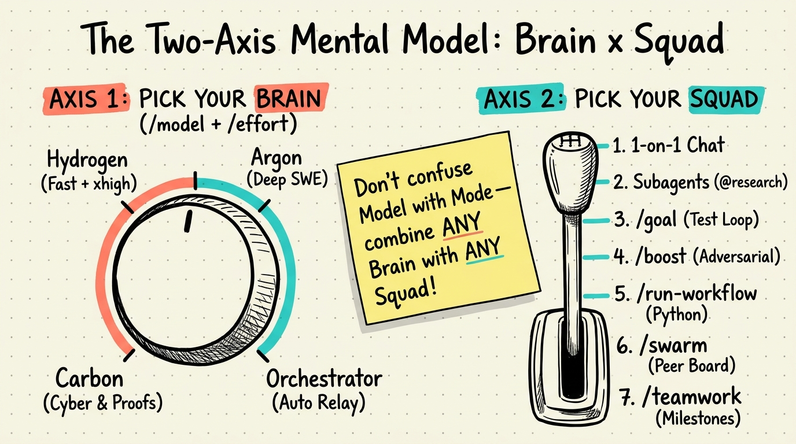
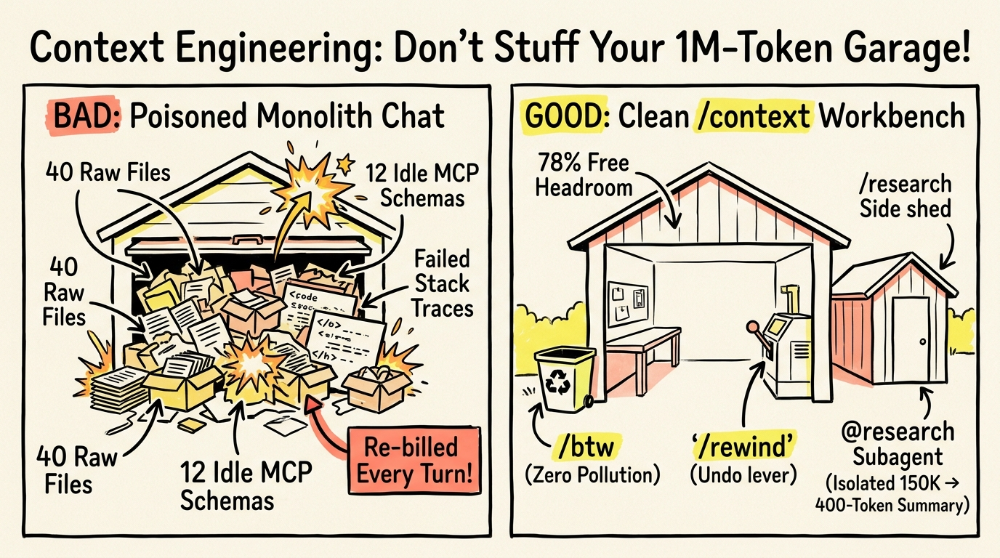
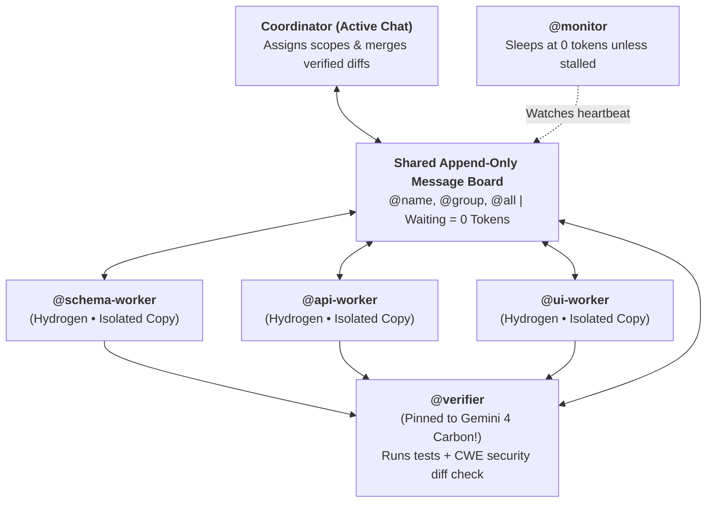

# Google Antigravity (v2.32) Slash Commands, Multi-Agent Orchestrators, Remote Sandboxes & Constructs Handbook (`Head First` Field Manual)

> [!IMPORTANT]
> **Unofficial Guide Disclaimer**: This handbook is an **unofficial, community-authored reference** reflecting the author's personal engineering notes and opinions. It is not affiliated with or endorsed by Google. Because features, flags, models, and plan availability evolve rapidly, always consult the **[Official Google Antigravity Documentation](https://antigravity.google/docs)** and **[Google Cloud Gemini Enterprise Documentation](https://docs.cloud.google.com/gemini/enterprise/docs/overview)** for the authoritative final word.

This handbook is the complete **Level 200 → Level 400 operational field manual** for Google Antigravity (App v2.32+, Antigravity CLI `agy`, IDE Extensions, Remote Agents, and Headless CI/CD). Every command, multi-agent topology, keyboard shortcut, and governance construct includes **copy-pasteable real-world prompts** tested by our **PulsePay** engineering pod (**Maya**, **Priya**, **Alex**, and **Sam** — see the hands-on **[Agentic SDLC Labs](../labs/agentic-sdlc/README.md)**).

---

## 0. Read This Cockpit Dial Before Touching Any Slash Command! (`Brain × Squad`)

Why do some engineers burn 5x their weekly quota fighting a single monolithic chat window while the engineer at the next desk ships a 12-file cross-stack feature in 25 minutes? Because great Antigravity engineers never confuse **Axis 1 (The Brain)** with **Axis 2 (The Squad)**:



- **Axis 1 — Pick Your Brain (`/model` + `/effort`)**: Controls *how each individual agent thinks* (`gemini-4-hydrogen` with `low`/`medium`/`high`/`xhigh`, `gemini-4-argon`, `gemini-4-carbon`, or bidirectional `Orchestrator`).
- **Axis 2 — Pick Your Squad (Execution Mode / Slash Command)**: Controls *how one or many agents coordinate, isolate files, loop on tests, and challenge each other* (`1-on-1`, `Subagents`, `/goal`, `/boost`, `/run-workflow`, `/swarm`, or `/teamwork`).

---

## 1. Complete Slash Command Reference Matrix (v2.32)

### 1.1 Planning, Reasoning & Multi-Agent Orchestration Commands

| Command | Surfaces | Plan Availability | Core Behavior & When to Reach for It |
| :--- | :--- | :--- | :--- |
| **`/grill-me`** | App & CLI | All Plans | **Socratic Requirements Stress-Tester**: Explores the codebase first (never asks what code already answers), then interviews you **one question at a time** with `(Recommended)` options first until every edge case, SLA, and trade-off is settled. |
| **`/plan`** | App & CLI | All Plans | **Blueprint Gate**: Researches files and dependencies and writes a structured `implementation_plan.md` artifact. **Zero files are modified** until you click **Proceed** or approve. Stack as `/plan /grill-me <task>`. |
| **`/boost`** | App & CLI | Paid Plans | **Adversarial Deep-Reasoning Pipeline**: Runs `Orchestrator` → `DeepCoder` / `DeepInvestigator` → adversarial improvement workers that actively try to break the prior draft against real tests → independent spot-check. |
| **`/swarm`** | App & CLI | Pro & Ultra *(Preview)* | **Peer-Coordinated Multi-Agent Mesh**: Turns your current chat into a Coordinator and spawns named `@workers`, cross-model `@verifier`s (1 per 2–4 workers), and `@monitor` connected via a shared append-only message board. |
| **`/run-workflow`** | App & CLI | Pro & Ultra *(v2.32+)* | **Deterministic Python Dynamic Workflow**: Generates and displays a Python orchestration script (`phase`, `parallel`, `pipeline`, `agent`, `trajectory`) where isolated agents return JSON-Schema validated outputs without free-form chatter. |
| **`/teamwork`** | App & CLI | Paid Plans | **Autonomous Multi-Milestone Squad**: Phase 1 Scoping Interview (*what, not how* + integrity mode) → Phase 2 autonomous milestone execution inside `~/teamwork_projects/{PROJECT_NAME}` with `Sentinel`, `Project Orchestrator`, `Workers`, `Critic`, `Challenger`, `Auditor`, and `Success Auditor`. |
| **`/goal`** | App & CLI | All Plans | **Relentless Verification Loop**: Continues autonomously across turns—editing code, running tests/builds, reading stack traces, and fixing regressions—intercepting premature stops until your objective command passes `100%`. |

### 1.2 UI Prototyping, Browser QA, Knowledge & Automation Commands

| Command | Surfaces | Plan Availability | Core Behavior & When to Reach for It |
| :--- | :--- | :--- | :--- |
| **`/generative_ui`** | App Only | All Plans | **Interactive Visual Widget Builder**: Renders single-file sandboxed HTML/Tailwind/SVG/Canvas interactive prototypes, architecture simulators, and data explorers as a **Standalone Artifact** (side panel) or **Inline Widget** (`≤ 500px`). |
| **`/browser`** | App & CLI | All Plans | **Sandboxed Chromium E2E Subagent**: Opens URLs (governed by Admin allowlist/denylist), clicks flows, inspects live DOM + console logs, and captures screenshot artifacts. |
| **`/automation`** | App Only | All Plans | **Stateful Timezone-Pinned Cron Sidecar**: Interviews you on cadence and access scope, pins `CRON_TZ=<IANA_zone>`, and writes `~/.gemini/config/sidecars/<id>/sidecar.json` (starts paused until enabled in the **Automations** tab). |
| **`/schedule`** | App & CLI | All Plans | **Lightweight Timer / 5-Field Cron**: Schedules one-shot reminders or recurring cron prompts (`30 8 * * 1-5`) directly from the conversation or CLI. |
| **`/learn`** | App & CLI | All Plans | **Institutional Memory Capture**: Extracts a hard-won bug fix, migration pattern, or team convention from the active session into a reusable `_agents/skills/<name>/SKILL.md` or `_agents/rules/*.md`. |
| **`/antigravity-guide`** | App & CLI | All Plans | **Built-In Platform Advisor**: Answers questions about Antigravity capabilities, keyboard shortcuts, customization schemas, and release updates directly inside your workspace. |

### 1.3 Context Hygiene, Model Control, Customizations & FinOps Commands



| Command | Surfaces | Operational Purpose & Pro Tip |
| :--- | :--- | :--- |
| **`/context`** | CLI | Renders a visual token grid (`◉` active conversation, `□` free headroom, `⛁` system/rules/MCP overhead, `⊠` checkpoint compaction buffer) plus every tracked file in memory. |
| **`/btw`** | App & CLI | Zero-pollution side channel: answers a quick question in an ephemeral tangent and discards it immediately so your primary trajectory stays clean and cache-aligned. |
| **`/rewind`** | App & CLI | Rolls back conversation history **and** reverts local file edits to an earlier step index—essential whenever an experimental approach goes sideways. |
| **`/fork`** | App & CLI | Branches the conversation from the current point so you can A/B test two architectural designs without losing your warm context prefix. |
| **`/clear`** | App & CLI | Wipes the active conversation window when switching to an unrelated ticket so you stop paying to re-read yesterday's tokens. |
| **`/model`** | App & CLI | Switches between `Orchestrator (Carbon)`, `Orchestrator (Argon)`, `gemini-4-hydrogen`, `gemini-4-argon`, `gemini-4-carbon`, `gemini-3.8-flash`, `claude-sonnet-5-5`, `claude-opus-5-5`, or local `Gemma 4`. |
| **`/effort`** | App & CLI | Tunes thinking token budget: `low`, `medium`, `high`, or **`xhigh`** (*Extra* — supported on `gemini-4-hydrogen`). Note: `Orchestrator` manages effort automatically. |
| **`/mcp`** | App & CLI | Inspects connected MCP servers, toggles noisy servers off to reclaim `⛁` system context tokens, and diagnoses OAuth / stdio transport status. |
| **`/plugin`** | App & CLI | Installs, enables, updates, or packages workspace plugins (`@[plugin:swarm]`, Google Workspace `gdocs`/`gdrive`/`gsheets`/`gslides`, GitHub, or custom `.agents/plugins/`). |
| **`/agy-customizations`** | App & CLI | Audits loaded `AGENTS.md`, `GEMINI.md`, `_agents/rules/*.md`, `SKILL.md` bundles, `.agents/agents/*.md`, and `_agents/hooks.json` precedence—and runs the **1-prompt importer** for Claude Code, Codex, and Cursor configs. |
| **`/permissions`** | App & CLI | Switches between **Default** (human confirmation for destructive writes/commands) and **Turbo** (autonomous execution inside isolated Git worktrees guarded by `hooks.json`). |
| **`/remote-control`** | App & CLI | Generates an authenticated session bridge so you can monitor and steer your **local workstation** conversation from any mobile or web browser. |
| **`/voice`** | App & CLI | Activates hands-free conversational coding (`/voice live`), push-to-talk dictation (`/voice dictate`, or press **`F5`**), for rapid PRD brainstorming and code walkthroughs. |
| **`/usage`** *(or `/quota`)* | App & CLI | Displays live per-model remaining quota percentages and reset countdowns. |
| **`/credits`** | App & CLI | Displays AI Credit balance, billing-cycle burn summary, and overage toggle state (`"useG1Credits": false` recommended on Enterprise seats). |

> **💥 Watch Out! Stop Arguing with a Poisoned Garage (`◉`)!**
> Look at the left side of `07_context_garage.jpg`: if you read 40 raw files into your main chat, leave 12 unused MCP schemas enabled in `⛁`, and spend 6 turns arguing *"No, that broke the build again!"*, every single subsequent turn re-bills those broken stack traces AND biases the model toward failed code patterns. Delegate broad file scans to `@research` (the clean side shed!), toggle idle MCPs off via `/mcp`, ask quick side questions via `/btw`, and pull the **`/rewind`** lever the instant an experiment goes sideways!

---

## 2. Deep-Dive Copy-Paste Playbooks for the Core Orchestrators

### 2.1 `/grill-me` + `/plan` — Spec-First Socratic Alignment (Level 200 → 300)
Stacking `/plan /grill-me` forces the agent to inspect your codebase *first*, interview you one decision at a time (putting its recommended choice first), and then emit a zero-mutation `implementation_plan.md` artifact for sign-off.

```text
/plan /grill-me We need to add multi-region webhook delivery with HMAC-SHA256 replay protection and exponential backoff dead-letter queues to services/webhooks/. Inspect our existing Cloud Tasks and Pub/Sub abstractions first, grill me one question at a time on delivery SLAs, secret rotation windows, and idempotency keys, and then produce an implementation plan before editing any files.
```

---

### 2.2 `/generative_ui` — Interactive Prototypes & Architecture Simulators (Level 200 → 300)
Available in the Antigravity Desktop/Web App across all plans, `/generative_ui` builds single-file sandboxed HTML/CSS/JS/SVG/Canvas experiences:
- **Standalone Artifact** (opens in the right-hand preview pane): Full multi-tab product mockups, interactive ERD explorers, and FinOps calculators.
- **Inline Widget** (`≤ 500px` embedded directly in chat): Interactive state-machine steppers, latency trade-off sliders, and regex/SQL visualizers.

```text
/generative_ui Build an interactive Standalone Artifact mockup for our "Tenant Quota & Failover Control Plane" dashboard. Include live sliders for regional RPS burst caps, a toggle between Active-Active and Active-Passive Spanner topologies that dynamically updates estimated RPO/RTO and monthly cost cards, and a simulated failover drill timeline.
```

---

### 2.3 `/boost` — Adversarial Deep-Reasoning & Race-Condition Solver (Level 300 → 400)
`/boost` does **not** merely crank up temperature or thinking tokens on one prompt. Under the hood, it runs a structured **4-stage adversarial pipeline**:
1. **Orchestrator Framing**: Decomposes the problem, constraints, and falsifiable success criteria.
2. **Specialist Investigation**: Dispatches `DeepCoder` or `DeepInvestigator` to trace call graphs, memory models, and edge cases.
3. **Adversarial Improvement Loop**: Spawns challenger passes whose explicit job is to **break the candidate patch** with counter-examples and real test executions, iterating on repairs.
4. **Independent Spot-Check**: Audits the surviving solution before presenting it to you.

```text
/boost Under bursty reconnects (>2,000 WebSockets/sec), services/realtime-gateway/ leaks goroutines and occasionally delivers duplicate sequence frames right after a Redis Sentinel failover. Prove the exact interleaving causing both bugs, construct a deterministic reproduction test, and verify the fix under `go test -race ./...`.
```

---

### 2.4 `/swarm` (`@[plugin:swarm]`) — Peer-Coordinated Multi-Agent Mesh (Level 300 → 400)


When your task naturally splits into parallel tracks that **need to share discoveries mid-flight** (e.g., changing a shared TypeScript API contract while updating 4 consumers, or racing 4 root-cause hypotheses in parallel), reach for **`/swarm`**.

#### How `/swarm` Works Under the Hood
- **Coordinator (Your Current Conversation)**: Decomposes the problem, defines file/worktree boundaries, spawns the roster, and synthesizes the final result.
- **Named Workers (`@api-worker`, `@ui-worker`, `@fix-1..4`)**: Execute in parallel—optionally inside **isolated per-worker working copies** so parallel edits never collide.
- **Cross-Model `@verifier` (1 per 2–4 workers)**: Independently validates diffs and test suites. **Power Move**: Run fast `gemini-4-hydrogen` workers paired with a `gemini-4-carbon` `@verifier` for frontier security and logic scrutiny!
- **`@monitor`**: Remains dormant (`Waiting` = **0 tokens consumed**) and wakes up *only* if message-board progress stalls or deadlocks.
- **Append-Only Shared Message Board**: Agents coordinate asynchronously via `@worker-name`, `@group`, or `@all`. Any agent in the `Waiting` state consumes **zero tokens** until addressed.



#### `/swarm` UI Views & CLI TUI Shortcuts
- **Desktop/Web App Views**: Switch live between **Board** (chronological `@mention` feed), **Members** (status & model per agent), and **Graph** (communication topology with **timeline replay slider**).
- **CLI `/swarm board` (or press `Alt+S`)**:
  - `j` / `k` (or `↑` / `↓`): Navigate board messages and member cards
  - `f`: Follow live message tail
  - `p`: Filter messages by participant (`@verifier`, `@api-worker`, etc.)
  - `z`: Zoom full message / diff payload
  - `o`: Open selected worker's live transcript
  - `Alt+J`: Jump straight to the next worker awaiting tool approval
  - `Ctrl+K`: Fast-approve pending sandboxed command

```text
/swarm Migrate our checkout microservice from REST v1 to ConnectRPC v2 across proto/, services/checkout-api/, web/checkout-ui/, and tests/e2e/. Give each worker an isolated working copy, have @proto-worker post the finalized field types to the board before @api-worker and @ui-worker finalize bindings, and pin @verifier to gemini-4-carbon to verify authz interceptors and full integration tests.
```

---

### 2.5 `/run-workflow` — Deterministic Python Dynamic Workflows (Level 300 → 400)

Introduced in **Antigravity v2.32.0**, **`/run-workflow`** solves the exact opposite problem from `/swarm` (right half of `05_swarm_vs_workflow.jpg`): when you have a **repeatable, structured fan-out/fan-in pipeline** (e.g., auditing 30 microservices, migrating 50 DAO classes, or generating compliance matrices) and you want **zero free-form inter-agent chatter** and **100% JSON-Schema validated outputs**.

#### How `/run-workflow` Works
1. You invoke `/run-workflow <goal>`.
2. Antigravity writes and **displays a readable Python script** executing on Antigravity's bundled Python runtime (overrideable via `ANTIGRAVITY_PYTHON`).
3. Inspect live execution in the CLI via **`Ctrl+O`** (expand workflow output) or **`/tasks` (`Ctrl+T`)**.

#### Core Python Primitives Inside `/run-workflow`
| Primitive | Signature & Purpose |
| :--- | :--- |
| `phase(name)` | Context manager grouping logical stages in the UI/CLI progress tree (`with phase("1. AST Inventory"):`). |
| `log(*args)` | Emits structured progress lines to the workflow pane. |
| `agent(...)` | `agent(prompt, schema=..., role=..., type_name="research"\|"self", workspace="inherit", model="gemini-4-hydrogen")` — spawns a fresh isolated subagent and validates its output against `schema` (JSON Schema / Pydantic). |
| `parallel(items, fn)` | Runs `fn(item)` concurrently across a collection with automatic concurrency throttling. |
| `pipeline(items, fn)` | Streams items sequentially or across staged transformations. |
| `await trajectory(...)` | Inspects step-level execution metadata when custom retry or escalation logic is needed. |

```python
# Illustrative Dynamic Workflow generated by /run-workflow
from antigravity_workflow import agent, log, parallel, phase

AUDIT_SCHEMA = {
    "type": "object",
    "required": ["service", "DeprecatedCalls", "blocking_risk", "patch_ready"],
    "properties": {
        "service": {"type": "string"},
        "DeprecatedCalls": {"type": "integer"},
        "blocking_risk": {"type": "string", "enum": ["LOW", "MEDIUM", "HIGH"]},
        "patch_ready": {"type": "boolean"},
    },
}

async def main(services: list[str]):
    with phase("Stage 1: Parallel Read-Only Service Audit"):
        reports = await parallel(
            services,
            lambda svc: agent(
                prompt=f"Audit services/{svc} for legacy SecretManager v1beta1 calls. Do NOT modify files.",
                schema=AUDIT_SCHEMA,
                role=f"Auditor ({svc})",
                type_name="research",
                model="gemini-4-hydrogen",
            ),
        )

    risky = [r for r in reports if r["DeprecatedCalls"] > 0]
    log(f"Found {len(risky)}/{len(services)} services needing migration.")

    with phase("Stage 2: Targeted Carbon Security Review on High-Risk Services"):
        high_risk = [r["service"] for r in risky if r["blocking_risk"] == "HIGH"]
        await parallel(
            high_risk,
            lambda svc: agent(
                prompt=f"Draft migration plan for services/{svc} preserving WIF IAM bindings.",
                role=f"Carbon Architect ({svc})",
                type_name="research",
                model="gemini-4-carbon",
            ),
        )
```

> **🙋 There Are No Dumb Questions**
>
> **Q: *How do I decide in 3 seconds between `/swarm`, `/run-workflow`, and `/teamwork`?***
>
> **A:** Ask two questions:
> 1. **Is this a multi-hour, multi-milestone greenfield subsystem or full-repo migration needing fresh orchestrator handoffs between milestones?** → Pick **`/teamwork`**.
> 2. **Otherwise, do my parallel workers need to negotiate contracts or share discoveries live while running?**
>    - **Yes** (DB + API + UI changing together, or 4 competing root-cause hypotheses) → Pick **`/swarm`**.
>    - **No** (auditing or codemodding `N` independent services/files into structured JSON) → Pick **`/run-workflow`**.

---

### 2.6 `/teamwork` — Autonomous Multi-Milestone Engineering Organization (Level 400)

> [!NOTE]
> `/teamwork` replaces the legacy `/teamwork-preview` command with a full two-phase autonomous engineering organization featuring fresh-context orchestrator handoffs and adversarial quality gates.

#### Two-Phase Architecture & Workspace Layout
- **Phase 1 — Interactive Scoping Interview**: Interviews you on *what* to build (never micromanaging *how* individual workers code) and locks in an **Integrity Mode**:
  - `development` *(standard production software engineering)*
  - `demo` *(fast end-to-end vertical slice prototyping)*
  - `benchmark` *(strict zero-shortcut verification with locked test harnesses)*
- **Phase 2 — Autonomous Milestone Execution**: Operates inside `~/teamwork_projects/{PROJECT_NAME}` with **strict exclusive file ownership per worker** so merge conflicts are structurally eliminated.
- **Specialized Autonomous Roles**:
  - **`Sentinel`**: Ultra-light user liaison; records user steering, sends cron progress digests, and restarts stalled orchestrators.
  - **`Project Orchestrator`**: Plans the active milestone and **hands off to a brand-new successor `Project Orchestrator` between milestones** so long projects never suffer context rot!
  - **`Explorers` & `Workers`**: Map codebases and implement owned modules.
  - **Adversarial Verification Quartet (`Critic`, `Challenger`, `Auditor`, `Success Auditor`)**: Review designs, construct adversarial edge-case inputs, verify integrity-mode rules (ensuring tests weren't weakened or mocked away!), and gate milestone sign-off.
- **5 Specialized Execution Paths**: `General`, `Iterative coding`, `Document Review`, `Math / Proof`, and `Math / Proof (Large Team)`.

```text
/teamwork Build a complete OpenTelemetry Collector custom processor and BigQuery FinOps anomaly detector in ~/teamwork_projects/otel-finops-guardian using Iterative coding path and development integrity mode. Milestone 1: specification & proto contracts; Milestone 2: streaming processor + unit benchmarks; Milestone 3: adversarial load testing & release readiness audit.
```

---

### 2.7 `/automation` vs. `/schedule` — Choosing the Right Background Timer

| Dimension | `/schedule` (App & CLI) | `/automation` (App Only) |
| :--- | :--- | :--- |
| **Setup Experience** | Direct inline 5-field cron or one-shot timer in prompt. | Guided interview capturing cadence, IANA timezone, and explicit tool/plugin permissions. |
| **Timezone Handling** | Host local clock. | Explicit **`CRON_TZ=<IANA_Timezone>`** (e.g., `CRON_TZ=America/New_York`), DST-safe. |
| **Persistence Format** | Lightweight session/CLI schedule entry. | Saves structured `~/.gemini/config/sidecars/<id>/sidecar.json` invoking `agentapi new-conversation` with scoped `access_grants`. |
| **Safety Activation Gate** | Active immediately upon creation. | Created **Paused by default** so you can inspect `sidecar.json` and `access_grants` in the **Automations** tab before toggling **ON**. |

---

## 3. Remote Execution & Headless CI/CD Reference (Level 300 → 400)

### 3.1 Remote Agents vs. Remote Control — Never Confuse the Two

> **💥 Watch Out! Laptop Lid Open vs. Laptop Lid Closed**
> Every week someone launches `/remote-control`, shuts their MacBook lid to get on a plane, and wonders why their session paused! **Remote Control** drives *your local workstation* from your phone; **Remote Agents** run inside a *Google-managed Debian 12 cloud VM* that keeps running even if you throw your laptop in a Faraday bag!

| Capability | **Remote Agents** (`antigravity.google.com` / `agy --remote-agent`) | **Remote Control** (`/remote-control` / `agy remote-control start`) |
| :--- | :--- | :--- |
| **Where Compute Runs** | **Google-managed ephemeral Debian 12 Linux VM** in the cloud. | **Your own local laptop, desktop, or dev workstation.** |
| **If Your Laptop Sleeps / Loses Wi-Fi** | **Keeps running 100% uninterrupted** in the cloud VM. | Pauses if your local machine powers off or disconnects. |
| **Filesystem & Git Access** | Clones attached GitHub repos (`/home/antigravity/<owner>/<repo>`), mounts Google Drive files, and stages uploads (`/home/antigravity/upload`). | Full direct access to your local uncommitted Git worktrees, local Docker daemons, VPNs, and hardware GPUs. |
| **Credential Security** | Zero raw OAuth tokens inside the VM; `agy-plugin-proxy` swaps `agy-h-*` stand-in handles at the wire boundary. | Uses your local workstation keychain, ADC, and SSH/Git config directly. |
| **How to Launch from CLI** | `agy --remote-agent --project="my-project" "Fix issue #142"` | `agy remote-control start --name "workstation-main"` *(persistent OS login daemon)* |
| **Account Support** | Pro & Ultra personal accounts (`antigravity.google.com`). *(Enterprise teams use Headless CLI in CI or Gemini Managed Agents SDK on GCP.)* | Supported across Desktop App & CLI (`Settings > Application > Enable Remote Control`). |

### 3.2 Headless CLI (`agy -p`) Flags for GitHub Actions & CI Pipelines

Run Antigravity non-interactively inside any CI runner, Cloud Build step, or cron job (see [`github-actions-issue-to-pr.yml`](../starter-kits/tier4-architect-fleet-and-sidecar/github-actions-issue-to-pr.yml) and **[Lab S4](../labs/agentic-sdlc/github-issue-to-remote-pr.md)**):

```bash
# Single-turn JSON-Schema validated headless audit in a sandboxed runner
export AGY_ADC_AUTH=true
export GOOGLE_CLOUD_QUOTA_PROJECT="${GCP_PROJECT_ID}"

agy -p "Audit git diff origin/main...HEAD for SQL injection, missing authz checks, and BigQuery full-table scans." \
  --model gemini-4-carbon \
  --effort high \
  --sandbox \
  --output-format json \
  --json-schema '{"type":"object","required":["approved","findings"],"properties":{"approved":{"type":"boolean"},"findings":{"type":"array","items":{"type":"string"}}}}'
```

| Headless CLI Flag | Values & Purpose |
| :--- | :--- |
| `-p` / `--prompt` | Runs a non-interactive headless prompt and exits cleanly with code `0` on success. |
| `--output-format` | `text` (human readable), `json` (structured final object + token usage telemetry), or `stream-json` (real-time JSONL event stream per tool call). |
| `--input-format stream-json` | Keeps a warm headless `agy` process alive reading multi-turn JSONL messages over `stdin`—preserving the 95% implicit prompt cache across pipeline steps! |
| `--json-schema` | Forces the final JSON output to conform strictly to an inline JSON Schema string or schema file. |
| `--sandbox` | Enforces OS-level filesystem and network sandboxing (`exebox`) around every `run_command` call. |
| `--dangerously-skip-permissions` | Auto-approves tool execution **only** inside disposable, isolated CI containers or ephemeral cloud VMs. |

---

## 4. Subagents & Enterprise Customizations Reference

### 4.1 Built-In & Custom Subagents

| Subagent | Identifier | Mutation Policy & Best Fit |
| :--- | :--- | :--- |
| **Research** | `research` | **Read-only sandbox** (`view_file`, `grep_search`, `find_by_name`). Use to scan 30–100 files in an isolated context window and return a compact 400-token Verified Fact Matrix. |
| **Self** | `self` | Full tool inheritance in a clean context window. Pair with `workspace="share"` or `workspace="branch"` when running parallel local worktree implementations. |
| **Browser** | `browser` | Sandboxed Chromium E2E testing, DOM assertions, console error capture, and visual regression screenshots. |
| **Custom Repo Agents** | `.agents/agents/*.md` | Team-curated specialist personas committed to Git (e.g., [`code-reviewer.md`](../starter-kits/tier3-pro-code-and-sdk/.agents/agents/code-reviewer.md), [`security-and-finops-auditor.md`](../starter-kits/tier3-pro-code-and-sdk/.agents/agents/security-and-finops-auditor.md)). |

> [!TIP]
> **Always Reuse `Idle` Subagents**: When a subagent finishes its turn, it enters the **`Idle`** state—costing **0 tokens while idle** yet keeping its entire file-reading context hot in cache. Send follow-up questions to that existing `Idle` subagent ID rather than spawning a cold duplicate!

### 4.2 Precedence, 4-Trigger Rules & Deterministic Lifecycle Hooks

1. **Customization Resolution Precedence**:
   - **Workspace (`_agents/` or `.agents/`)** → **User/Enterprise Global (`~/.gemini/config/`)** → **Built-In Defaults**.
2. **4-Trigger Rule Modes (`_agents/rules/*.md`)**:
   - `always_on`: Short universal invariants (`<500` tokens).
   - `glob`: File-scoped standards (e.g., `globs: "*.tf,*.tfvars"` in [`terraform_and_gcp_security.md`](../_agents/rules/terraform_and_gcp_security.md)).
   - `model_decision`: Task-activated domain rules (e.g., [`bigquery_finops.md`](../_agents/rules/bigquery_finops.md) loaded only when SQL/warehouse tasks arise).
   - `manual`: Explicitly invoked via `@rule-name`.
3. **Deterministic JSON Hooks ([`_agents/hooks.json`](../_agents/hooks.json) + [`hooks-scripts/gate.py`](../hooks-scripts/gate.py))**:
   - Execute outside the LLM at `PreToolUse`, `PostToolUse`, `PreInvocation`, `PostInvocation`, and `Stop` to deterministically `deny` destructive commands (`terraform destroy`, `rm -rf`, `DROP TABLE`), block `.env` / PEM key writes, and prevent premature stops when merge conflict markers remain.

<details>
<summary><b>🧲 Command Magnets — Test Your v2.32 Reflexes Across 6 PulsePay Scenarios! (Click to Play)</b></summary>

**Magnet Tray**: `Alt+S → p` • `/btw` • `/rewind` • `/run-workflow` • `--input-format stream-json` • `/agy-customizations`

1. **Alex** just switched from Cursor & Claude Code and wants all his old skills, MCPs, and rules converted into an Antigravity plugin in 60 seconds: **`____________________`**
2. **Maya** is mid-way through a clean PRD session and suddenly wants to ask *"Wait, what ISO-4217 code is Swiss Franc?"* without adding a single token to her conversation history: **`____________________`**
3. **Alex** tried an experimental ORM library for 3 turns, hates the compiler errors, and wants to snap both his chat *and* local files back to Step 4: **`____________________`**
4. **Sam** is watching a live CLI `/swarm` and wants to filter the board strictly to `@verifier`'s `gemini-4-carbon` security messages: **`____________________`**
5. **Priya** needs 28 merchant microservices audited into a JSON Schema table with zero inter-agent chatter: **`____________________`**
6. **Sam** wants a 3-stage GitHub Actions `agy` pipeline (`Triage → Patch → Carbon Audit`) to keep its **95% implicit prompt cache** warm across stages over `stdin`: **`____________________`**

---
**Answers:**
1. **`/agy-customizations`** *(1-prompt importer)*
2. **`/btw`** *(zero trajectory pollution)*
3. **`/rewind`** *(reverts chat + local file mutations together)*
4. **`Alt+S → p`** *(opens CLI `/swarm board` and filters by participant)*
5. **`/run-workflow`** *(generates deterministic Python `parallel()` + `agent(schema=...)`)*
6. **`--input-format stream-json`** *(paired with `--output-format stream-json`)*

</details>
