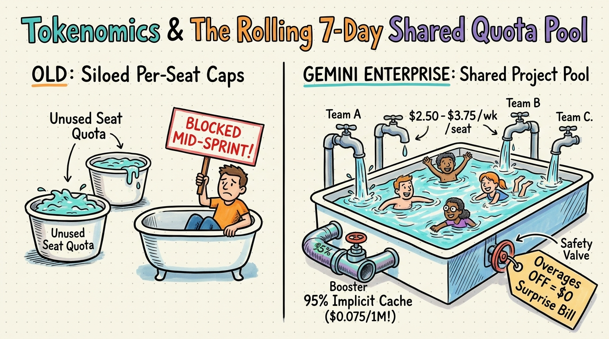
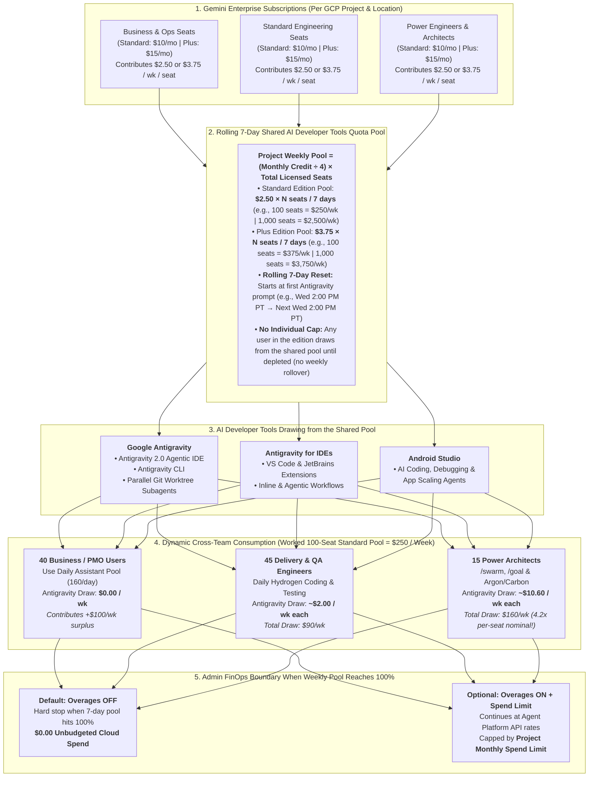

# Google Antigravity + Gemini Enterprise: Enterprise Value Proposition & Domain Playbooks (`Head First` Executive & Architect Guide)

> [!NOTE]
> **Unofficial Guide Disclaimer**: This document is part of an **unofficial, personal GitHub repository** and reflects the author's personal views and engineering mental models. It is not affiliated with or endorsed by Google. For authoritative and up-to-date product capabilities, quotas, and pricing, always refer to the official [Google Cloud Gemini Enterprise Documentation](https://docs.cloud.google.com/gemini/enterprise/docs/overview) and [Google Antigravity Documentation](https://antigravity.google/docs).

---

## 1. Executive Summary for Engineering Leaders, FinOps & Security Architects

Why are engineering VPs, CISOs, and FinOps leaders consolidating fragmented point-tool CLI agents onto **Google Antigravity + Gemini Enterprise**? Because scaling agentic workflows across an entire company requires three capabilities that standalone developer point tools cannot deliver on their own:

1. **Shared Project-Level Weekly Quota Pooling**: **Gemini Enterprise Standard (`$30/mo`) and Plus (`$45+/mo`)** automatically fund a **project-wide weekly pooled Antigravity quota** (`$2.50/seat/week` on Standard or `$3.75/seat/week` on Plus), allowing lighter business and operations users to naturally balance high-intensity engineering workloads with zero unbudgeted overages by default.
2. **Defense-in-Depth Enterprise Governance**: Native Google Cloud IAM (`roles/businessaicode.*`), OS-level terminal sandboxing, Browser URL allow/denylists, Admin-overridden MCP registries, wire-level Managed Agents **Credentials API**, and deterministic local lifecycle hooks ([`_agents/hooks.json`](../_agents/hooks.json)).
3. **Full-Workforce Agent Creation**: Unifies **Knowledge Work** & **Software Engineering** UI layouts (`v2.30+`), no-code Markdown agents, low-code JSON/YAML plugins, IDE/CLI subagents, `/swarm` & `/run-workflow` orchestrators, the Python Antigravity SDK (`google-antigravity`), and 24x7 background sidecar daemons under a single platform.

---

## 2. Core Enterprise Architectural Pillars & Differentiators

| Enterprise Dimension | **Google Antigravity + Gemini Enterprise Capability** | **Business & Engineering Impact** |
| :--- | :--- | :--- |
| **Licensing & Quota Pool Economics** | **Included in Gemini Enterprise** (`$10/mo` Standard or `$15/mo` Plus pooled across the GCP project weekly: **`$2,500–$3,750/wk` per 1,000 seats**). Zero overage by default (`Pay-as-you-go` toggleable with monthly spend caps). | Predictable FinOps budgeting with zero duplicate tool licensing costs and zero surprise per-token API spikes. |
| **Centralized Admin & IAM Governance** | Native **Google Cloud IAM** (`roles/businessaicode.admin`, `developer`, `viewer`), OS terminal sandbox toggle, Browser URL allow/denylists, **Regional PSC (`*.<location>.rep.googleapis.com`)**, and **Admin-overridden MCP JSON**. | Enforces zero-trust boundaries across every workstation from a single Google Cloud Console control plane. |
| **Multi-Agent Orchestration Topologies** | **`/swarm`** (peer message board + cross-model `@verifier`), **`/run-workflow`** (Python JSON-Schema fan-out), **`/teamwork`** (multi-milestone squads), **`/boost`** (adversarial deep reasoning), and **`Idle` subagents** (`0` idle tokens). | Matches every engineering coordination shape without context pollution, concurrent file collisions, or cold-start re-indexing waste. |
| **Deterministic Compliance Gates (`hooks.json`)** | Native `PreToolUse`, `PostToolUse`, `PreInvocation`, `PostInvocation`, and `Stop` hooks ([`gate.py`](../hooks-scripts/gate.py)) that can **overwrite** arguments, **force_ask**, or **deny** dangerous commands in code. | Guarantees critical security and FinOps rules execute deterministically outside the LLM. |
| **Business-to-Architect Workforce Span** | Dual **Knowledge Work** & **Software Engineering** UI layouts (`v2.30+`), `/generative_ui` prototypes, 1-prompt importer for Claude Code/Codex/Cursor, Python AGY SDK, and 24x7 `CRON_TZ` Sidecars. | Enables PMs (**Maya**), architects (**Priya**), full-stack devs (**Alex**), and QA/security leads (**Sam**) to collaborate inside one repository. |
| **Gemini 4 Fleet & Local NPU Zero-Egress** | **Gemini 4 Hydrogen (`xhigh`)**, **Gemini 4 Argon**, **Gemini 4 Carbon**, **Bidirectional `Orchestrator`**, **Nano Banana 2**, partner **Claude 5.5**, **Managed Agents (`antigravity-preview-09-2026`)**, plus **local Gemma 4 (`LiteRTAgentConfig`)**. | Pairs frontier reasoning and **95% implicit cached-input discounts** with `$0.00` zero-egress on-device execution when needed. |
| **Real-Time Telemetry & Chargeback** | **Developer Tool Metrics** in GCP Console refreshed every **5–15 minutes** (active users, requests, tokens, latency, errors) with Cloud Logging export. | Provides live adoption visibility and departmental FinOps attribution. |

### 2.1 Visual Architecture: How Gemini Enterprise Pooled Quota Works in Google Antigravity

Grounded in the official [Gemini Enterprise Quotas and Overages](https://docs.cloud.google.com/gemini/enterprise/docs/quotas-and-overages), [AI Developer Tools Overview](https://docs.cloud.google.com/gemini/enterprise/docs/ai-developer-tools-overview), and [View Pooled Quota Usage](https://docs.cloud.google.com/gemini/enterprise/docs/feature-usage) documentation, **Gemini Enterprise** eliminates rigid per-seat developer caps by pooling AI developer tool credits across all licensed users of the same edition within a Google Cloud project and location (`Global`, `US`, or `EU`).

> **🙋 There Are No Dumb Questions**
>
> **Q: *Look at the booster pipe in `08_tokenomics_quota_pool.jpg` (`95% Implicit Cache — $0.075/1M!`). How does implicit caching stretch our weekly shared pool in real life?***
>
> **A:** In multi-turn agentic coding (`/goal`, `/swarm`, `@research` subagent follow-ups), `80–90%` of input tokens on Turn 2 through Turn 25 are repeated prefix tokens (`AGENTS.md`, tool schemas, previously read files). Because **Gemini 4 Hydrogen** automatically bills cached input at **`$0.075 / 1M` tokens instead of `$1.50 / 1M` (`95%` off!)**, a `$250/week` 100-seat Standard pool delivers the effective multi-turn coding throughput of **thousands of dollars** of uncached legacy model calls!
>
> **Q: *Why not just buy 20 standalone CLI seats for our top 20% engineers instead of pooling across Gemini Enterprise?***
>
> **A:** Because standalone per-seat tools hit **two walls simultaneously**: (1) your PMs, analysts, and QA leads stay locked out of the repository workflow (recreating the broken PRD handoff!), and (2) during release week, your 20 senior engineers slam into rigid individual seat rate limits while unused quota on quieter seats evaporates. With Gemini Enterprise pooling, **every business and operations seat actively deepens the engineering sprint reservoir**!

#### Where Pooled Quota Applies Across Gemini Enterprise (Official Specification)

Per [Google Cloud Quotas and Overages](https://docs.cloud.google.com/gemini/enterprise/docs/quotas-and-overages#feature-quotas), quota pooling operates at two scopes inside a Google Cloud project and location (`Global`, `US`, `EU`):

| Quota Category | Included Tools & Capabilities | Gemini Enterprise Standard | Gemini Enterprise Plus | Pooling Boundary | Reset Schedule |
| :--- | :--- | :--- | :--- | :--- | :--- |
| **AI Developer Tools** *(Invoiced Cloud Billing required)* | • **Google Antigravity** (`Antigravity 2.0` & `Antigravity CLI`) • **Antigravity for IDEs** • **Android Studio** | **`$10` credit / user / mo** *(Enforced as **`$2.50 × seats`** per 7-day pool)* | **`$15` credit / user / mo** *(Enforced as **`$3.75 × seats`** per 7-day pool)* | **Pooled across all users in the same edition** per project & location | **Every 7 days** starting from the timestamp of the first AI developer tool prompt in the project (e.g., Wed 2:00 PM PT → next Wed 2:00 PM PT). No weekly rollover. |
| **Assistant & Conversational Search** | Enterprise Web Grounding & Workspace / Data Store Assistant | **160 queries / user / day** | **200 queries / user / day** | **Pooled across all users in the same edition** per project & location | **Daily** at midnight Pacific Time (PT) |
| **No-Code Agent Building Tools** | Creating & running no-code Workflow Builder agents | **1 agent created / user / day** | **10 agents created / user / day** | **Pooled across all users in the same edition** per project & location | **Daily** at midnight Pacific Time (PT) |
| **Deep Research** | Autonomous multi-step synthesis agent | **3 requests / user / day** | **10 requests / user / day** | **Pooled across all users in the same edition** per project & location | **Daily** at midnight Pacific Time (PT) |
| **Multimodal Generation** | Image & Video generation | **5 images & 2 videos / user / day** | **10 images & 3 videos / user / day** | **Pooled across all users in the same edition** per project & location | **Daily** at midnight Pacific Time (PT) |
| **Storage + Data Indexing** | Enterprise connector & RAG index storage | **30 GiB / user** | **75 GiB / user** | **Pooled across ALL editions combined** per project & location | Continuous allocation (prorated overage at `$5/GiB/mo` if exceeded) |

#### Why Project-Level Pooling Is a Decisive Advantage Over Siloed Per-Seat Quotas

| Architectural Scenario | Traditional Siloed Per-Seat Quota Model | **Google Antigravity + Gemini Enterprise Pooled Quota** |
| :--- | :--- | :--- |
| **Light or Non-Coding Seat Under-Utilization** | Unused monthly tokens on light users or PM/operations seats are **stranded and wasted** at month-end; cannot be transferred to busy engineers. | Every licensed seat in the edition automatically increases the project's shared weekly pool (`+$2.50/wk` Standard or `+$3.75/wk` Plus). Light users' unused developer credits are **100% available to active developers**. |
| **Power-User Sprint Bottlenecks** | A senior engineer running multi-file refactors hits an individual seat rate limit mid-sprint and is blocked or forced onto expensive per-user add-ons. | **Individual usage is never capped at the per-user nominal amount.** Power engineers can consume `4x–10x` the average per-seat credit from the shared edition pool without interruption. |
| **Reserving Non-Developer Credits for Engineering** | Requires purchasing separate developer-only point-tool licenses on top of enterprise AI seats. | Per [AI Developer Tools IAM Controls](https://docs.cloud.google.com/gemini/enterprise/docs/ai-developer-tools-overview#before-you-begin), admins can assign a custom role without AI developer tool permissions to business users in the same project—keeping **100% of their seats' Antigravity credits reserved for software engineers**. |
| **Zero-Ticket Elasticity & Spend Governance** | Adding seats or raising limits requires manual vendor contract amendments or per-user billing changes. | Quotas **scale automatically** with license count (including free-trial seats). Admins monitor real-time percentage consumption in **Gemini Enterprise > Usage & Spending** and keep `Overages` **OFF** by default (or **ON** with a strict monthly cap). |

> **💥 Watch Out! Separate Editions Do Not Cross-Pool AI Developer Credits**
> Remember that **AI developer tools** credits pool across all users holding the **same edition** (`Standard` with `Standard`, `Plus` with `Plus`) inside the **same GCP project and location** (`global`, `us`, or `eu`). Don't accidentally scatter 50 engineers across 50 tiny isolated GCP projects if you want them sharing one deep, elastic weekly sprint pool!

### 2.2 Multi-Level Tokenomics & Pooled Quota Visibility (User, Project & Org Levels) + Threshold Alerts

Organizations can monitor token consumption, active seat adoption, and pooled quota burn across three distinct governance levels—and trigger automated threshold alerts before limits are reached:

| Governance Level | Where to View (`UI / CLI / API`) | What You See & How to Configure Threshold Alerts |
| :--- | :--- | :--- |
| **1. User Level** *(Developer IDE & CLI)* | • **[`/usage` (or `/quota`)](https://antigravity.google/docs/cli/commands/usage/)**: Interactive Model Quotas TUI panel in Antigravity CLI / 2.0. • **[`/credits`](https://antigravity.google/docs/cli/commands/credits/)**: Active credit balance, billing-cycle usage summary, and statusline indicator (`AI Credits: <N>`). • **Per-User Log Attribution**: Enable **Metadata logging** in **Gemini Enterprise > Settings > AI developer tools** to query per-user requests in Cloud Logging by `principalEmail` / `google.subject`. | • Live on-demand refresh of remaining requests/tokens per model (`Gemini 4 Hydrogen`, `Gemini 4 Argon`, `Gemini 4 Carbon`, `Gemini 3.8 Flash`). • **Built-in Low-Quota Alert**: The CLI statusline automatically highlights a warning when remaining credits cross the low-quota threshold. • **Enterprise Guardrail**: Set `"useG1Credits": false` in `/config` (`settings.json`) to prevent fallback to personal credits. |
| **2. Project Level** *(Google Cloud Console)* | • **Pooled Quota %**: **[Gemini Enterprise > Usage & Spending > Usage tab](https://docs.cloud.google.com/gemini/enterprise/docs/feature-usage)** (`roles/discoveryengine.agentspaceAdmin` with `monitoring.timeSeries.list` & `serviceconsumermanagement.quota.get`). • **Tokenomics & Adoption (5–15 min refresh)**: **[Gemini Enterprise > Developer tools metrics](https://docs.cloud.google.com/gemini/enterprise/docs/ai-developer-tools-metrics)** (`Hourly/Daily/Weekly/28-Day Active Users`, `Total Tokens`, `Daily Token Usage`, `Daily API Calls` by `error_type`). • **30-Day Overage Costs**: **[Gemini Enterprise > Usage & Spending > Billing tab](https://docs.cloud.google.com/gemini/enterprise/docs/view-costs)**. | • **Chart-Level Cloud Monitoring Alerts**: Click **Create alert policy (`add_alert` bell icon)** on any chart in **Developer tools metrics** to open Cloud Monitoring pre-populated with that metric's query; set warning/critical alerts at **75% and 90%** of weekly run-rate (routed to Slack, PagerDuty, Google Chat, Email, or Pub/Sub). • **Project Monthly Spend Limit**: In **Usage & Spending > Usage tab**, click **Set limit** under **Project monthly spend limit** (scoped to `Vertex AI / aiplatform.googleapis.com`). Set alerts at **50%, 80%, 90%, and 100%**—at **100%**, Gemini Enterprise **automatically stops overage usage**. |
| **3. Organization Level** *(Cross-Project FinOps)* | • **[Cloud Billing Reports & BigQuery Export](https://docs.cloud.google.com/billing/docs/how-to/reports/gemini-enterprise-costs)**: Click **View details in Billing** from the **Billing tab** and group by **Project / Folder / Label**. • **Multi-Project Cloud Monitoring Scope**: Aggregate `Total Tokens` and quota metrics across all business-unit projects in **Metrics Explorer**. | • Organization-wide visibility into subscription spend, pooled quota efficiency across departments, and Vertex AI (`aiplatform.googleapis.com`) overage attribution. • Organization-level Cloud Billing budget alerts across all Gemini Enterprise folders/projects. |

### 2.3 Enterprise SSO & Third-Party Identity Integration: Okta, Microsoft Entra ID & OIDC/SAML (`BYOID / WIF`)

Per [Antigravity Enterprise — Bring Your Own Identity (`BYOID / WIF`)](https://antigravity.google/docs/enterprise#bring-your-own-identity-byoid--wif) and [Configure Identity Provider in Gemini Enterprise](https://docs.cloud.google.com/gemini/enterprise/docs/configure-identity-provider), enterprises using **Okta**, **Microsoft Entra ID (Azure AD)**, **Ping Identity**, or **AD FS** can authenticate developers directly with their corporate credentials:

1. **Admin Setup (Workforce Identity Federation + Lowercase Subject Mapping)**:
   - Create a Workforce Identity Pool in **IAM & Admin > Workforce Identity Pools** and connect **Okta** or **Microsoft Entra ID** via OIDC or SAML 2.0.
   - Map `google.subject` to the lowercase email (`google.subject=assertion.email.lowerAscii()` for OIDC or `assertion.attributes['.../emailaddress'][0].lowerAscii()` for Entra SAML) so case-sensitive Gemini Enterprise license assignments always match.
   - Bind the pool in **Gemini Enterprise > Settings > Authentication** (`3rd party identity`) and grant `roles/discoveryengine.agentspaceUser` to the federated group (`principalSet://iam.googleapis.com/locations/global/workforcePools/{POOL_ID}/group/{GROUP_ID}`).
2. **Developer Sign-In (`Interactive BYOID` & `Headless ADC`)**:
   - **Interactive**: In Antigravity 2.0, Antigravity CLI, or VS Code/JetBrains extensions, choose **Sign in > Business account > Advanced WIF Configuration**, paste the administrator's **WIF Configuration String** (`locations/global/workforcePools/{POOL_ID}/providers/{PROVIDER_ID}`), authenticate via Okta/Entra SSO, and select the licensed project in the **License Selector**.
   - **Headless / CLI ADC**: Run `gcloud iam workforce-pools create-login-config` + `gcloud auth application-default login --login-config=... --project={PROJECT_ID}` and set `export AGY_ADC_AUTH=true` (or `"userSettings": {"enableAdc": true}` in `~/.gemini/config/config.json`).
   - *(See [**Section 2.3 of `docs/01_enterprise_governance_and_rollout.md`**](01_enterprise_governance_and_rollout.md#23-third-party-identity-provider-idp-authentication-okta-microsoft-entra-id--oidcsaml-byoid--wif) for the complete sequence diagram, exact Okta/Entra attribute mappings, and Cloud Audit Log verification steps.)*

---

## 3. Domain Adoption Playbooks

### 3.1 Antigravity + Gemini Enterprise in Product, Design & Application Development Teams
- **Core Engineering Needs**: Seamless handoff from PM specs to clickable UI mockups, parallel multi-file feature implementation, automated UI/E2E verification, and friction-free migration from fragmented single-thread CLI agents.
- **How Antigravity + Gemini Enterprise Accelerates Delivery** *(walk through live in **[Labs S1 → S3](../labs/agentic-sdlc/README.md)**)*:
  1. **Unified Knowledge Work + Software Engineering Layouts (v2.30+)**: Product Managers switch `Settings > General > Interface Layout` to **Knowledge Work** to connect Google Drive, Docs, Sheets, and Slides, stress-test PRDs via `/grill-me`, and generate interactive clickable prototypes via `/generative_ui`—all inside the same shared repository engineers open in **Software Engineering** layout.
  2. **1-Prompt Migration from Claude Code, Codex & Cursor**: Teams consolidating point tools run `/agy-customizations` (or prompt Antigravity directly) to automatically import existing MCP servers, skills, custom commands, subagents, and instruction files into a portable Antigravity plugin in seconds.
  3. **Peer-Coordinated `/swarm` & Dynamic `/run-workflow` Execution**: Engineers dispatch fast `gemini-4-hydrogen` workers across isolated working copies in `/swarm` while pinning `@verifier` to **`gemini-4-carbon`** for frontier CWE security verification and `/browser` Chromium E2E assertions.

### 3.2 Antigravity + Gemini Enterprise in DevOps, SRE & Legacy Modernization Teams
- **Core Engineering Needs**: Large-scale dependency upgrades, autonomous Issue-to-PR pipelines, Terraform infrastructure authoring, autonomous test-fix loops, and 24x7 incident response.
- **How Antigravity + Gemini Enterprise Accelerates Delivery** *(walk through live in **[Lab S4](../labs/agentic-sdlc/github-issue-to-remote-pr.md)**)*:
  1. **Gemini 4 Hydrogen + 95% Implicit Cache Economics**: Engineers run `/goal` and `/run-workflow` with `gemini-4-hydrogen` (`$1.50/1M` input, **`$0.075/1M` cached input — 95% off!**) inside the **pooled Gemini Enterprise allowance**, escalating to **`gemini-4-argon`** (`High`) or **`/boost`** for gnarly concurrency bugs and 40M-line repository refactors.
  2. **Autonomous GitHub Issue → Remote Sandbox → Pull Request Pipelines**: Platform teams run headless `agy -p --sandbox --output-format json --json-schema` in keyless WIF GitHub Actions ([`github-actions-issue-to-pr.yml`](../starter-kits/tier4-architect-fleet-and-sidecar/github-actions-issue-to-pr.yml)) or orchestrate `antigravity-preview-09-2026` **Gemini Managed Agents** with the wire-level **Credentials API** ([`issue_to_pr_pipeline.py`](../starter-kits/tier4-architect-fleet-and-sidecar/issue_to_pr_pipeline.py)).
  3. **24x7 Timezone-Pinned Sidecar Daemons (`/automation` & `sidecar.json`)**: SRE teams deploy persistent background sidecars (`CRON_TZ`, `restart_policy: "always"`, see [`sentinel_sidecar.py`](../starter-kits/tier4-architect-fleet-and-sidecar/sidecars/incident-sla-sentinel/sentinel_sidecar.py)) that monitor P1/P2 incident queues and trigger root-cause analysis conversations automatically via `agentapi`.

### 3.3 Antigravity + Gemini Enterprise in Regulated & Privacy-Sensitive Enterprise Environments
- **Core Engineering Needs**: Strict data residency, VPC Service Controls (VPC-SC) + Regional Private Service Connect (`*.<location>.rep.googleapis.com`), audit logging, and zero-egress PII scrubbing.
- **How Antigravity + Gemini Enterprise Accelerates Delivery**:
  1. **Frontier Cybersecurity Defense (`gemini-4-carbon`) + On-Device `Gemma 4`**: Regulated teams audit critical payment, auth, and ledger diffs with **`gemini-4-carbon`** (`0%` indirect prompt injection rate on Gray Swan benchmarks) through `vertex=True` ADC binding (`v2.31.2+`), while scrubbing raw PII logs 100% locally via **Gemma 4 (`LiteRTAgentConfig`)**.
  2. **Interactive Socratic Alignment (`/plan /grill-me`)**: Before modifying regulated payment, healthcare, or core ledger code, engineers run `/plan /grill-me` to produce an auditable `implementation_plan.md` artifact requiring explicit human sign-off.
  3. **Immutable Compliance Audit Trail**: Administrators enable prompt/response logging to Cloud Logging and enforce local `PreToolUse` / `PostToolUse` audit hooks across all repositories.

<b>🕵️ Be the FinOps Architect — Stress-Test PulsePay's 1,000-Seat Blended Quota Pool! (Click to Model)</b>

**Scenario**: PulsePay rolls out **1,000 Gemini Enterprise Standard** seats (`$30/user/mo`, contributing `$2.50/seat/week`) inside one unified GCP governance project:
- **250 Citizen Builders (Tier 1 — Ops, PMO, Finance)**: Average `$0.65 / week` in light Markdown/Workspace copilot calls.
- **300 PMs, Designers & QA Analysts (Tier 2 — Maya's cohort)**: Average `$1.60 / week` running `/grill-me`, `/generative_ui`, and `/browser`.
- **350 Full-Stack & Data Engineers (Tier 3 — Alex's cohort)**: Average `$3.40 / week` (`36%` above nominal `$2.50`!) running `Hydrogen` + `Argon` `/swarm`, `/run-workflow`, and `/goal`.
- **100 Principal Architects & Cyber Leads (Tier 4 — Priya & Sam's cohort)**: Average `$5.20 / week` (**`2.08x`** nominal `$2.50`!) running `/boost`, `Carbon` security audits, and Issue-to-PR sandboxes.

**Questions**:
1. Does **any** Tier 3 or Tier 4 power engineer get throttled at `$2.50/week`?
2. What is PulsePay's total weekly burn vs. their 1,000-seat shared weekly pool, and what is their unbudgeted cloud overage bill?

---
**Run `python3 scripts/enterprise_license_and_agent_audit.py --seats 1000` to verify the exact math!**
1. **Zero Individual Throttling**: Individual seats are *never* capped at `$2.50/week`—every engineer draws seamlessly from the shared edition pool!
2. **Pool Utilization & `$0.00` Overage**:
   - **Shared 7-Day Pool**: `1,000 × $2.50 =` **`$2,500.00 / week`**.
   - **Blended Weekly Burn**: `(250 × $0.65) + (300 × $1.60) + (350 × $3.40) + (100 × $5.20) = $162.50 + $480.00 + $1,190.00 + $520.00 =` **`$2,352.50 / week`** (**`94.1%` pool utilization**, **`$0.00` unbudgeted overage**—and `62.7%` utilization on Gemini Enterprise Plus's `$3,750/week` pool!).

---

## 4. Enterprise Architecture & Adoption FAQ

| Common Question | Grounded Technical & Operational Guidance |
| :--- | :--- |
| *"Which Gemini 4 model should our teams pick for daily work vs. complex architecture?"* | Use **`gemini-4-hydrogen`** (`Medium`/`High`, or `xhigh` for surgical reasoning) for 75–80% of fast agentic coding, subagent exploration, and CI loops; **`gemini-4-argon`** (`High`) for large-scale multi-module refactoring; and **`gemini-4-carbon`** (`High`) for frontier cybersecurity audits, formal verification, and `/swarm` `@verifier` gates. On Pro/Ultra seats, **`Orchestrator`** automates this handoff within a single turn (`-24%` quota, `+19%` speed). |
| *"How do we standardize instructions across monorepos and subdirectories?"* | Antigravity automatically walks the directory tree from the Git root down to the active working directory to load **[`AGENTS.md`](../AGENTS.md)** and **[`GEMINI.md`](../GEMINI.md)** (up to `100 KB`), complemented by file-pattern (`glob`) and task-driven (`model_decision`) rules in `_agents/rules/*.md`. |
| *"How do we prevent accidental destructive commands when engineers use Turbo Mode?"* | Configure **deterministic [`_agents/hooks.json`](../_agents/hooks.json) (`PreToolUse`)**. Our [`hooks-scripts/gate.py`](../hooks-scripts/gate.py) intercepts every command in Python and returns `"decision": "deny"` on `terraform destroy`, `rm -rf`, or credential file edits before the shell ever executes them. |
| *"How do we ensure power users don't exhaust shared project quota mid-week?"* | Gemini Enterprise pools quota across all project seats (`$2.50/seat/week` Standard or `$3.75/seat/week` Plus). Combining `gemini-4-hydrogen`'s **95% implicit cached-input discount**, warm `Idle` subagent reuse (`0` idle tokens), and **Developer Tool Metrics** (5–15 min refresh) provides massive sprint headroom while keeping unbudgeted overages at `$0.00`. |
