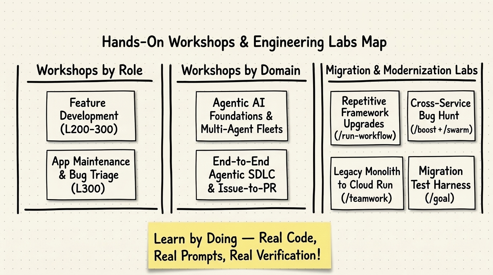

# 🧠 Hands-On Engineering Labs Catalog (Head First Edition)

> [!NOTE]
> **Unofficial Practitioner Field Guide Disclaimer**: This hands-on lab catalog is an unofficial, community-crafted enterprise enablement guide built for engineering teams adopting Google Antigravity and Gemini Enterprise. Product surfaces, model identifiers, and pricing tiers evolve rapidly — always consult the official documentation at https://antigravity.google/docs for the latest canonical reference.



---

## Why Atomic Labs Beat 6-Hour Slide Marathons

Your brain does not learn multi-agent orchestration by watching a presenter read 94 bullet points about context windows. Your brain wires new neural pathways when **something breaks at PulsePay**, you pick a **Brain × Thinking Effort** pairing, launch a squad of agents, watch a test fail, ask a side question via `/btw` without polluting the trajectory, and see `/goal` turn red tests green.

Every module in this catalog is an **atomic, self-contained 30–60 minute engineering lab** built around **PulsePay** — a fast-growing global payments platform juggling high-velocity merchant features on one side and a crusty 80-column COBOL-era settlement batch ledger on the other.

> **💡 Brain Power**: Notice how the two tracks mirror real enterprise life. Nobody gets to build greenfield prototypes all week, and nobody wants to debug fixed-width settlement files without safety nets. Mastering *both* tracks turns your team from "prompt typists" into **Agentic Systems Engineers**.

---

## Track 1: Agentic Green-Field & Feature SDLC (`labs/agentic-sdlc/`)

Ship net-new product capabilities from ambiguous product requirements to verified, browser-tested pull requests without burning your weekly shared quota pool.

| Lab Module | Difficulty | Time | Recommended Brain × Squad | Core Antigravity Loop |
| :--- | :--- | :--- | :--- | :--- |
| [**Lab S1: Ambiguous PRD → Clickable Prototype**](agentic-sdlc/prd-to-clickable-prototype.md) | 🟢 Beginner | 35 min | `Orchestrator (Argon)` + `Nano Banana 2` (`/generative_ui`) | `/grill-me` → `/plan` → `/generative_ui` interactive HTML artifact |
| [**Lab S2: Parallel Full-Stack Feature Swarm**](agentic-sdlc/parallel-fullstack-swarm.md) | 🟡 Intermediate | 50 min | `/swarm`: `gemini-4-hydrogen` `@workers` + `gemini-4-carbon` `@verifier` | Isolated Git worktrees + peer board coordination + adversarial review |
| [**Lab S3: Self-Healing QA & Live Browser Verification**](agentic-sdlc/self-healing-qa-and-browser.md) | 🟡 Intermediate | 45 min | `Orchestrator (Hydrogen/Argon)` + `/goal` + `/browser` | Objective pass/fail loop + live DOM, network & console validation |
| [**Lab S4: Zero-Laptop GitHub Issue → Remote PR**](agentic-sdlc/github-issue-to-remote-pr.md) | 🔴 Advanced | 55 min | `antigravity-preview-09-2026` (`gemini-4-hydrogen` default) + Credentials API | Headless Managed Sandbox + wire-level OAuth proxy (`agy-plugin-proxy`) |

---

## Track 2: Legacy Migration, Debugging & Modernization ([`labs/migration-modernization/`](migration-modernization/README.md))

Tame brownfield tech debt, hunt cross-service monetary bugs, modernize fleets deterministically, and decompose monoliths safely against our runnable zero-dependency sandbox: **[`pulsepay-legacy-ledger`](sandbox-apps/pulsepay-legacy-ledger/README.md)**.

| Lab Module | Difficulty | Time | Recommended Brain × Squad | Core Antigravity Loop |
| :--- | :--- | :--- | :--- | :--- |
| [**Lab M1: Golden-File Parity Test Harness**](migration-modernization/migration-test-harness.md) | 🟢 Beginner | 35 min | `Orchestrator (Argon)` (`Medium` effort) + `@research` | `/plan` → characterization snapshots → `/goal` parity gate |
| [**Lab M2: Fleet-Scale SDK & Python 3.12 Upgrades**](migration-modernization/repetitive-framework-upgrades.md) | 🟡 Intermediate | 45 min | `gemini-4-hydrogen` (`Low`/`Medium`) via `/run-workflow` `parallel()` | Codify `SKILL.md` once → fan out deterministically → JSON-Schema verdicts |
| [**Lab M3: Hunting a Cross-Service Monetary Bug**](migration-modernization/cross-service-bug-investigation.md) | 🟡 Intermediate | 50 min | `/boost` (`gemini-4-carbon` `High`) + `/swarm` hypotheses + `/learn` | Competing root-cause hypotheses → regression test → `/learn` skill capture |
| [**Lab M4: 12-Factor Cloud Run & Zero-Secret Refactor**](migration-modernization/cloud-native-refactor.md) | 🟠 Upper-Int | 45 min | `gemini-4-argon` (`High` plan / `Low` edit) + `_agents/hooks.json` | Strip hardcoded DSNs/relays → ADC/WIF (`vertex=True`) → `PreToolUse` gate |
| [**Lab M5: Multi-Milestone Monolith Decomposition**](migration-modernization/legacy-monolith-decomposition.md) | 🔴 Advanced | 60 min | `/teamwork` (`development` integrity) + `gemini-4-carbon` `@verifier` | Phase 1 Scoping Interview → Phase 2 Exclusive Ownership Milestones |

---

## 🧩 Composing Custom Workshops from Atomic Labs

Facilitators and Engineering Enablement leads don't need to write custom curricula from scratch. Snap together 2 to 5 atomic labs below to match your audience, calendar block, and transformation goal:

| Workshop Track Name | Target Audience | Total Duration | Composed Atomic Lab Sequence | Key Takeaway |
| :--- | :--- | :--- | :--- | :--- |
| **⚡ 90-Minute "Lunch & Learn" Taste Test** | All Product & Platform Engineers | 90 min | 1. [Lab S1: PRD → Clickable Prototype](agentic-sdlc/prd-to-clickable-prototype.md) *(35m)*<br>2. [Lab M1: Golden-File Parity Test Harness](migration-modernization/migration-test-harness.md) *(35m)*<br>3. *20m Debrief on `/context` & `/btw`* | Immediate muscle memory for `/grill-me`, `/plan`, `/generative_ui`, and `/goal`. |
| **🚀 Half-Day Full-Stack Velocity Sprint** | Feature Squads, Frontend/Backend Devs, QA | 3.5 hrs | 1. [Lab S1: PRD → Clickable Prototype](agentic-sdlc/prd-to-clickable-prototype.md)<br>2. [Lab S2: Parallel Full-Stack Swarm](agentic-sdlc/parallel-fullstack-swarm.md)<br>3. [Lab S3: Self-Healing QA & Browser](agentic-sdlc/self-healing-qa-and-browser.md) | End-to-end feature delivery from rough idea to browser-verified UI using `/swarm`. |
| **🛠️ Half-Day Brownfield Modernization Clinic** | Core Platform, Payments, Data & Legacy Maintainers | 3.5 hrs | 1. [Lab M1: Golden-File Parity Harness](migration-modernization/migration-test-harness.md)<br>2. [Lab M3: Cross-Service Monetary Bug](migration-modernization/cross-service-bug-investigation.md)<br>3. [Lab M2: Fleet-Scale Python 3.12 Upgrades](migration-modernization/repetitive-framework-upgrades.md) | Characterize before touching code, squash subtle contract bugs with `/boost`, and scale fixes with `/run-workflow`. |
| **🛡️ Cloud Security, SRE & FinOps Governance Clinic** | Staff SREs, Cloud Architects, AppSec & DevSecOps | 3.0 hrs | 1. [Lab M4: 12-Factor & Zero-Secret WIF Refactor](migration-modernization/cloud-native-refactor.md)<br>2. [Lab S4: GitHub Issue → Remote Sandbox PR](agentic-sdlc/github-issue-to-remote-pr.md)<br>3. [Lab M2: Deterministic JSON-Schema Verdicts](migration-modernization/repetitive-framework-upgrades.md) | Enforce deterministic [`_agents/hooks.json`](../_agents/hooks.json) gates, WIF/ADC auth, and wire-level proxy credentials. |
| **🏛️ 2-Day Principal Architect & Staff Bootcamp** | Tech Leads, Principal Architects, AI Champions | 2 Days *(2 × 3.5h)* | **Day 1 (SDLC + Triage)**: [Lab S1](agentic-sdlc/prd-to-clickable-prototype.md) → [Lab S2](agentic-sdlc/parallel-fullstack-swarm.md) → [Lab M3](migration-modernization/cross-service-bug-investigation.md)<br>**Day 2 (Scale + Architecture)**: [Lab M2](migration-modernization/repetitive-framework-upgrades.md) → [Lab M4](migration-modernization/cloud-native-refactor.md) → [Lab M5](migration-modernization/legacy-monolith-decomposition.md) → [Lab S4](agentic-sdlc/github-issue-to-remote-pr.md) | Full mastery of the Two-Axis Brain × Effort model, `/swarm` vs. `/run-workflow` vs. `/teamwork`, and quota governance. |

---

## 🚦 60-Second Pre-Flight Checklist Before Any Lab

1. **Verify Governance Rules Are Loaded**: Confirm [`AGENTS.md`](../AGENTS.md) and [`GEMINI.md`](../GEMINI.md) sit at the workspace root so Antigravity's directory-walk engine loads model routing and security boundaries automatically.
2. **Smoke-Test the PulsePay Legacy Sandbox** *(zero external packages needed)*:
   ```bash
   python3 -m unittest discover -s labs/sandbox-apps/pulsepay-legacy-ledger -p "test_*.py" -v
   ```
3. **Keep Your Context Window Lean**:
   - Check token breakdown anytime with `/context`.
   - Fire curiosity or Socratic questions while agents work using `/btw` (**zero trajectory pollution**).
   - If an experiment goes sideways, `/rewind` or `/fork` instead of arguing with a polluted context window — and `/clear` between labs!

> **🙋 There are no Dumb Questions**
>
> **Q: Why does every lab specify both a *Model Brain* AND a *Thinking Effort* tier?**
> **A:** Because thinking tokens are billed at **output token rates** (`5x` input rate)! Running `gemini-4-carbon` at `High` effort to rename environment variables burns your team's weekly shared quota pool for zero accuracy gain, whereas `gemini-4-hydrogen` (`$1.50` in / `$7.50` out, `$0.075` cached) at `Low` or `Medium` effort flies through structured edits — saving `gemini-4-carbon` for genuine cross-service mysteries like [Lab M3](migration-modernization/cross-service-bug-investigation.md) and `@verifier` sign-offs like [Lab M5](migration-modernization/legacy-monolith-decomposition.md).
