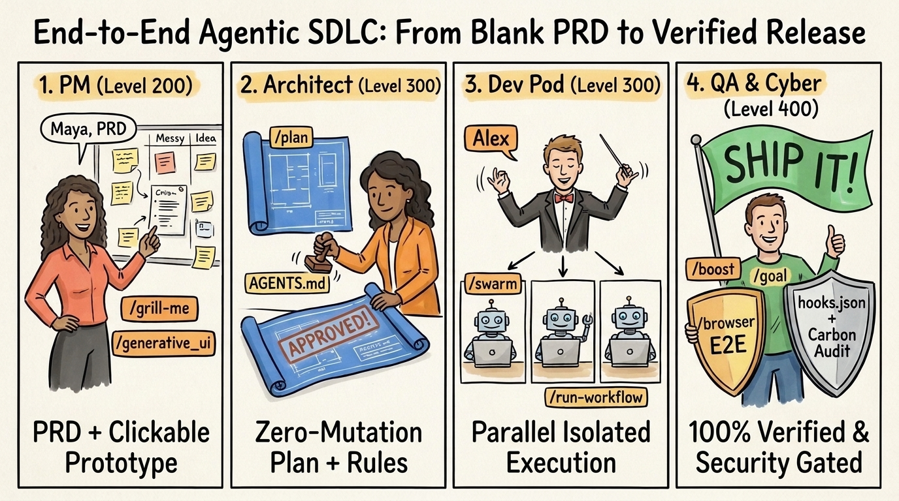
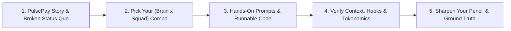

# Agentic SDLC Hands-On Labs (`Level 200 → 400`)

> [!IMPORTANT]
> **Unofficial Guide Disclaimer — Read This First!**
> These hands-on labs are part of an **unofficial, community-authored engineering guide** reflecting the author's personal research, mental models, and architectural opinions. They are **not** affiliated with, sponsored by, or endorsed by Google or Google Cloud. Because slash commands, models, flags, and enterprise quotas evolve rapidly, always verify production settings against the **[Official Google Antigravity Documentation](https://antigravity.google/docs)** and **[Google Cloud Gemini Enterprise Documentation](https://docs.cloud.google.com/gemini/enterprise/docs/overview)**.

Welcome to the **End-to-End Agentic Software Development Lifecycle (SDLC)** lab track!

Most AI coding tutorials hand you a toy "FizzBuzz" prompt, clap when a single file compiles, and call it a day. **Real enterprise software engineering doesn't look like that.** Real engineering starts with a messy product idea, collides with legacy settlement schemas, spans backend + frontend + tests simultaneously, faces strict CWE security audits, and often starts from a GitHub Issue filed at 6:45 PM after everyone has closed their laptops.

---

## Meet Your PulsePay Pod (One Feature, Four Roles, Zero Handoff Amnesia)

Across all four labs in this directory, you will step into the shoes of the **PulsePay Payments Pod** as they take **"PulsePay Instant Refund Guard"** (instant auto-approval under `$500`, real-time fraud velocity scoring at or above `$500`, and an operations override console) from sticky notes on a whiteboard to a Carbon-verified Pull Request:

| Storyboard Stage | Pod Member & Role | Surface & Layout | Signature `(Brain × Squad)` Combo |
| :--- | :--- | :--- | :--- |
| **1. PM (`[Level 200]`)** | **Maya** — Senior Product Manager | Antigravity App (**Knowledge Work** layout) | `gemini-4-hydrogen (medium/high)` × Workspace Grounding + `/grill-me` + `/generative_ui` |
| **2. Architect (`[Level 300]`)** | **Priya** — Principal Systems Architect | Antigravity App (**Software Engineering** layout) | `gemini-4-argon (high)` *(or `Orchestrator (Argon)`)* × `/plan /grill-me` + [`AGENTS.md`](../../AGENTS.md) |
| **3. Dev Pod (`[Level 300]`)** | **Alex** — Full-Stack Tech Lead | Antigravity App & CLI (`Alt+S` Board TUI) | `gemini-4-hydrogen (high/xhigh)` workers + `gemini-4-carbon` `@verifier` × `/swarm` & `/run-workflow` |
| **4. QA & Cyber (`[Level 300–400]`)** | **Sam** — Staff QA & Security Lead | CLI, `/browser` Chromium & Cloud Sandboxes | `/goal` + `/browser` + [`_agents/hooks.json`](../../_agents/hooks.json) + `/learn` + Remote Issue-to-PR Sandboxes |

---

## Choose Your Lab (`S1 → S4`)

You can run these four labs sequentially as a complete **half-day team bootcamp (~3 hours)** or jump straight into the stage matching your role:

| Lab | Depth | Title & Core Capabilities Mastered | Est. Time |
| :--- | :--- | :--- | :--- |
| **[Lab S1: PRD to Clickable Prototype](prd-to-clickable-prototype.md)** | **`[Level 200]`** | **Product Manager & Architect Handoff**: Toggle **Knowledge Work** layout, ground in PulsePay settlement data & Google Docs/Sheets, stress-test edge cases one question at a time via `/grill-me`, render an interactive clickable console via `/generative_ui`, and lock a zero-mutation `/plan`. | `35 min` |
| **[Lab S2: Parallel Full-Stack Swarm](parallel-fullstack-swarm.md)** | **`[Level 300]`** | **Cross-Stack Peer Mesh vs. Deterministic Fan-Out**: Orchestrate `@ledger-worker`, `@webhook-worker`, and `@ui-worker` in isolated working copies via `/swarm`, drive the `Alt+S` CLI board, pin `@verifier` to `gemini-4-carbon`, and contrast against Python `/run-workflow`. | `45 min` |
| **[Lab S3: Self-Healing QA & Browser Gate](self-healing-qa-and-browser.md)** | **`[Level 300–400]`** | **Relentless Verification & Deterministic Safety**: Converge failing unit tests to `100%` green with `/goal`, run live Chromium DOM & console assertions with `/browser`, test pure-Python `PreToolUse` / `Stop` gates in [`gate.py`](../../hooks-scripts/gate.py), and capture reusable skills via `/learn`. | `45 min` |
| **[Lab S4: GitHub Issue to Remote PR](github-issue-to-remote-pr.md)** | **`[Level 400]`** | **New-Wave Zero-Laptop Autonomous SWE**: Resolve GitHub Issue `#418` with your laptop closed via Cloud Remote Agents (`agy --remote-agent`), keyless WIF GitHub Actions (`agy -p --json-schema`), and Gemini Managed Agents (`antigravity-preview-09-2026`) + Wire-Level Credentials API. | `50 min` |

---

## How Every Lab Works: The Brain-Friendly 5-Stage Loop

Every lab in this track follows the same repeatable **5-Stage Agentic Engineering Loop** so your team builds muscle memory instead of memorizing trivia:

1. **🎬 Stage 1 — The PulsePay Story & Broken Status Quo**: See *why* naive single-thread prompting breaks down on real enterprise code.
2. **🧠 Stage 2 — Pick Your `(Brain × Squad)` Combo**: Select the exact Gemini 4 element (`Hydrogen`, `Argon`, `Carbon`, or `Orchestrator`), thinking `/effort`, and coordination mode before touching a file.
3. **🛠️ Stage 3 — Hands-On Execution**: Run copy-pasteable prompts and real verification scripts against our runnable workspace ([`../sandbox-apps/pulsepay-legacy-ledger/`](../sandbox-apps/pulsepay-legacy-ledger/) and [`../../starter-kits/`](../../starter-kits/tier4-architect-fleet-and-sidecar/issue_to_pr_pipeline.py)).
4. **🔬 Stage 4 — Verify Telemetry, Context & Guardrails**: Inspect `/context`, `/usage`, test exit codes, and deterministic hook responses.
5. **🎓 Stage 5 — Sharpen Your Pencil & Facilitator Ground Truth**: Test your intuition with interactive puzzles and expand `
` blocks for complete reference solutions and workshop grading rubrics.

---

> **🙋 There Are No Dumb Questions**
>
> **Q: *Do I need live Google Cloud billing or paid production APIs to practice the verification steps in these labs?***
>
> **A:** Every lab gives you **both** copy-pasteable Antigravity App/CLI prompts *and* 100% offline-runnable Python verification commands inside this repository (including the zero-dependency [`pulsepay-legacy-ledger`](../sandbox-apps/pulsepay-legacy-ledger/README.md) test suite, [`gate.py`](../../hooks-scripts/gate.py) hook simulator, and [`issue_to_pr_pipeline.py --dry-run`](../../starter-kits/tier4-architect-fleet-and-sidecar/issue_to_pr_pipeline.py)). Whether you are running live on Gemini Enterprise or practicing in an air-gapped classroom, every verification check runs cleanly!
>
> **Q: *What if a lab modifies files in `pulsepay-legacy-ledger/` and I want a clean slate before the next lab?***
>
> **A:** Work inside an isolated Git branch (`git checkout -b lab/sdlc-practice`) or reset the sandbox directory at any time with `git checkout -- labs/sandbox-apps/pulsepay-legacy-ledger/`.

> **💥 Watch Out! Respect the Two-Axis Rule**
> Never burn `gemini-4-carbon` (`High` effort) on routine boilerplate edits when `gemini-4-hydrogen` (`Medium`/`High`, with `$0.075 / 1M` cached input!) executes 3x faster at a fraction of your project's 7-day pooled quota—and conversely, never skip `Carbon` verification when auditing authz, cryptographic signatures, or monetary ledger diffs!

---

## Companion Reference Guides

- **Book Home**: [`../../README.md`](../../README.md) (*Mastering Google Antigravity — Chapters 1–8*)
- **Slash Commands & Orchestrators Field Manual**: [`../../docs/02_slash_commands_subagents_and_constructs_handbook.md`](../../docs/02_slash_commands_subagents_and_constructs_handbook.md)
- **Enterprise Governance, Okta/Entra WIF & Pooled Quota FinOps**: [`../../docs/01_enterprise_governance_and_rollout.md`](../../docs/01_enterprise_governance_and_rollout.md)
- **Start Lab S1 Now →**: **[Lab S1 `[Level 200]`: PRD to Clickable Prototype](prd-to-clickable-prototype.md)**
