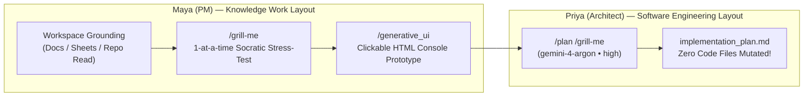

# Lab S1 `[Level 200]`: Product Manager Flow — Socratic PRD Stress-Test & Clickable Prototype (`Knowledge Work` + `/grill-me` + `/generative_ui`)

> [!IMPORTANT]
> **Unofficial Guide Disclaimer**: This lab is part of an **unofficial, community-authored guide** and is not affiliated with or endorsed by Google. Always consult the **[Official Google Antigravity Documentation](https://antigravity.google/docs)** and **[Google Cloud Gemini Enterprise Documentation](https://docs.cloud.google.com/gemini/enterprise/docs/overview)** for authoritative product specifications.

**Navigation**: [← Back to Agentic SDLC Hub](README.md) | **Next Lab**: [Lab S2: Parallel Full-Stack Swarm →](parallel-fullstack-swarm.md)

| Lab Metadata | Specification |
| :--- | :--- |
| **Difficulty & Track** | **`[Level 200]`** — Agentic SDLC Stage 1 & Stage 2 Handoff |
| **Estimated Duration** | `35 minutes` |
| **Active Personas** | **Maya** *(Senior Product Manager)* → **Priya** *(Principal Systems Architect)* |
| **Antigravity Surface** | **Antigravity Desktop / Web App** (`Knowledge Work` layout → `Software Engineering` layout) |
| **Optimal `(Brain × Squad)`** | `gemini-4-hydrogen (medium/high)` × `/grill-me` + `/generative_ui` → `gemini-4-argon (high)` × `/plan /grill-me` |

---

## 🎬 Stage 1 — The PulsePay Story & Broken Status Quo

It is Monday morning of Q4 Planning at **PulsePay**.

**Maya** (Senior PM) has a whiteboard covered in sticky notes for **"PulsePay Instant Refund Guard"**: merchants want instant customer refunds under `$500` auto-settled in under 2 seconds, while refunds of `$500` or more should pause in a `HELD` queue for real-time velocity scoring and one-click Operations override.

Last quarter, Maya wrote a 6-page PRD in a standalone web chatbot that had **zero visibility** into PulsePay's actual settlement codebase ([`../sandbox-apps/pulsepay-legacy-ledger/`](../sandbox-apps/pulsepay-legacy-ledger/README.md)). Look at what went wrong in Sprint Week 3:
1. The PRD used floating-point dollars (`499.99`), whereas [`ledger_batch.py`](../sandbox-apps/pulsepay-legacy-ledger/ledger_batch.py) stores integer minor units (`amount_cents: int`, `refund_cents: int`).
2. Nobody asked what happens when a compromised merchant fires **three `$400` partial refunds (`PART_REFND`) in 10 seconds** against a single `$1,000` capture—bypassing the `$500` single-refund threshold AND over-refunding the original `$1,000` order by `$200`!
3. Operations stakeholders didn't see the UI until after frontend engineers spent 8 days building the wrong table layout in React.

**Today, Maya and Priya fix that broken handoff forever—inside a single shared repository.**

---

## 🧠 Stage 2 — Pick Your `(Brain × Squad)` Combo

Why does Antigravity (`v2.30+`) let a Product Manager and a Principal Systems Architect collaborate inside the same Git repo without stepping on each other or drowning in terminal flags? Because of **Dual Interface Layouts** paired with **Spec-First Slash Commands**:



| Workflow Step | Selected Brain (`/model` + `/effort`) | Selected Squad / Tool | Why This Exact Choice Wins |
| :--- | :--- | :--- | :--- |
| **1. Grounding & Brainstorming** | `gemini-4-hydrogen` (`medium`) | **Knowledge Work** layout + `gdrive`/`gdocs`/`gsheets` + `/voice` (`F5`) | Fast prefill (`$1.50/1M` in, `$0.075/1M` cached) while reading existing settlement data and Workspace tables. |
| **2. Socratic PRD Stress-Test** | `gemini-4-hydrogen` (`high`) | **`/grill-me`** | Reads the repo silently *first* (never asks what code already answers!), then asks **one sharp question at a time** with `(Recommended)` first. |
| **3. Clickable UI Prototype** | `gemini-4-hydrogen` (`medium`) | **`/generative_ui`** *(App Only)* | Renders a sandboxed, interactive HTML/CSS/JS **Standalone Artifact** in ~90 seconds so Ops stakeholders click through flows on Day 1. |
| **4. Architectural Blueprint Gate** | `gemini-4-argon` (`high`) *(or `Orchestrator (Argon)`)* | **`/plan /grill-me`** | Synthesizes cross-service data contracts into `implementation_plan.md` while guaranteeing **zero production files are modified** prior to human sign-off. |

> **🙋 There Are No Dumb Questions**
>
> **Q: *I'm a Product Manager, not a Python developer. Why should I run `/grill-me` inside the PulsePay Git repository instead of an empty folder?***
>
> **A:** Because `/grill-me` inspects the codebase *silently* in the background before asking its first question! Instead of wasting 20 minutes asking you *"What currencies do you support?"*, `/grill-me` spots `USD`, `EUR`, and `GBP` plus `PART_REFND` and `HELD` right inside [`sample_settlements.dat`](../sandbox-apps/pulsepay-legacy-ledger/sample_settlements.dat) and immediately asks you the `$50,000` business question: *"Should the `$500` instant-approval cap convert `EUR` and `GBP` at capture-time FX rates or settlement-time FX rates?"*
>
> **Q: *What is the difference between a Standalone Artifact and an Inline Widget in `/generative_ui`?***
>
> **A:** Use a **Standalone Artifact** (opens in the right-hand preview canvas) for full multi-panel product prototypes like Maya's **Ops Refund Override Console**. Use an **Inline Widget** (`≤ 500px` tall, rendered directly inside the chat stream) when Priya wants engineers to drag a quick rate-limit or retry-backoff slider mid-conversation!

---

## 🛠️ Stage 3 — Hands-On Execution

### Step 3.1 — Switch to `Knowledge Work` Layout & Ground on Existing PulsePay Data

1. Open `/home/antigravity/cmanikandan/antigravity-enterprise-blueprint` in the **Antigravity App**.
2. Navigate to **`Settings > General > Interface Layout`** and select **`Knowledge Work`** *(note how clean document, artifact, and Workspace plugin controls take center stage without noisy build panes)*.
3. Select `/model gemini-4-hydrogen` and `/effort high`.
4. *(Optional Workspace Grounding)* If you have Google Docs / Google Sheets connected via `<plugins>`, reference your team's Q3 Chargeback Sheet—or ground directly on the runnable PulsePay settlement dataset included in this repo ([`labs/sandbox-apps/pulsepay-legacy-ledger/`](../sandbox-apps/pulsepay-legacy-ledger/README.md)).
5. *(Optional Voice Dictation)* Press **`F5`** (`/voice dictate`) to speak your rough feature idea naturally, or paste the Socratic prompt below!

### Step 3.2 — Stress-Test the PRD with `/grill-me` (One Question at a Time!)

Run the following prompt in chat and **answer at least 4 rounds of single-question Socratic grilling**:

```text
/grill-me I am Maya, PM for PulsePay. We are drafting the PRD for "PulsePay Instant Refund Guard":
- Merchant refunds < $500.00 auto-settle immediately.
- Merchant refunds >= $500.00 enter HELD status for fraud velocity scoring (0-100) and Ops manual override (Approve / Reject / Escalate).

First, inspect labs/sandbox-apps/pulsepay-legacy-ledger/ (Do NOT modify any existing files) so you know our exact integer-cents schema, statuses (SETTLED, PART_REFND, HELD, CHARGEBACK), currencies (USD, EUR, GBP), and webhook payload fields.
Then interview me ONE question at a time—putting your (Recommended) option first—on cumulative partial-refund abuse, multi-currency thresholds, idempotency windows, and accounting webhook SLAs. Once all ambiguities are resolved, draft the complete PRD as an artifact (do not write into labs/sandbox-apps/).
```

Notice what happens on every turn:
- Antigravity asks **one focused multiple-choice or structured decision**, never overwhelming you with a 14-bullet questionnaire.
- Every option list leads with **`(Recommended)`** grounded in payment-industry best practices and PulsePay's `amount_cents` / `refund_cents` data model!

### Step 3.3 — Build a Clickable Stakeholder Prototype in 90 Seconds (`/generative_ui`)

Once `/grill-me` finalizes your PRD decisions, turn that spec into an interactive prototype Maya can demo to Payment Operations *before a single backend ticket enters the sprint*:

```text
/generative_ui Build an interactive Standalone Artifact clickable prototype for the "PulsePay Ops Refund Override Console" grounded in our finalized PRD and the sample merchants in labs/sandbox-apps/pulsepay-legacy-ledger/sample_settlements.dat (such as MCH_ACME_001, MCH_BETA_002, MCH_GAMMA_03).

Include:
1. A live "Auto-Hold Risk Score Threshold" slider (0–100) and a "$500 Minor-Unit Equivalent" currency badge (USD / EUR / GBP).
2. An interactive queue table showing HELD and PART_REFND refund requests with cumulative refund velocity indicators (highlighting when 3 partial refunds approach the original capture amount_cents!).
3. Working "Approve (Instant Settle)", "Reject Refund", and "Escalate to Fraud" buttons with mandatory audit-reason selection.
4. A live "Accounting Webhook Payload Preview" JSON panel at the bottom that updates dynamically whenever an operator clicks an action!
```

Click through your rendered **Standalone Artifact** in the right-hand preview pane: drag the risk-score slider, approve a `HELD` refund for `MCH_GAMMA_03`, and watch the live JSON webhook payload update on screen!

### Step 3.4 — Architectural Handoff to Priya (`/plan /grill-me` Zero-Mutation Gate)

Now put on **Priya's** hat (Principal Systems Architect):
1. Switch **`Settings > General > Interface Layout`** → **`Software Engineering`**.
2. Switch `/model` to **`gemini-4-argon`** with `/effort high` *(or `Orchestrator (Argon)` on Pro/Ultra)*.
3. Stack **`/plan /grill-me`** so Antigravity resolves technical storage/concurrency contracts and produces `implementation_plan.md` **without touching a single source file**:

```text
/plan /grill-me Using our finalized Instant Refund Guard PRD and prototype contracts, design a zero-mutation technical implementation plan extending PulsePay's settlement & webhook architecture (modeled in labs/sandbox-apps/pulsepay-legacy-ledger/). Grill me one question at a time on atomic cumulative refund_cents checks, UTC timestamp standardization, and backward-compatible webhook fields before generating implementation_plan.md. Do NOT modify any repository files.
```

---

## 🔬 Stage 4 — Verify Telemetry, Context & Guardrails

Run these three verification checks to confirm your Stage 1–2 workflow stayed razor-sharp and zero-mutation safe:

1. **Verify Zero Premature File Mutations**:
   ```bash
   git status --short labs/sandbox-apps/pulsepay-legacy-ledger/
   ```
   **Expected Output**: Empty (`0` modified files)! `/plan` holds an ironclad gate until an engineer explicitly clicks **Proceed** (or hands the plan to `/swarm` in **Lab S2**).

2. **Verify Baseline Sandbox Health**:
   ```bash
   python3 -m unittest discover -s labs/sandbox-apps/pulsepay-legacy-ledger -p "test_*.py" -v
   ```
   **Expected Output**: All `7` baseline tests pass (`OK`).

3. **Inspect Pooled Quota Efficiency (`/usage` & `/context`)**:
   - Run `/usage` (or `/credits`) in Antigravity. Because Maya ran `/grill-me` and `/generative_ui` on **`gemini-4-hydrogen`** (`$1.50/1M` input, **`$0.075/1M` cached input — 95% off!**) and only escalated to **`gemini-4-argon`** for Priya's final architectural `/plan`, the entire PRD + Prototype + Architecture RFC consumed **less than `$0.12`** of your team's rolling 7-day Gemini Enterprise shared pool!

> **💥 Watch Out! Two Classic PM-to-Engineering Anti-Patterns**
> - **Anti-Pattern #1 — Skipping `/grill-me` and typing *"Write me a PRD for instant refunds"***: When you don't authorize the agent to grill you, it silently *invents* business policies (guessing FX rules, inventing arbitrary retry timeouts) and buries those assumptions inside 2,000 words of confident-sounding prose.
> - **Anti-Pattern #2 — Asking for React production scaffolding during stakeholder discovery**: Don't generate 25 `node_modules` files just to ask Operations if they want a "Hold" button! `/generative_ui` creates a zero-dependency, sandboxed single-file HTML artifact in seconds with zero repo clutter.

---

## 🎓 Stage 5 — Sharpen Your Pencil & Facilitator Ground Truth

### 🧲 Command Magnets — Snap the Right Construct into Each Slot!

Match each item from the magnet tray (`Knowledge Work`, `/grill-me`, `/generative_ui (Inline ≤500px)`, `/generative_ui (Standalone Artifact)`, `/plan /grill-me`, `F5 (/voice dictate)`) to the exact PulsePay moment:

1. Maya wants to talk through 3 messy customer escalation calls hands-free without typing a wall of text: **`____________________`**
2. Maya wants a full multi-panel clickable Ops Override Console in the right-hand preview pane for Friday's stakeholder review: **`____________________`**
3. Priya wants an interactive 350px-tall sliding-window vs. token-bucket burst visualizer right inside the architecture chat thread: **`____________________`**
4. Maya wants Antigravity to read `pulsepay-legacy-ledger` silently first and interview her one edge case at a time with `(Recommended)` choices first: **`____________________`**
5. Priya wants an approved `implementation_plan.md` blueprint with a hard guarantee that zero `.py` files are edited yet: **`____________________`**

<details>
<summary><b>🔑 Click to Reveal Solutions & Facilitator Ground Truth Rubric</b></summary>

### Command Magnets Solutions
1. **`F5 (/voice dictate)`** *(or `/voice live` for two-way conversational brainstorming)*
2. **`/generative_ui (Standalone Artifact)`**
3. **`/generative_ui (Inline ≤500px)`**
4. **`/grill-me`**
5. **`/plan /grill-me`**

---

### Facilitator Ground Truth: The 4 Hidden Edge Cases `/grill-me` Must Surface from `pulsepay-legacy-ledger`
When grading or facilitating Lab S1, verify that participants' `/grill-me` transcript caught all four code-grounded nuances:
1. **Cumulative Partial-Refund Velocity (`PART_REFND`)**: [`sample_settlements.dat`](../sandbox-apps/pulsepay-legacy-ledger/sample_settlements.dat) tracks both `AMOUNT_CENTS` (`24:36`) and `REFUND_CENTS` (`49:61`). The `$500` (`50000` minor-unit) instant-approval rule **must** check cumulative `sum(refund_cents)` per capture/merchant window—otherwise `3 × $400` (`120000` cents) bypasses `HELD` and exceeds a `$1,000` (`100000` cents) capture!
2. **Net Payout Contract Bug Awareness**: In [`notification_service.py`](../sandbox-apps/pulsepay-legacy-ledger/notification_service.py), merchant receipts/webhooks must clearly distinguish gross `amount_cents`, `refund_cents`, and `net_payout_cents` on `PART_REFND` events.
3. **Multi-Currency Minor-Unit Thresholds (`USD`, `EUR`, `GBP`)**: `50000` minor units in `GBP` (`£500.00`) is worth ~`$630 USD`—the PRD must explicitly pick either per-currency minor-unit tables (`50000 USD`, `46000 EUR`, `40000 GBP`) or capture-locked USD notional conversion.
4. **Idempotency Key & State Transition Atomicity**: Once a `HELD` refund (`STL20261115C` for `MCH_GAMMA_03`) receives an Ops click (`Approve` vs. `Reject`), duplicate clicks or webhook retries must be idempotent (`idempotency_key` + immutable operator audit reason).

</details>

---

**Ready to build Priya's approved plan in parallel across backend, webhooks, and UI?**
👉 **[Continue to Lab S2 `[Level 300]`: Parallel Cross-Stack Feature Build with `/swarm` →](parallel-fullstack-swarm.md)**
