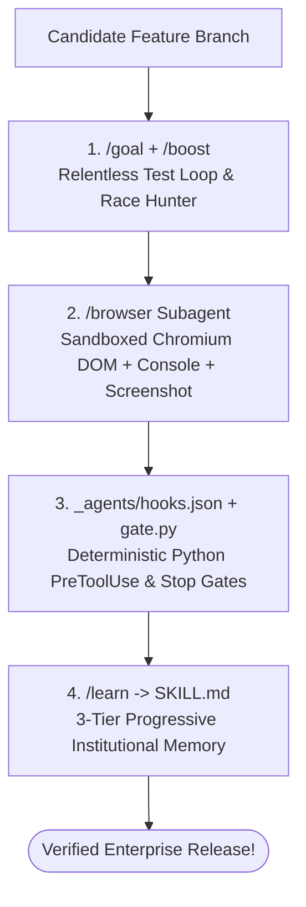

# Lab S3 `[Level 300–400]`: Self-Healing QA (`/goal`), Sandboxed `/browser` E2E, Deterministic `hooks.json` Gates & `/learn` Skill Capture

> [!IMPORTANT]
> **Unofficial Guide Disclaimer**: This lab is part of an **unofficial, community-authored guide** and is not affiliated with or endorsed by Google. Always consult the **[Official Google Antigravity Documentation](https://antigravity.google/docs)** and **[Google Cloud Gemini Enterprise Documentation](https://docs.cloud.google.com/gemini/enterprise/docs/overview)** for authoritative product specifications.

**Navigation**: [← Lab S2: Parallel Full-Stack Swarm](parallel-fullstack-swarm.md) | [Agentic SDLC Hub](README.md) | **Next Lab**: [Lab S4: GitHub Issue to Remote PR →](github-issue-to-remote-pr.md)

| Lab Metadata | Specification |
| :--- | :--- |
| **Difficulty & Track** | **`[Level 300–400]`** — Agentic SDLC Stage 4 (QA, Browser E2E, Security Hooks & Institutional Memory) |
| **Estimated Duration** | `45 minutes` |
| **Active Persona** | **Sam** *(Staff QA & Cybersecurity Lead)* |
| **Antigravity Surface** | **Antigravity App & CLI** + **Sandboxed `/browser` Chromium Subagent** + **Lifecycle Hook Engine** |
| **Optimal `(Brain × Squad)`** | `gemini-4-hydrogen (high)` × `/goal` + `/browser` + `gemini-4-carbon (high)` × `/boost` + [`_agents/hooks.json`](../../_agents/hooks.json) + `/learn` |

---

## 🎬 Stage 1 — The PulsePay Story & Broken Status Quo

Look back at Panel 4 of our storyboard ([`04_sdlc_storyboard.jpg`](../../assets/visuals/04_sdlc_storyboard.jpg)): **Sam** is standing in front of the green **`SHIP IT!`** flag holding **two giant shields**—a golden **`/browser E2E`** shield and a silver **`hooks.json + Carbon Audit`** shield, backed by **`/goal`** and **`/boost`**.

Why does Sam carry *four* different verification tools instead of just running `pytest` once in chat? Because in production payment engineering, **four distinct failure modes slip past ordinary chat prompts**:

1. **Premature Agent Quit**: On a 9-file refactor with 6 failing edge cases, a standard chat turn fixes 4 tests, sees a long stack trace, summarizes *"Almost done, 2 minor failures left for you!"*, and stops.
2. **Headless-Blind UI Bugs**: Backend unit tests pass `100%`, yet clicking **"Approve Held Refund"** in the browser throws an uncaught `TypeError` in JavaScript or fires a malformed `POST` payload.
3. **Probabilistic Prompt Drift Under `Turbo` Mode**: Telling an LLM *"Please never run `terraform destroy` or edit `.pem` keys"* in Markdown is **99% effective advice—not a 100% security boundary**. Compliance auditors require deterministic code enforcement outside the model!
4. **Groundhog-Day Bug Amnesia**: You spend 40 minutes fixing a subtle `PART_REFND` gross-vs-net payout bug today, `/clear` your chat, and next Tuesday another developer's agent makes the exact same mistake.

**In this lab, you will arm all four shields—and test the deterministic Python hook gate live in your terminal.**

---

## 🧠 Stage 2 — Pick Your `(Brain × Squad)` Combo: Sam's 4-Layer Release Gate



| Shield | Construct | What It Protects Against | Model / Runtime Cost |
| :--- | :--- | :--- | :--- |
| **1. Relentless Convergence** | **`/goal`** *(+ `/boost` for race conditions)* | Intercepts premature stops and keeps editing + running your objective test command across turns until exit code == `0`. | `gemini-4-hydrogen (high)` (`95%` cached prefix!) or `gemini-4-carbon` on `/boost` |
| **2. Live UI & Network Proof** | **`/browser`** | Launches a sandboxed Chromium subagent (governed by Admin URL allow/denylists) to click buttons, assert DOM state, inspect `console.error`, and save screenshot evidence. | Isolated `@browser` subagent context (zero DOM dump in parent chat!) |
| **3. Deterministic Guardrail** | **[`_agents/hooks.json`](../../_agents/hooks.json) + [`gate.py`](../../hooks-scripts/gate.py)** | Pure Python executing **outside the LLM** on `PreToolUse`, `PostToolUse`, `PreInvocation`, `PostInvocation`, and `Stop` (`deny`, `force_ask`, `overwrite`, `continue`). | **`$0.00` (`0` LLM tokens — runs in `<15ms` local Python!)** |
| **4. Permanent Team Immunity** | **`/learn`** → `_agents/skills/<name>/SKILL.md` | Extracts root causes and invariants into a 3-tier skill bundle so future sessions load only `~100` YAML frontmatter tokens until needed. | `~100` tokens startup (`⛁`) via progressive disclosure |

> **🙋 There Are No Dumb Questions**
>
> **Q: *If an engineer turns on `Turbo` mode (`/permissions`), does `Turbo` bypass `_agents/hooks.json`?***
>
> **A:** **NO!** That is the entire superpower of lifecycle hooks in Antigravity. Even inside `Turbo` mode, every matched tool call (`run_command`, `write_to_file`, `replace_file_content`) passes its JSON payload over `stdin` to [`hooks-scripts/gate.py`](../../hooks-scripts/gate.py) **before** execution:
> - Returning `{"decision": "deny", "reason": "..."}` blocks `terraform destroy` or `service_account.json` edits immediately.
> - Returning `{"decision": "force_ask", "reason": "..."}` overrides `Turbo` mode and forces an interactive human approval modal on `git push` or `terraform apply`!
> - Returning `{"decision": "allow", "overwrite": {"CommandLine": "..."}}` transparently rewrites `bq query` commands to inject FinOps `--label=managed_by:antigravity` attribution!

---

## 🛠️ Stage 3 — Hands-On Execution

### Step 3.1 — Unleash `/goal` for Relentless `100%` Test Convergence

Inspect [`labs/sandbox-apps/pulsepay-legacy-ledger/notification_service.py`](../sandbox-apps/pulsepay-legacy-ledger/notification_service.py) and [`test_settlement_flow.py`](../sandbox-apps/pulsepay-legacy-ledger/test_settlement_flow.py). Notice that while the 7 baseline tests pass, `PART_REFND` payout edge cases need ironclad regression coverage.

Run **`/goal`** with an explicit, machine-verifiable exit command and an anti-reward-hacking rule:

```text
/goal Audit labs/sandbox-apps/pulsepay-legacy-ledger/notification_service.py and ledger_batch.py for partial-refund (PART_REFND) payout accuracy.
1. First add a strict regression test in test_settlement_flow.py asserting that on PART_REFND record STL20261115B (amount_cents=84000, refund_cents=25000), merchant payout calculations reflect net settled cents (59000) rather than over-paying gross 84000 cents.
2. Do NOT delete or weaken any of the 7 existing test methods.
3. Fix the implementation and keep iterating until `python3 -m unittest discover -s labs/sandbox-apps/pulsepay-legacy-ledger -p "test_*.py" -v` exits with code 0 and 100% passing tests.
```

*(Note: If you hit a gnarly multi-threaded race condition or distributed lock bug instead of a straightforward assertion gap, swap `/goal` for **`/boost`** on `gemini-4-carbon` to run `DeepInvestigator` + adversarial breaker passes!)*

### Step 3.2 — Run Sandboxed Chromium E2E Verification with `/browser`

Backend unit tests never prove a button actually works in CSS and DOM. Launch `/browser` against the Ops Override Console prototype you built in [Lab S1](prd-to-clickable-prototype.md) (or serve any local preview with `IsDaemon: true`):

```text
/browser Open our PulsePay Ops Refund Override Console preview, perform an end-to-end operator release check, and return a concise QA Evidence Matrix:
1. Filter the queue to HELD refunds >= $500 (verify STL20261115C for MCH_GAMMA_03 is visible).
2. Drag the Auto-Hold Risk Score slider to 65 and verify the threshold badge updates live in the DOM.
3. Click "Approve (Instant Settle)" with audit reason "Verified Invoice Match", confirm the row status badge transitions cleanly, and verify the live Webhook JSON panel contains integer minor-unit cents (zero floating-point drift).
4. Assert ZERO browser console errors (`console.error`) and capture a release-evidence screenshot artifact.
```

Notice how `@browser` executes all DOM clicks, screenshots, and console inspections inside its **isolated subagent context**—returning a compact pass/fail summary + artifact screenshot without dumping 80,000 tokens of raw HTML into your main conversation!

### Step 3.3 — Test Deterministic `hooks.json` & `gate.py` Live in Your Terminal!

Don't take anyone's word for how [`_agents/hooks.json`](../../_agents/hooks.json) and [`hooks-scripts/gate.py`](../../hooks-scripts/gate.py) work—pipe simulated Antigravity tool-call JSON payloads straight into `gate.py` right now and watch all three deterministic actions (`deny`, `force_ask`, and `overwrite`) fire in milliseconds!

**Test A — Hard `deny` on Destructive Infrastructure Commands (`terraform destroy`)**:
```bash
echo '{"toolCall":{"name":"run_command","args":{"CommandLine":"terraform destroy -auto-approve"}}}' \
  | python3 hooks-scripts/gate.py --mode=pre-tool
```
*Expected Output*:
```json
{"decision": "deny", "reason": "[ENTERPRISE SECURITY GATE] Blocked destructive command pattern: 'terraform destroy'. Explicit human execution outside the agent is required."}
```

**Test B — Hard `deny` on Writing Sensitive Credential Files (`service_account.json`)**:
```bash
echo '{"toolCall":{"name":"write_to_file","args":{"TargetFile":"/tmp/prod_service_account.json"}}}' \
  | python3 hooks-scripts/gate.py --mode=pre-tool
```
*Expected Output*:
```json
{"decision": "deny", "reason": "[ENTERPRISE SECURITY GATE] Modifying sensitive credential file '/tmp/prod_service_account.json' is prohibited by workspace security policy."}
```

**Test C — Transparent FinOps Argument `overwrite` on `bq query`**:
```bash
echo '{"toolCall":{"name":"run_command","args":{"CommandLine":"bq query --use_legacy_sql=false \"SELECT COUNT(*) FROM pulsepay.refunds\""}}}' \
  | python3 hooks-scripts/gate.py --mode=pre-tool
```
*Expected Output* (auto-injects FinOps labels before BigQuery ever sees the query!):
```json
{"decision": "allow", "reason": "Auto-injected mandatory FinOps attribution labels into bq query.", "overwrite": {"CommandLine": "bq query --label=managed_by:antigravity --label=env:enterprise --use_legacy_sql=false \"SELECT COUNT(*) FROM pulsepay.refunds\""}}
```

**Test D — Progressive-Disclosure Skill Verifier Script (`0` Source Code Tokens in LLM Context!)**:
```bash
python3 _agents/skills/cloud-architecture-readiness/scripts/verify_release_readiness.py --self-test
```

### Step 3.4 — Capture Institutional Memory Permanently with `/learn`

Close the loop so no agent in PulsePay ever repeats the gross-vs-net `PART_REFND` payout mistake again:

```text
/learn Extract the PulsePay partial-refund (PART_REFND) integer minor-unit invariant (net_payout_cents = amount_cents - refund_cents - fee_cents; never emit floating-point currency amounts or gross capture amounts as settled payouts) into a concise 3-tier skill specification following the progressive-disclosure format of _agents/skills/cloud-architecture-readiness/SKILL.md.
```

---

## 🔬 Stage 4 — Verify Telemetry, Context & Guardrails

1. **Inspect Your `/context` Bar After `/browser` and `/learn`**:
   Run `/context` in the CLI. Notice two huge wins:
   - Because `/browser` ran inside a child subagent, `◉ Active Conversation` stayed lean instead of swelling with raw DOM trees.
   - Because skills use **3-Tier Progressive Disclosure** ([`SKILL.md`](../../_agents/skills/cloud-architecture-readiness/SKILL.md)), `⛁ System, Rules, Skills & MCP Schemas` only carries `~100` tokens of `name` + `description` frontmatter per skill at startup!
2. *(Optional Sandbox Reset)* If you edited `labs/sandbox-apps/pulsepay-legacy-ledger/` during Step 3.1 and want to keep git clean:
   ```bash
   git checkout -- labs/sandbox-apps/pulsepay-legacy-ledger/
   ```

> **💥 Watch Out! Never Give `/goal` a Weak Verification Command**
> `/goal` is a heat-seeking missile aimed at whatever pass/fail criteria you give it. If you say `"/goal make the app work"`, the criterion is subjective. Always give `/goal` an **exact deterministic shell command** (e.g., `pytest -q && mypy --strict src/`) **plus** the explicit constraint *"Never delete, skip (`@unittest.skip`), or weaken existing assertions."*

---

## 🎓 Stage 5 — Sharpen Your Pencil & Facilitator Ground Truth

### 🕵️ Be the Security & QA Architect — Predict `gate.py`'s Exact Verdict!

Look at [`hooks-scripts/gate.py`](../../hooks-scripts/gate.py) and predict the exact JSON `decision` (`allow`, `deny`, `force_ask`, `allow + overwrite`, or `continue`) for each lifecycle event below:

1. **`PreToolUse`**: Agent in `Turbo` mode calls `run_command` with `"gcloud run deploy pulsepay-refund-api --image=..."` → **`____________________`**
2. **`PreToolUse`**: Agent calls `replace_file_content` on `"/workspace/certs/webhook_signing.pem"` → **`____________________`**
3. **`PreInvocation`**: User sends Turn 1 of a brand-new conversation → **`____________________`**
4. **`Stop`**: Agent tries to finish its turn (`terminationReason == "model_stop"`), while `git diff --check` finds a leftover `<<<<<<< HEAD` merge conflict marker in `ledger_batch.py` → **`____________________`**

<details>
<summary><b>🔑 Click to Reveal Solutions & Facilitator Ground Truth</b></summary>

1. **`"decision": "force_ask"`** — `"gcloud run deploy"` matches `FORCE_ASK_PATTERNS` in [`gate.py`](../../hooks-scripts/gate.py), overriding cached/`Turbo` permissions and forcing interactive human sign-off!
2. **`"decision": "deny"`** — `".pem"` matches `SENSITIVE_FILE_SUFFIXES`, blocking credential/key mutation before disk I/O occurs.
3. **`"injectSteps": [{"ephemeralMessage": "..."}]`** — `PreInvocation` injects a transient compliance reminder into the active model call **without** polluting the saved conversation transcript!
4. **`"decision": "continue"`** — `handle_stop_gate()` runs `git -C <ws> diff --check`, catches the non-zero exit code from conflict/whitespace errors, and forces the agent to stay awake and clean up the conflict markers before stopping!

</details>

---

**Final Boss Level (`[Level 400]`): What happens when Issue `#418` arrives on Friday evening after everyone's laptop is shut in their backpack?**
👉 **[Continue to Lab S4 `[Level 400]`: Zero-Laptop SWE — GitHub Issue → Remote Sandbox → Carbon-Verified PR →](github-issue-to-remote-pr.md)**
