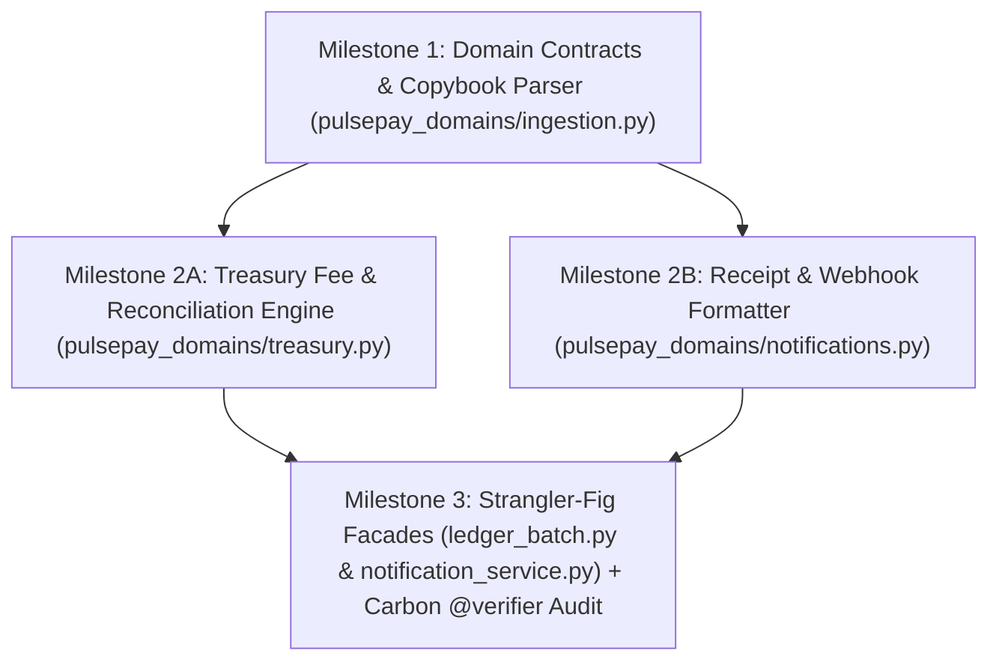

# 🏛️ Lab M5: Multi-Milestone Monolith Decomposition

**Difficulty**: 🔴 Advanced | **Duration**: 60 Minutes | **Sandbox**: [`../sandbox-apps/pulsepay-legacy-ledger/`](../sandbox-apps/pulsepay-legacy-ledger/README.md)

---

## 📖 The Three-Squad Merge-Conflict Gridlock at PulsePay

PulsePay's Engineering Org just split into three autonomous domain squads:
1. **Ingestion & Copybook Rail Squad** (owns fixed-width COBOL/ISO-20022 parsing & `SettlementEvent` domain contracts)
2. **Treasury & Pricing Squad** (owns basis-point fee math & multi-currency batch reconciliation)
3. **Merchant Experience Squad** (owns payout receipts & accounting webhooks)

Today, all three squads step on each other's toes every afternoon inside [`ledger_batch.py`](../sandbox-apps/pulsepay-legacy-ledger/ledger_batch.py) and [`notification_service.py`](../sandbox-apps/pulsepay-legacy-ledger/notification_service.py) — while **14 downstream cron jobs** still execute `from ledger_batch import SettlementEvent, load_settlement_batch, summarize_batch` and cannot tolerate a breaking import change!

Why can't you just throw a single flat `/swarm` at a monolith decomposition? Because **Milestone 2 (Treasury & Notifications)** depends on **Milestone 1 (Domain Contracts)** being frozen first — and if an eager agent stubs `calculate_platform_fee_cents()` with `# TODO: implement later` to pass an early check, your monolith silently rots!

Enter **`/teamwork`**: Antigravity's autonomous multi-milestone project orchestrator featuring a **Phase 1 Scoping Interview**, **`development` Integrity Mode** (zero stubbed `TODO` shortcuts allowed), **Exclusive Ownership Milestones**, and an independent **`gemini-4-carbon` `@verifier`** gating every milestone transition.

---

## 🧠 Recommended Brain × Squad + Tokenomics Tip

| Dimension | Recommended Selection | Why This Wins on Speed & Quota |
| :--- | :--- | :--- |
| **Orchestration Primitive** | `/teamwork` *(Phase 1 Scoping Interview → Phase 2 Milestone Gates)* | Coordinates sequenced dependency milestones (`M1 → M2a ∥ M2b → M3`) with explicit ownership boundaries in `~/teamwork_projects/{NAME}`. |
| **Integrity Mode** | `development` | Hard-blocks placeholder `pass`/`TODO` stubs and mock-only tests between milestones. |
| **Domain Builder Workers** | `gemini-4-hydrogen` (`Medium` effort) | `$1.50` in / `$7.50` out — executes well-scoped package extractions cleanly once Milestone 1 freezes interfaces. |
| **Milestone Gatekeeper** | `@verifier` pinned to `gemini-4-carbon` (`Medium`/`High` effort) | Independently audits import DAG acyclicity, strangler-fig backward compatibility, and test execution before unlocking the next milestone. |
| **💰 Tokenomics Tip** | Reuse warm worker contexts within a milestone (`send_message`) and let idle milestone workers sleep in `Waiting` (`0` tokens burned) while `@verifier` runs! |

---

## ⚡ 60-Second Quick Start

1. Inspect the coupled responsibilities currently tangled inside `ledger_batch.py`:
   ```bash
   python3 -c "import ast, pathlib; tree = ast.parse(pathlib.Path('labs/sandbox-apps/pulsepay-legacy-ledger/ledger_batch.py').read_text()); print([n.name for n in tree.body if isinstance(n, (ast.FunctionDef, ast.ClassDef))])"
   ```
   *(Notice `SettlementEvent`, `parse_settlement_line`, `load_settlement_batch`, `calculate_platform_fee_cents`, `summarize_batch`, and `main` all live in one flat module!)*
2. Kick off **Phase 1 (Scoping Interview)** with `/teamwork`:
   ```text
   /teamwork Decompose labs/sandbox-apps/pulsepay-legacy-ledger/ into a clean 3-domain package under pulsepay_domains/ (ingestion, treasury, notifications) in development integrity mode, while preserving ledger_batch.py and notification_service.py as 100% backward-compatible Strangler-Fig facades so test_settlement_flow.py continues to pass unmodified.
   ```

---

## 🔄 Guided 5-Stage Antigravity Loop

### Stage 1: Nail the Phase 1 `/teamwork` Scoping Interview
Before spawning builders, `/teamwork` conducts a structured scoping interview. Align on these **4 non-negotiable architectural decisions**:



1. **Dependency DAG Rule**: `treasury.py` and `notifications.py` may import `SettlementEvent` from `ingestion.py`, **never** from each other and **never** circularly from legacy `ledger_batch.py`.
2. **Exclusive File Ownership**: Milestone `2A` owns *only* `pulsepay_domains/treasury.py` + `test_treasury_domain.py`; Milestone `2B` owns *only* `pulsepay_domains/notifications.py` + `test_notifications_domain.py`.
3. **Strangler-Fig Backward Compatibility**: Legacy [`test_settlement_flow.py`](../sandbox-apps/pulsepay-legacy-ledger/test_settlement_flow.py) must remain **100% unmodified** in Milestone 3 to prove zero breaking changes for the 14 downstream cron callers!
4. **Integrity Mode**: `development` (every milestone must pass real `unittest` suites with zero `NotImplementedError` or `TODO` placeholders).

### Stage 2: Milestone 1 — Freeze `ingestion.py` & Verify Before Fan-Out
Let the Ingestion worker extract `SettlementEvent`, `RECORD_WIDTH`, `parse_settlement_line()`, and `load_settlement_batch()` into `labs/sandbox-apps/pulsepay-legacy-ledger/pulsepay_domains/ingestion.py` plus dedicated `test_ingestion_domain.py`. Watch `@verifier` (`gemini-4-carbon`) validate the contract before unlocking Milestones `2A` and `2B`!

### Stage 3: Concurrent Socratic Exploration During Milestone 2 (`/btw` & `/context`)
While Milestone `2A` (Treasury) and Milestone `2B` (Notifications) execute in parallel across strictly non-overlapping files, ask `/btw`:

- `/btw Why would running Milestone 1, 2A, 2B, and 3 simultaneously in a flat un-gated parallel() run fail on import paths?`
- `/btw Why is keeping legacy test_settlement_flow.py completely untouched during Milestone 3 a stronger Strangler-Fig proof than editing the tests to import from pulsepay_domains/?`

### Stage 4: Milestone 3 — Wire Strangler-Fig Façades & Enforce Acyclic Imports (`/goal`)
In Milestone 3, rewire `ledger_batch.py` and `notification_service.py` into thin re-export & delegation façades over `pulsepay_domains.*`, then run `@verifier`'s full regression + DAG gate:

```text
/goal Verify Strangler-Fig backward compatibility, new domain unit suites, and zero reverse imports from pulsepay_domains back into legacy facades by passing:
python3 -m unittest discover -s labs/sandbox-apps/pulsepay-legacy-ledger -p "test_*.py" -v && ! grep -rnE "from (ledger_batch|notification_service) import|import (ledger_batch|notification_service)" labs/sandbox-apps/pulsepay-legacy-ledger/pulsepay_domains/
```

### Stage 5: Executive Architecture Sign-Off (`@verifier` Report)
Inspect the final `@verifier` (`gemini-4-carbon`) milestone sign-off artifact citing exact `file://` paths, line counts removed from the monolith, test count growth (`7` baseline → `15+` domain + parity tests), and confirmed zero circular dependencies.

---

## 🕵️ Spot the Anti-Pattern: Three Broken Monolith Migrations

Three Principal Architects proposed decomposition plans for PulsePay. **Identify the fatal flaw in each rejected plan**:

1. **Plan Alpha ("Big-Bang Delete")**: *"Delete `ledger_batch.py` and `notification_service.py` in Milestone 1, move everything into `pulsepay_domains/`, and rewrite `test_settlement_flow.py` imports to match."*
2. **Plan Beta ("Mock-First Velocity")**: *"Run `/teamwork` in lightweight stub mode so Milestone 1 writes `def calculate_platform_fee_cents(event): return 0  # TODO M2` and ship the PR early."*
3. **Plan Gamma ("Leaky Domain Cycle")**: *"Have `pulsepay_domains/treasury.py` import `HARDCODED_SPOOL_DIR` from `ledger_batch.py`, while `ledger_batch.py` imports `summarize_batch` from `pulsepay_domains/treasury.py`."*

*(Compare your architectural critique with the Facilitator Spoiler below!)*

---

## ✅ Dual-Layer Verification Rubric

| Layer | Check | Pass Criteria |
| :--- | :--- | :--- |
| **Layer 1: Objective `/goal` + DAG Gate** | `python3 -m unittest discover -s labs/sandbox-apps/pulsepay-legacy-ledger -p "test_*.py" -v && ! grep -rnE "from (ledger_batch\|notification_service) import" labs/sandbox-apps/pulsepay-legacy-ledger/pulsepay_domains/` | Exit code `0`; untouched `test_settlement_flow.py` passes alongside new `test_*_domain.py` suites; zero circular/upward imports. |
| **Layer 2: `/teamwork` Milestone Artifacts** | Phase 1 Scoping Spec + Phase 2 Milestone Board + `gemini-4-carbon` `@verifier` Verdict | Exclusive file ownership respected in `2A`/`2B`; `development` integrity mode verified (zero `TODO` / `NotImplementedError` stubs). |

---

<details>
<summary>🎓 Facilitator Ground Truth & Root-Cause Spoiler (Click to Expand)</summary>

### 1. Critique of the Three Rejected Plans
1. **Plan Alpha Flaw (Violates Strangler-Fig Compatibility)**: Deleting `ledger_batch.py` and rewriting `test_settlement_flow.py` simultaneously destroys your independent parity oracle AND breaks all 14 downstream cron consumers in production! Keeping `test_settlement_flow.py` untouched proves legacy callers still work without code changes.
2. **Plan Beta Flaw (Phantom Progress via Stubs)**: Stubbing `return 0 # TODO` lets early milestones turn "green" while breaking real business invariants (`1200` cents fee on `STL20261115B`). `/teamwork` in **`development` integrity mode** forbids stub shortcuts and requires real tests at every gate.
3. **Plan Gamma Flaw (Circular Import Time-Bomb)**: If `ledger_batch.py` imports `pulsepay_domains.treasury` at module load while `treasury.py` imports `ledger_batch`, Python raises `ImportError: cannot import name 'summarize_batch' from partially initialized module 'pulsepay_domains.treasury' (most likely due to a circular import)`. Dependencies must flow strictly one-way: `facade → domain → ingestion`.

### 2. Reference Target Package Layout
```text
labs/sandbox-apps/pulsepay-legacy-ledger/
├── pulsepay_domains/
│   ├── __init__.py
│   ├── ingestion.py       # SettlementEvent, RECORD_WIDTH, parse_settlement_line, load_settlement_batch
│   ├── treasury.py        # PLATFORM_FEE_BPS, calculate_platform_fee_cents, summarize_batch
│   └── notifications.py   # resolve_payout_units, build_webhook_payload, format_receipt
├── ledger_batch.py        # Thin Strangler-Fig re-export facade + CLI main()
├── notification_service.py# Thin Strangler-Fig re-export facade
├── test_settlement_flow.py# Untouched 2021 legacy compatibility suite (7/7 green!)
└── test_domains.py        # Isolated domain unit tests + acyclic import check
```

</details>
