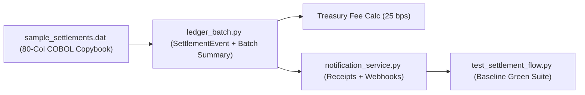

# PulsePay Legacy Ledger Sandbox (`pulsepay-legacy-ledger`)

Welcome to the runnable brownfield sandbox powering the **Migration, Debugging & Legacy Modernization** hands-on labs in [`../../migration-modernization/`](../../migration-modernization/README.md).

This compact, zero-dependency Python 3 application models a real-world enterprise payment operations headache: a **2019 fixed-width settlement batch parser** (`ledger_batch.py`) bolted onto a **2022 merchant receipt notification service** (`notification_service.py`).

---

## Architecture at a Glance



| File | Responsibility | Intentional Brownfield Seams for Hands-On Labs |
| :--- | :--- | :--- |
| [`sample_settlements.dat`](sample_settlements.dat) | 8 fixed-width 80-character settlement records across `USD`, `EUR`, and `GBP` (`SETTLED`, `PART_REFND`, `HELD`, `CHARGEBACK`). | Edge-case combinations for golden-file parity testing (**Lab M1**). |
| [`ledger_batch.py`](ledger_batch.py) | Parses 80-column records into `SettlementEvent` (`amount_cents: int`), computes 25 bps platform fees, and summarizes batch totals. | Naive `datetime.utcnow()` calls (**Lab M2**), hardcoded DSN/spool constants (**Lab M4**), and coupled monolith duties (**Lab M5**). |
| [`notification_service.py`](notification_service.py) | Formats merchant email receipts (`format_receipt`) and JSON accounting webhooks (`build_webhook_payload`). | Subtle cross-service monetary contract bug on `PART_REFND` payouts (**Lab M3**) plus hardcoded internal relay endpoints (**Lab M4**). |
| [`test_settlement_flow.py`](test_settlement_flow.py) | 7 baseline unit tests compatible with both `python3 -m unittest` and `pytest`. | Passes 100% out-of-the-box — yet leaves partial-refund payout receipts untested (**Labs M1 & M3**). |

---

## Fixed-Width 80-Byte Copybook Specification (`PPAY-STL-80`)

Every non-empty line in [`sample_settlements.dat`](sample_settlements.dat) is strictly **80 ASCII characters** wide:

| Slice (`0`-indexed) | Width | Field Name | Format & Example |
| :--- | :--- | :--- | :--- |
| `0:12` | `12` | `RECORD_ID` | Alphanumeric settlement ID (`STL20261115A`) |
| `12:24` | `12` | `MERCHANT_ID` | Merchant account identifier (`MCH_ACME_001`) |
| `24:36` | `12` | `AMOUNT_CENTS` | Zero-padded integer minor units (`000000125050` → `$1,250.50`) |
| `36:39` | `3` | `CURRENCY` | ISO-4217 currency code (`USD`, `EUR`, `GBP`) |
| `39:49` | `10` | `STATUS` | Right-padded status (`SETTLED   `, `PART_REFND`, `HELD      `, `CHARGEBACK`) |
| `49:61` | `12` | `REFUND_CENTS` | Zero-padded integer minor units (`000000025000` → `$250.00`) |
| `61:69` | `8` | `VALUE_DATE` | Settlement value date `YYYYMMDD` (`20261115`) |
| `69:80` | `11` | `CHANNEL` | Rail identifier (`ACH_CORE_V1`, `CARD_SETTLE`, `SEPA_BATCH1`) |

---

## Quick Verification Commands

Run the batch processor CLI directly from the repository root:

```bash
python3 labs/sandbox-apps/pulsepay-legacy-ledger/ledger_batch.py
```

Run the baseline test suite (zero external dependencies required):

```bash
python3 -m unittest discover -s labs/sandbox-apps/pulsepay-legacy-ledger -p "test_*.py" -v
```

> [!TIP]
> **Resetting Between Labs**: If you want a fresh starting state before trying another module in [`labs/migration-modernization/`](../../migration-modernization/README.md), run:
> ```bash
> git checkout -- labs/sandbox-apps/pulsepay-legacy-ledger/
> ```
