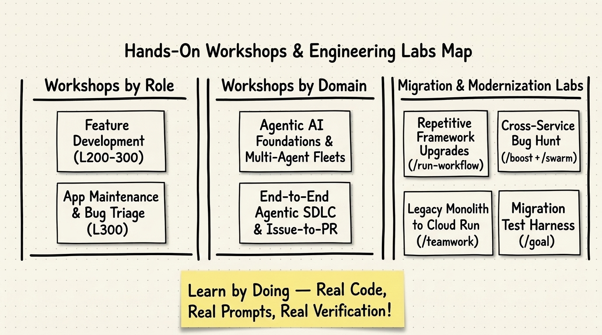
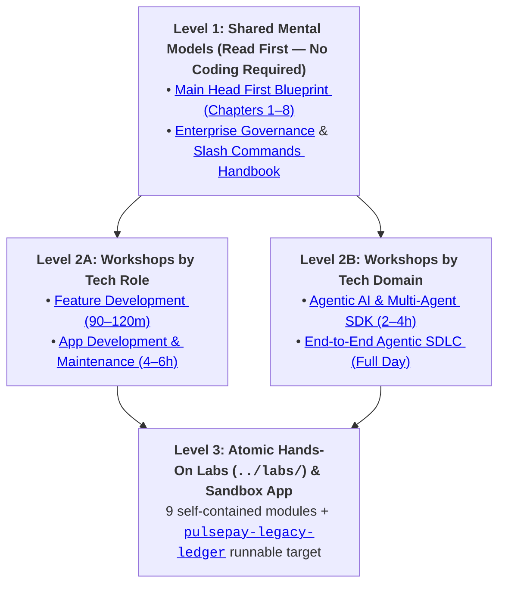

# Head First Google Antigravity Workshops: Your Hands-On Flight Simulator

> [!NOTE]
> **Unofficial Enablement & Workshop Guide**: This curriculum is a community and enterprise field blueprint for engineering teams adopting Google Antigravity and Gemini 4. For official product documentation, release notes, and platform specifications, always consult **[https://antigravity.google/docs](https://antigravity.google/docs)**.



Welcome to the **hands-on wing** of the *Antigravity Enterprise Blueprint*!

Reading about multi-agent orchestration on a slide deck doesn't rewire your engineering muscle memory—**shipping features, crushing race conditions, refactoring legacy ledgers, and watching four parallel Gemini 4 workers coordinate live in isolated working copies does.**

Every workshop in this directory drops you directly into **PulsePay**, a fast-scaling payments company modernizing its battle-scarred transaction stack ([`pulsepay-legacy-ledger`](../labs/sandbox-apps/pulsepay-legacy-ledger/)). Instead of dry, fill-in-the-blank toy exercises, you'll pair up with PulsePay's core pod to solve real production messes:

| PulsePay Teammate | Role & Daily Surface | Signature Antigravity Superpower |
| :--- | :--- | :--- |
| **Maya** | **Staff Product Manager** *(Antigravity App — Knowledge Work Layout)* | Stress-testing ambiguous specs with `/grill-me`, synthesizing Drive/Docs/Sheets context, and building clickable HTML prototypes in 90 seconds via `/generative_ui`. |
| **Priya** | **Principal Architect** *(Antigravity App & CLI — `gemini-4-argon`)* | Stacking `/plan /grill-me` for zero-mutation RFCs, wiring [`AGENTS.md`](../AGENTS.md) & [`GEMINI.md`](../GEMINI.md) guardrails, and designing `/swarm` vs. `/run-workflow` topologies. |
| **Alex** | **Full-Stack Dev Lead** *(Antigravity CLI `agy` & Cloud Remote Agents)* | Driving `Orchestrator` and `gemini-4-hydrogen` across multi-file builds, keeping context razor-sharp with `/context`, `/btw`, and `/rewind`, and dispatching GitHub Issues to **Remote Agents**. |
| **Sam** | **QA & Cyber Lead** *(CLI + Headless CI `agy -p` — `gemini-4-carbon`)* | Hunting concurrency bugs with `/boost`, enforcing 100% test convergence via `/goal`, verifying live DOM/network flows in `/browser`, and locking down tool calls via [`_agents/hooks.json`](../_agents/hooks.json). |

---

## How This Enablement System Fits Together

Not every teammate needs the same starting line on Monday morning. We separate **sequential mental-model reading** from **choose-your-own-adventure cohort workshops** and **atomic lab building blocks**:



### 💬 Fireside Chat: Static Prompt Sheet vs. The Antigravity 5-Stage Loop

> **Old-School Lab Sheet**: *"Step 1: Copy-paste this 12-line prompt into a chat box. Step 2: Grab coffee for 15 minutes while it edits files blindly. Step 3: Hope the PR compiles!"*
>
> **Antigravity Workshop**: *"Hold on—if all an engineer learns in a workshop is `Ctrl+C` and `Ctrl+V`, what happens on Tuesday when they face an ambiguous Jira ticket and a 200-table database?"*
>
> **Old-School Lab Sheet**: *"Well... they write a vague prompt, argue with the model for nine turns when tests fail, burn \$4.00 of frontier output tokens, and blame the AI."*
>
> **Antigravity Workshop**: *"Exactly! That's why every workshop here trains the **Antigravity 5-Stage Engineering Loop**: (1) **Align & Plan** with `/grill-me` + `/plan` before touching a single line of code; (2) **Route & Orchestrate** on the lightest Gemini 4 primitive that fits; (3) **Converge & Verify** objectively with `/goal` and `/browser`; (4) **Protect Context** using `/context`, `/btw`, and `/rewind`; and (5) **Compound Team Memory** by turning today's lesson into a permanent `SKILL.md`, scoped rule, or `/automation` sentinel via `/learn`."*

---

## Pick Your Workshop Track

### 1. Workshops by Technical Role (`by-tech-role/`)

Designed around a specific engineering persona's daily workflow—ideal for role-based onboarding cohorts and sprint guild sessions.

| Workshop | Depth | Duration | Target Persona | Core Antigravity Capabilities Practiced |
| :--- | :--- | :--- | :--- | :--- |
| **[Feature Development](by-tech-role/development/feature-development/README.md)** | `[Level 200–300]` | `90–120 min` | Product Engineers, Full-Stack Developers, Tech Leads | Knowledge Work ↔ SWE layouts, `/plan /grill-me`, `/generative_ui` prototypes, `Orchestrator`, `/swarm` + `gemini-4-carbon` `@verifier`, `/goal`, `/browser`, `/learn` |
| **[Application Development & Maintenance](by-tech-role/development/app-maintenance/README.md)** | `[Level 200–400]` | `4–6 hrs` *(3 modular tracks)* | App Owners, Full-Stack Pods, Modernization Engineers | Parity harnesses, `/boost` cross-service & concurrency forensics, `/run-workflow` fleet upgrades, 12-factor cloud-native refactors, Remote Agents & `/automation` sentinels |

### 2. Workshops by Technical Domain (`by-tech-domain/`)

Deep dives into specialized architectural capabilities—ideal for platform engineering offsites, AI enablement bootcamps, and Staff/Principal summits.

| Workshop | Depth | Duration | Target Persona | Core Antigravity Capabilities Practiced |
| :--- | :--- | :--- | :--- | :--- |
| **[Agentic AI & Multi-Agent Systems](by-tech-domain/ai-and-automation/agentic-ai/README.md)** | `[Level 300–400]` | `2–4 hrs` | AI Engineers, Platform Architects, Security Engineers | 4-Part Subagent Contract, 3-Tier `SKILL.md`, `google-genai >= 2.3.0` (`vertex=True`), Managed Agents `antigravity-preview-09-2026` + Wire-Level Credentials API, local Gemma 4 PII scrubbing, `hooks.json` |
| **[Agentic SDLC at Scale](by-tech-domain/ai-and-automation/agentic-sdlc/README.md)** | `[Level 200–400]` | `1 Day` *(4 × 90m sessions)* | Engineering Leads, SDETs, Platform/SRE & Architects | Full lifecycle from PRD → Blast-Radius Intelligence → Self-Healing `/goal` + `/browser` QA → Keyless `agy -p` Issue-to-PR → 3-Stream Parallel Modernization Capstone |

---

## Atomic Lab Building Blocks (`../labs/`) & Custom Agenda Recipes

Every guided workshop above composes reusable, self-contained challenges from [`../labs/`](../labs/sandbox-apps/pulsepay-legacy-ledger/). Facilitators can also mix and match individual labs to build custom half-day clinics:

### Atomic Labs Catalog Cross-Reference

| Category | Atomic Lab Module | Difficulty | Est. Time | Primary Primitive & Brain |
| :--- | :--- | :--- | :--- | :--- |
| **Agentic SDLC** | [PRD to Clickable Prototype](../labs/agentic-sdlc/prd-to-clickable-prototype.md) | `[Level 200]` | `35 min` | `/grill-me` + `/plan` + `/generative_ui` (`gemini-3.8-flash` / `Argon`) |
| **Agentic SDLC** | [Parallel Full-Stack Swarm](../labs/agentic-sdlc/parallel-fullstack-swarm.md) | `[Level 300]` | `50 min` | `/swarm` (`gemini-4-hydrogen` workers + `gemini-4-carbon` `@verifier`) |
| **Agentic SDLC** | [Self-Healing QA & Browser E2E](../labs/agentic-sdlc/self-healing-qa-and-browser.md) | `[Level 300]` | `45 min` | `/goal` + `/browser` + `/learn` (`gemini-4-hydrogen`) |
| **Agentic SDLC** | [GitHub Issue to Remote PR](../labs/agentic-sdlc/github-issue-to-remote-pr.md) | `[Level 300–400]` | `45 min` | Cloud Remote Agent + Headless `agy -p` + Credentials API |
| **Migration & Modernization** | [Migration Test Harness](../labs/migration-modernization/migration-test-harness.md) | `[Level 300]` | `50 min` | `@research` + Golden-File Parity + `/goal` (`Orchestrator`) |
| **Migration & Modernization** | [Repetitive Framework Upgrades](../labs/migration-modernization/repetitive-framework-upgrades.md) | `[Level 300]` | `50 min` | `/run-workflow` JSON-Schema Map-Reduce (`Hydrogen` → `Argon`) |
| **Migration & Modernization** | [Cross-Service Bug Investigation](../labs/migration-modernization/cross-service-bug-investigation.md) | `[Level 300]` | `45 min` | `@research` + `/boost` Adversarial Proof (`Hydrogen` / `Carbon`) |
| **Migration & Modernization** | [Cloud-Native Refactor](../labs/migration-modernization/cloud-native-refactor.md) | `[Level 300]` | `55 min` | `/plan` + `SKILL.md` Readiness Gate (`Orchestrator (Argon)`) |
| **Migration & Modernization** | [Legacy Monolith Decomposition](../labs/migration-modernization/legacy-monolith-decomposition.md) | `[Level 400]` | `65 min` | `/swarm` Worktree Isolation + `/teamwork` Milestones (`Argon` / `Carbon`) |

### Custom Workshop Recipes for Facilitators

| Cohort Goal | Recommended Module Chain | Total Time |
| :--- | :--- | :--- |
| **Lunch-and-Learn: PM + Eng Spec Alignment** | [PRD to Clickable Prototype](../labs/agentic-sdlc/prd-to-clickable-prototype.md) → [Parallel Full-Stack Swarm](../labs/agentic-sdlc/parallel-fullstack-swarm.md) | `90 min` |
| **Legacy Modernization Bootcamp** | [Migration Test Harness](../labs/migration-modernization/migration-test-harness.md) → [Cloud-Native Refactor](../labs/migration-modernization/cloud-native-refactor.md) → [Legacy Monolith Decomposition](../labs/migration-modernization/legacy-monolith-decomposition.md) | `3 hrs` |
| **Zero-Laptop Autonomous SWE Clinic** | [Cross-Service Bug Investigation](../labs/migration-modernization/cross-service-bug-investigation.md) → [Self-Healing QA & Browser E2E](../labs/agentic-sdlc/self-healing-qa-and-browser.md) → [GitHub Issue to Remote PR](../labs/agentic-sdlc/github-issue-to-remote-pr.md) | `2.5 hrs` |
| **Fleet Hygiene & FinOps Sprint** | [Repetitive Framework Upgrades](../labs/migration-modernization/repetitive-framework-upgrades.md) → [GitHub Issue to Remote PR](../labs/agentic-sdlc/github-issue-to-remote-pr.md) | `90 min` |

---

## 🕵️ Be the Orchestrator: Match the Scenario to the Right Primitive!

Before jumping into a lab, test your instincts! PulsePay has five urgent items on Monday's sprint board. Match each ticket (`1–5`) with the **lightest, most cost-effective Antigravity primitive** (`A–E`) per [`AGENTS.md`](../AGENTS.md) and [`GEMINI.md`](../GEMINI.md):

| PulsePay Sprint Ticket | Candidate Primitive |
| :--- | :--- |
| **1.** Upgrade 14 internal merchant webhooks from `hmac-v1` to `hmac-v2` and collect a structured `{service, tests_passed}` report. | **A.** `/boost` (`DeepInvestigator` + adversarial challenge rounds) |
| **2.** Scan 38 legacy files in `pulsepay-legacy-ledger` to map every place monetary values convert between `float` and integer cents—without polluting your main chat window. | **B.** `/swarm` (`gemini-4-hydrogen` workers in isolated working copies + `gemini-4-carbon` `@verifier`) |
| **3.** Build a new Dispute Evidence API, SQLite/Spanner schema migration, and React Ops Drawer simultaneously where backend and UI must negotiate payload shapes live. | **C.** Read-only `@research` subagent (`gemini-4-hydrogen`, `/effort low`, *"Do NOT modify any files"*) |
| **4.** Two concurrent `\$400` partial refunds on a `\$600` capture succeed `0.04%` of the time under retry storms—prove the exact race condition with a deterministic test. | **D.** `/run-workflow` (Stage 1 parallel `Hydrogen` JSON-schema workers → Stage 2 `Argon` escalation) |
| **5.** Check every weekday at `07:30 America/New_York` for unreviewed Dependabot CVE PRs without burning frontier thinking tokens. | **E.** `/automation` `CRON_TZ` `sidecar.json` pinned to `gemini-3.5-flash-lite` (`Minimal`/`Low` effort) |

<details>
<summary><b>🔑 Click to check your Orchestrator answers!</b></summary>

- **1 → D (`/run-workflow`)**: All 14 services need the *exact same deterministic transformation* with zero need for peer-to-peer debate. `/run-workflow` fans out `gemini-4-hydrogen` workers (`$1.50/1M` input, `$0.075/1M` cached) and validates output against a strict JSON schema!
- **2 → C (`@research` subagent)**: Reading 38 files (`~120k` tokens) in your main window forces every future turn to step over that history. A read-only `@research` subagent absorbs the raw scan in an isolated child context and returns a crisp 400-token Verified Fact table.
- **3 → B (`/swarm`)**: Cross-layer changes with coupled API contracts shine in `/swarm`—workers code in isolated Git working copies, coordinate field names over the zero-idle-cost message board (`Alt+S`), and pass a final `gemini-4-carbon` `@verifier` audit before merge.
- **4 → A (`/boost`)**: Subtle concurrency and retry-storm bugs require deep vertical reasoning and adversarial self-critique, not breadth. `/boost` forces candidate hypotheses to survive challenge rounds and a failing reproduction test.
- **5 → E (`/automation` + `gemini-3.5-flash-lite`)**: Routine cron scanning should never burn `gemini-4-carbon` (`$20/1M` output/thinking). Pinning `sidecar.json` to `gemini-3.5-flash-lite` (`$0.25/1M` input, `$0.025/1M` cached) keeps sentinel hygiene virtually free!

</details>

---

## 🙋 There Are No Dumb Questions

**Q: Should workshop participants run labs in the Desktop/Web App, the `agy` CLI, or Cloud Remote Agents?**
> **A:** You can mix all three on the exact same codebase because they share one workspace customization engine ([`AGENTS.md`](../AGENTS.md), [`GEMINI.md`](../GEMINI.md), `_agents/rules/`, `_agents/skills/`, and `_agents/hooks.json`)! Product Managers and Architects love starting in the **Antigravity App** (toggling **Knowledge Work** ↔ **Software Engineering** layouts for `/generative_ui` and `/browser`), while backend and platform engineers fly in the **`agy` CLI** (`Alt+S` Swarm Board) and dispatch async tasks via **`agy --remote-agent`** so labs keep running even while discussing architecture as a group.

**Q: If 30 engineers run multi-agent labs at the same time, won't we blow through our token quota by lunch?**
> **A:** Two built-in Gemini 4 + Gemini Enterprise mechanics protect your workshop budget:
> 1. **95% Implicit Cached-Input Discount**: Repeated prompt prefixes on `gemini-4-hydrogen` drop automatically from `\$1.50/1M` to **`\$0.075/1M`**—as long as learners keep MCP servers stable and reuse warm `Idle` subagents instead of respawning cold ones!
> 2. **Rolling 7-Day Shared Project Quota Pool**: Under **Gemini Enterprise**, unused weekly capacity across all licensed seats in your Google Cloud project (`LocalAgentConfig(vertex=True, ...)`) pools automatically—so light business seats subsidize intense workshop sprints!

**Q: How do 20 attendees work against `pulsepay-legacy-ledger` without overwriting each other's Git branches?**
> **A:** Every lab uses either isolated local working copies (`git checkout -b workshop-<your-handle>` / `workspace="share"` worktrees in `/swarm`) or per-session Cloud Remote Agent sandboxes that push PRs from `fix/<your-handle>-<lab-slug>`. Never push directly to `main`!

---

## 🧲 Prompt Magnets: Facilitator Pre-Flight Check

Unscramble the four CLI commands below into the exact **Facilitator 60-Second Pre-Flight Sequence** before kicking off any live cohort session:

```text
[ /context ]   [ python3 hooks-scripts/gate.py --self-test ]   [ gh auth status ]   [ git checkout -b workshop-alex ]
```

1. Verify GitHub plugin proxy authentication is live: `_________________________`
2. Isolate your working branch from other attendees: `_________________________`
3. Confirm deterministic safety rails (`hooks.json`) are active: `_________________________`
4. Inspect baseline system/rule/MCP token overhead (`⛁ < 40k` tokens): `_________________________`

<details>
<summary><b>🔑 Solution: Facilitator Pre-Flight Sequence</b></summary>

1. `gh auth status` *(verifies `agy-plugin-proxy` OAuth handle injection without exposing raw tokens)*
2. `git checkout -b workshop-alex` *(prevents branch collisions across shared workshop repos)*
3. `python3 hooks-scripts/gate.py --self-test` *(or inspect [`_agents/hooks.json`](../_agents/hooks.json) to confirm `PreToolUse` blocks `.env` leaks and destructive commands)*
4. `/context` *(verifies lean startup `⛁` overhead before starting your first lab)*

</details>

---

## 💥 Watch Out! Three Classic Workshop Pitfalls

> [!CAUTION]
> 1. **Never enable `Turbo` mode on shared production repos without deterministic hooks!** Inside ephemeral Remote Agent VMs or isolated `pulsepay-legacy-ledger` branches, [`_agents/hooks.json`](../_agents/hooks.json) + [`gate.py`](../hooks-scripts/gate.py) act as your non-LLM seatbelt—blocking `.env` commits, `DROP TABLE`, and conflict markers even if an agent runs unattended.
> 2. **Stop arguing with failed turns—use `/rewind`!** If an experiment goes sideways for two turns, those broken stack traces pollute `◉` in your context window. Run `/rewind` to snap both conversation and files back to a clean checkpoint!
> 3. **Use `/btw` for side questions!** Wondering what a flag in `pytest` or `go test` does mid-lab? Ask `/btw <question>` so the tangent stays out of your main agent trajectory and preserves your 95% prompt cache.

---

## 📌 Bullet Points

- **Two Ways to Navigate**: Pick a **Role Workshop** ([Feature Development](by-tech-role/development/feature-development/README.md), [App Maintenance](by-tech-role/development/app-maintenance/README.md)) for day-in-the-life fluency, or a **Domain Workshop** ([Agentic AI](by-tech-domain/ai-and-automation/agentic-ai/README.md), [Agentic SDLC](by-tech-domain/ai-and-automation/agentic-sdlc/README.md)) for architectural mastery.
- **Pipeline Your Time**: Kick off background subagents, `/run-workflow` upgrades, or Cloud Remote Agents first, then use `/btw` and `/context` to explore architecture while workers execute in parallel.
- **Every Lab Ends with Compound Memory**: You don't leave empty-handed—every workshop teaches you to codify repeatable wins into `_agents/rules/`, `_agents/skills/<name>/SKILL.md`, or low-cost `/automation` sentinels via `/learn`.
