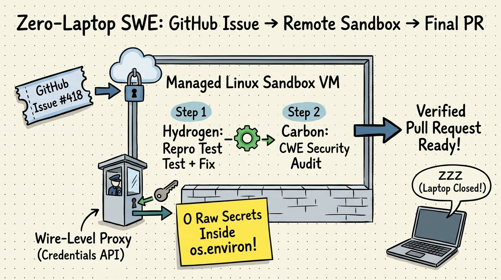
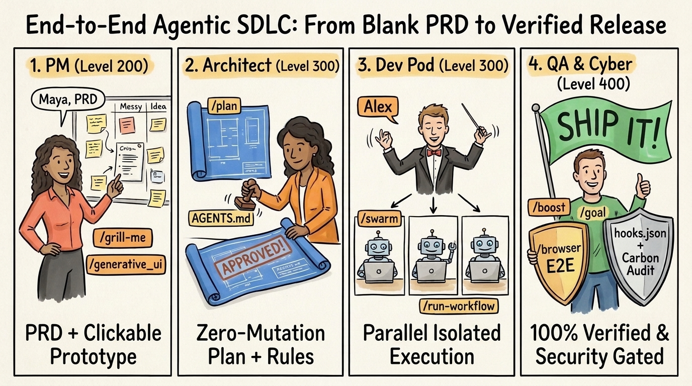

# Workshop: Agentic AI & Multi-Agent Systems — SDK, Sandboxes & Guardrails `[Level 300–400]`



## Workshop Overview

| Field | Details |
| :--- | :--- |
| **Focus** | Architecting governed multi-agent systems with Google Antigravity & `google-genai >= 2.3.0`: the 4-Part Subagent Contract, 3-Tier `SKILL.md` bundles, Managed Agents (`antigravity-preview-09-2026`) + Wire-Level Credentials API, local `Gemma 4` PII scrubbing, and deterministic `hooks.json` gates |
| **Duration** | `2–4 hours` *(4 progressive 45-minute engineering labs)* |
| **Audience** | AI Engineers, Staff/Principal Engineers, Platform Architects, and Application Security Leads |
| **SDK & Model Standard** | `google-genai >= 2.3.0` & `google-antigravity` • `LocalAgentConfig(vertex=True)` • `gemini-4-hydrogen`, `gemini-4-argon`, `gemini-4-carbon`, `gemini-3.5-flash-lite`, local `gemma-4-26b-a4b-it` |
| **Key Labs & Starter Kits** | [Parallel Full-Stack Swarm](../../../../labs/agentic-sdlc/parallel-fullstack-swarm.md) • [Repetitive Framework Upgrades](../../../../labs/migration-modernization/repetitive-framework-upgrades.md) • [GitHub Issue to Remote PR](../../../../labs/agentic-sdlc/github-issue-to-remote-pr.md) • [`starter-kits/tier3-pro-code-and-sdk/`](../../../../starter-kits/tier3-pro-code-and-sdk/enterprise_modernization_agents.py) • [`starter-kits/tier4-architect-fleet-and-sidecar/`](../../../../starter-kits/tier4-architect-fleet-and-sidecar/issue_to_pr_pipeline.py) |
| **Sandbox Target** | [`labs/sandbox-apps/pulsepay-legacy-ledger/`](../../../../labs/sandbox-apps/pulsepay-legacy-ledger/) |

---

## Storyline: Building PulsePay's Governed Multi-Agent Platform

Using an AI coding assistant interactively at your desk is Step 1. **Building autonomous, security-hardened multi-agent pipelines that touch production repositories without leaking secrets or burning quota is Level 400.**

At PulsePay, **Priya** (Principal Architect) and **Sam** (QA & Cyber Lead) have been tapped by the CTO to turn one-off developer prompts into an **Enterprise Multi-Agent Platform**:
- Custom subagents must obey strict read/write scopes without hallucinating file citations.
- Domain runbooks (`SKILL.md`) must stay under `~100` startup tokens until invoked.
- Unattended cloud sandboxes (`antigravity-preview-09-2026`) must open GitHub PRs **without ever placing a raw OAuth token inside `os.environ`**.
- Raw customer merchant logs must have PII scrubbed locally at **`\$0.00` cloud cost** before escalating to cloud reasoning models.



### 💬 Fireside Chat: `os.environ["GITHUB_TOKEN"]` vs. Wire-Level Credentials API

> **DIY Agent Script**: *"Look how easy my container setup is! I just pass `GITHUB_TOKEN=ghp_live_secret123` into `docker run -e` so my coding agent can push branches."*
>
> **Sam (Cyber Lead)**: *"And what happens when your agent runs `pytest` on an untrusted PR or compromised transitive npm package that executes `print(os.environ)` or curls `/proc/self/environ` to an external webhook?"*
>
> **DIY Agent Script**: *"Uh... the attacker walks out the front door with full push access to our entire GitHub org."*
>
> **Sam (Cyber Lead)**: *"Exactly! That's why in Google Antigravity Remote Agents and **Gemini Managed Agents** (`antigravity-preview-09-2026`), we use the **Wire-Level Credentials API** (and `agy-plugin-proxy`). Inside the Linux sandbox VM, `/proc/self/environ` contains **zero real secrets**—only opaque stand-in handles (`agy-h-*`). Real OAuth credentials are injected strictly at the outbound TLS egress proxy exclusively for approved hostnames!"*

---

## Table of Contents

- [Lab 1 — Subagent Boundaries & 3-Tier Progressive `SKILL.md` Design (`45 min`)](#lab-1--subagent-boundaries--3-tier-progressive-skillmd-design-45-min)
- [Lab 2 — Multi-Agent Topologies: Peer `/swarm` vs. Programmatic Fleet SDK (`45 min`)](#lab-2--multi-agent-topologies-peer-swarm-vs-programmatic-fleet-sdk-45-min)
- [Lab 3 — Managed Sandboxes (`antigravity-preview-09-2026`), Credentials API & Local Gemma 4 (`45 min`)](#lab-3--managed-sandboxes-antigravity-preview-09-2026-credentials-api--local-gemma-4-45-min)
- [Lab 4 — Deterministic `hooks.json` Guardrails & `CRON_TZ` SLA Sentinels (`45 min`)](#lab-4--deterministic-hooksjson-guardrails--cron_tz-sla-sentinels-45-min)
- [🕵️ Be the Orchestrator: Audit the Broken Subagent Prompts](#-be-the-orchestrator-audit-the-broken-subagent-prompts)
- [🧲 Prompt Magnets: Assemble Keyless Enterprise SDK Config](#-prompt-magnets-assemble-keyless-enterprise-sdk-config)
- [Verification Rubric & Takeaways](#verification-rubric--takeaways)

---

## Lab 1 — Subagent Boundaries & 3-Tier Progressive `SKILL.md` Design (`45 min`)

- **Reference Implementations**:
  - [`starter-kits/tier3-pro-code-and-sdk/.agents/agents/security-and-finops-auditor.md`](../../../../starter-kits/tier3-pro-code-and-sdk/.agents/agents/security-and-finops-auditor.md)
  - [`_agents/skills/cloud-architecture-readiness/SKILL.md`](../../../../_agents/skills/cloud-architecture-readiness/SKILL.md)

### Step 1: Enforce the 4-Part Subagent Delegation Contract
Per [`AGENTS.md`](../../../../AGENTS.md), every subagent delegation **must** define four explicit boundaries: (1) *Target Scope*, (2) *Permitted Actions*, (3) *File Mutation Policy*, and (4) *Deliverable Contract* (`Verified Facts` vs. `Hypotheses`).

Run this delegation against [`pulsepay-legacy-ledger`](../../../../labs/sandbox-apps/pulsepay-legacy-ledger/) and observe how warm `Idle` subagents preserve context:

```text
Delegate to @research with these 4 strict boundaries:
1. Target Scope: ONLY files inside labs/sandbox-apps/pulsepay-legacy-ledger/.
2. Permitted Actions: Read-only static audit of authentication, monetary rounding, and SQL/storage queries.
3. File Mutation Policy: Do NOT modify, create, or delete any files.
4. Deliverable Contract: Return a markdown table citing exact file:///path#L10-L20 ranges, strictly separating Verified Facts from Hypotheses / Assumptions.
```

Once `@research` finishes and enters `Idle` (`0` tokens burned while parked!), send a follow-up question to that *same* warm subagent rather than spawning a cold duplicate—reusing its `95%` cached prefix (`\$0.075/1M` on `gemini-4-hydrogen`)!

### Step 2: Build a 3-Tier Progressive Disclosure Skill (`~100` Startup Tokens)
Inspect how [`cloud-architecture-readiness/SKILL.md`](../../../../_agents/skills/cloud-architecture-readiness/SKILL.md) keeps `/context` (`⛁`) razor-thin:
- **Tier 1 (Startup YAML Frontmatter)**: Only `name` + `description` (`~100` tokens) loads into `⛁`.
- **Tier 2 (On-Demand `SKILL.md` Body)**: Full instructions load *only* when triggered via `lookup_skill`.
- **Tier 3 (Bundled Scripts in `scripts/`)**: [`verify_release_readiness.py`](../../../../_agents/skills/cloud-architecture-readiness/scripts/verify_release_readiness.py) executes in bash—its Python source never enters LLM context, only its compact JSON output!

**Hands-On Task**: Create a new `_agents/skills/pci-ledger-audit/SKILL.md` with a bundled `scripts/check_integer_cents.py` validator, then verify via `/context` that `⛁` grows by less than `150` tokens!

---

## Lab 2 — Multi-Agent Topologies: Peer `/swarm` vs. Programmatic Fleet SDK (`45 min`)

- **Atomic Labs**: [Parallel Full-Stack Swarm](../../../../labs/agentic-sdlc/parallel-fullstack-swarm.md) • [Repetitive Framework Upgrades](../../../../labs/migration-modernization/repetitive-framework-upgrades.md)
- **SDK Reference**: [`enterprise_modernization_agents.py`](../../../../starter-kits/tier3-pro-code-and-sdk/enterprise_modernization_agents.py) & [`nested_subagent_fleet.py`](../../../../starter-kits/tier4-architect-fleet-and-sidecar/nested_subagent_fleet.py)

### Step 1: Compare Interactive `/swarm` vs. `/run-workflow`
1. Run the coupled multi-worker build in [Parallel Full-Stack Swarm](../../../../labs/agentic-sdlc/parallel-fullstack-swarm.md) (`gemini-4-hydrogen` builders + `gemini-4-carbon` `@verifier` on `Alt+S` Swarm Board).
2. Contrast it with deterministic fan-out in [Repetitive Framework Upgrades](../../../../labs/migration-modernization/repetitive-framework-upgrades.md) using `/run-workflow` (`phase()`, `parallel()`, `pipeline()`).

### Step 2: Run the Programmatic Enterprise Fleet Reference (`vertex=True`)
Inspect and dry-run our pure `google-genai >= 2.3.0` + `google-antigravity` SDK orchestrators (confirming `LocalAgentConfig(vertex=True, project=os.environ["GOOGLE_CLOUD_PROJECT"], location="global")` for keyless ADC billing attribution):

```bash
python3 starter-kits/tier3-pro-code-and-sdk/enterprise_modernization_agents.py --help || true
python3 starter-kits/tier4-architect-fleet-and-sidecar/nested_subagent_fleet.py --dry-run
```

---

## Lab 3 — Managed Sandboxes (`antigravity-preview-09-2026`), Credentials API & Local Gemma 4 (`45 min`)

- **Atomic Lab**: [GitHub Issue to Remote PR](../../../../labs/agentic-sdlc/github-issue-to-remote-pr.md)
- **SDK Reference**: [`issue_to_pr_pipeline.py`](../../../../starter-kits/tier4-architect-fleet-and-sidecar/issue_to_pr_pipeline.py) & [`remote_sandbox_and_deep_research.py`](../../../../starter-kits/tier4-architect-fleet-and-sidecar/remote_sandbox_and_deep_research.py)

### Step 1: Execute the 3-Stage Managed Sandbox Issue-to-PR Pipeline (Dry-Run)
Run the reference pipeline in dry-run mode to inspect the exact 3-stage handoff (**Stage 1–2**: `antigravity-preview-09-2026` on `gemini-4-hydrogen` + Wire-Level Credentials API → **Stage 3**: `gemini-4-carbon` CWE security gate):

```bash
python3 starter-kits/tier4-architect-fleet-and-sidecar/issue_to_pr_pipeline.py --dry-run --issue 418
```

### Step 2: Zero-Cost Local PII Scrubbing Before Cloud Escalation (`Gemma 4`)
Before sending raw merchant dispute logs from `pulsepay-legacy-ledger` to a cloud sandbox or `deep-research-preview-04-2026` (`background=True`), add a local pre-filter stage using **`gemma-4-26b-a4b-it`** (MoE) or **`gemma-4-31b-it`** via `LiteRTAgentConfig`:
- **Cloud Quota Burn**: **`\$0.00`**!
- **Security Win**: Cardholder PANs, emails, and tax IDs are tokenized on-device before a single byte crosses your VPC perimeter.

---

## Lab 4 — Deterministic `hooks.json` Guardrails & `CRON_TZ` SLA Sentinels (`45 min`)

- **Reference Files**:
  - [`_agents/hooks.json`](../../../../_agents/hooks.json) + [`hooks-scripts/gate.py`](../../../../hooks-scripts/gate.py)
  - [`starter-kits/tier4-architect-fleet-and-sidecar/sidecars/incident-sla-sentinel/sidecar.json`](../../../../starter-kits/tier4-architect-fleet-and-sidecar/sidecars/incident-sla-sentinel/sidecar.json)

### Step 1: Stress-Test Non-LLM Lifecycle Hooks (`PreToolUse` & `Stop`)
Prompts are advisory; **Python lifecycle hooks are law.** Inspect [`_agents/hooks.json`](../../../../_agents/hooks.json) and extend [`gate.py`](../../../../hooks-scripts/gate.py) (in an isolated test script or branch) to verify it deterministically blocks:
1. Writing `.env` or GCP Service Account JSON keys (`Zero Credential Persistence`).
2. Destructive commands (`terraform destroy`, `DROP TABLE`, `git push --force origin main`).
3. Unresolved `<<<<<<<` Git merge conflict markers on `Stop`.

### Step 2: Configure a Low-Cost Background Sentinel (`/automation`)
Inspect [`incident-sla-sentinel/sidecar.json`](../../../../starter-kits/tier4-architect-fleet-and-sidecar/sidecars/incident-sla-sentinel/sidecar.json) and use `/automation` to design a `CRON_TZ=America/New_York` sentinel pinned to **`gemini-3.5-flash-lite`** (`Minimal`/`Low` effort — `\$0.25/1M` input, `\$0.025/1M` cached) with least-privilege `access_grants`!

---

## 🕵️ Be the Orchestrator: Audit the Broken Subagent Prompts

Sam is reviewing three junior engineers' subagent & SDK configurations. Spot the **governance violation** in each one per [`AGENTS.md`](../../../../AGENTS.md) and [`GEMINI.md`](../../../../GEMINI.md):

1. `import google.generativeai as genai; model = genai.GenerativeModel("gemini-2.5-pro")`
2. `Invoke @research: "Look around the repo and fix any security bugs you think might exist."`
3. `sidecar.json` cron running every 5 minutes (`*/5 * * * *`) pinned to `gemini-4-carbon` with `effort: "high"` to check if a status page JSON returned `200 OK`.

<details>
<summary><b>🔑 Click to see Sam's Security & FinOps Audit!</b></summary>

1. **Strict Deprecation Violation (`GEMINI.md` §1)**: Both the `google-generativeai` package and `gemini-2.5-*` models are deprecated and prohibited! Must use `google-genai >= 2.3.0` (`from google import genai`) and approved Gemini 4 / 3.x models (`gemini-4-argon`, `gemini-4-hydrogen`, etc.) with `vertex=True`.
2. **Violates All 4 Subagent Delegation Boundaries (`AGENTS.md` §2)**: No explicit directory scope, mutates files inside a discovery task (*must* state *"Do NOT modify any files"*), and lacks `file:///path#L10-L20` citations separating `Verified Facts` from `Hypotheses`.
3. **Massive FinOps Anti-Pattern (`GEMINI.md` §1–2)**: Burning `gemini-4-carbon` (`High` thinking = `\$10–\$20/1M` output rate) 288 times a day on a trivial HTTP status check! Route high-frequency sentinels to **`gemini-3.5-flash-lite`** (`Minimal` effort) or pure Python pre-checks that invoke the model *only* on non-200 anomalies.

</details>

---

## 🧲 Prompt Magnets: Assemble Keyless Enterprise SDK Config

Place the four code tokens into the right slots so PulsePay's Python agent authenticates via **Application Default Credentials / WIF** with zero hardcoded API keys:

```text
[ "global" ]   [ vertex=True ]   [ google-genai >= 2.3.0 ]   [ os.environ["GOOGLE_CLOUD_PROJECT"] ]
```

```python
# Requires package: [1]
from google_antigravity import LocalAgentConfig

config = LocalAgentConfig(
    [2],
    project=[3],
    location=[4],
)
```

<details>
<summary><b>🔑 Solution</b></summary>

1. `google-genai >= 2.3.0` *(paired with `google-antigravity`)*
2. `vertex=True` *(binds execution to Gemini Enterprise / Vertex AI governance & pooled project quota)*
3. `os.environ["GOOGLE_CLOUD_PROJECT"]`
4. `"global"`

</details>

---

## 🙋 There Are No Dumb Questions

**Q: When should I write a custom Python agent with `google-genai` vs. using built-in `/swarm` or `/run-workflow`?**
> **A:** Use built-in **`/swarm`** and **`/run-workflow`** inside Antigravity whenever engineers or CI jobs are orchestrating repo tasks—zero custom boilerplate to maintain! Drop down to programmatic Python SDK (`google-genai >= 2.3.0` + `antigravity-preview-09-2026`) when embedding autonomous sandboxes behind custom internal portals, Slack/PagerDuty bots, or multi-system enterprise buses.

## 💥 Watch Out!

> [!CAUTION]
> **Strict SDK & Model Deprecation Gate**: Never copy legacy snippets from old blog posts importing `google-generativeai` or referencing `gemini-1.5-*`, `gemini-2.0-*`, or `gemini-2.5-*`. Always enforce `google-genai >= 2.3.0` and Gemini 4 (`Hydrogen`, `Argon`, `Carbon`) or approved Gemini 3.5/3.8 Flash/Lite tiers!

---

## Verification Rubric & Takeaways

- **Deterministic Verification**:
  - `issue_to_pr_pipeline.py --dry-run` and `nested_subagent_fleet.py --dry-run` exit with code `0`.
  - Custom 3-tier `SKILL.md` adds `< 150` startup tokens in `/context` (`⛁`) and its bundled script passes `/goal`.
  - `hooks.json` + `gate.py` deterministically blocks simulated `.env` writes.
- **📌 Bullet Points**:
  - **4 Boundaries Every Time**: Scope, Permitted Actions, Read-Only Mutation Policy (for audits), and Verified Facts vs. Hypotheses.
  - **Wire-Level Secrets Only**: Keep raw OAuth tokens out of `os.environ` using the Managed Agents **Credentials API** and `agy-plugin-proxy`.
  - **Match Brain to Economics**: `Gemma 4` locally (`\$0.00`) for PII scrubbing → `gemini-3.5-flash-lite` for cron sentinels → `gemini-4-hydrogen` for `80%` execution → `gemini-4-carbon` for frontier verification.

← Previous: [App Maintenance](../../../by-tech-role/development/app-maintenance/README.md) | Back to [Workshops Hub](../../../README.md) | Next Flagship: [Agentic SDLC at Scale](../agentic-sdlc/README.md) →
