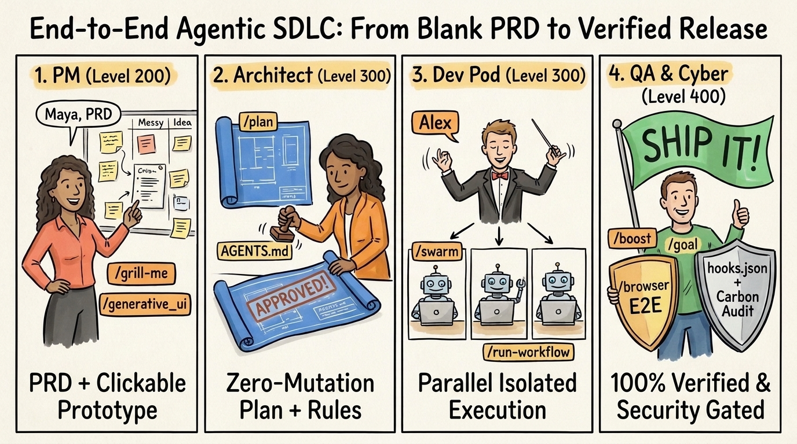
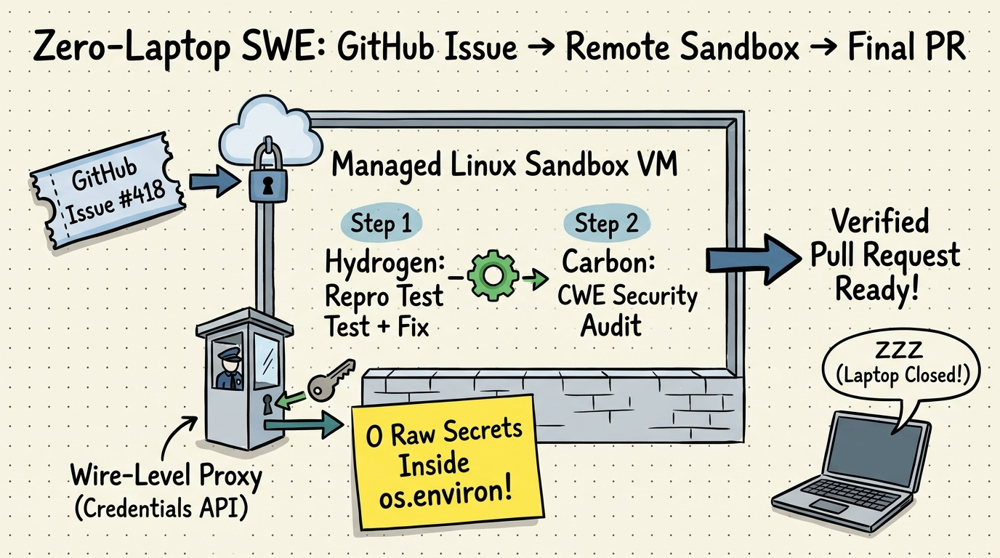
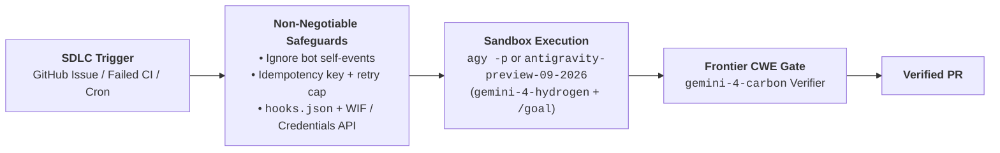

# Workshop: The End-to-End Agentic SDLC — Self-Healing QA & Autonomous Delivery at Scale `[Level 200–400]`



## Workshop Overview

| Field | Details |
| :--- | :--- |
| **Focus** | Full-lifecycle agentic software engineering: PM spec alignment (`/grill-me` + `/generative_ui`), codebase blast-radius & golden-file intelligence, self-healing `/goal` + `/browser` QA pipelines, keyless Issue-to-PR sandboxes (`agy -p`), and parallel multi-stream modernization (`/swarm` + `/run-workflow` + `/teamwork`) |
| **Duration** | `1 Full Day` *(4 progressive 90-minute sessions)* • Also sliceable into `Half-Day` or `2-Hour Executive` formats |
| **Audience** | Engineering Directors, Staff/Principal Architects, SDET & QA Leads, Platform/SRE Teams, and Product Engineering Pods |
| **Prerequisites** | Basic Git & CI/CD fluency; review [`AGENTS.md`](../../../../AGENTS.md) and [`GEMINI.md`](../../../../GEMINI.md) before Session 1 |
| **Sandbox Target** | [`labs/sandbox-apps/pulsepay-legacy-ledger/`](../../../../labs/sandbox-apps/pulsepay-legacy-ledger/) |

---

## Learning Objectives

By the end of this full-day immersion, your engineering organization will be able to:
1. **Unify PM, Architecture, Dev, and QA** across Antigravity's five execution surfaces (**Knowledge Work** ↔ **Software Engineering** App layouts, `agy` CLI, IDE extensions, Cloud Remote Agents, and Remote Control).
2. **Engineer Razor-Sharp Context & Tokenomics**—preserving Gemini 4's **`95%` implicit cached-input discount** (`\$1.50` → `\$0.075/1M` on `gemini-4-hydrogen`) using `@research` isolation, `/context`, `/btw`, `/rewind`, and 3-tier `SKILL.md` progressive disclosure.
3. **Build Self-Healing Verification Pipelines** combining golden-file parity harnesses, `/boost` adversarial root-cause proofs, `/goal` exit-code convergence, and live `/browser` Chromium E2E checks.
4. **Automate Zero-Laptop Issue-to-PR Delivery** using Cloud Remote Agents, keyless WIF GitHub Actions (`agy -p --json-schema` + `AGY_ADC_AUTH=true`), and Managed Agents (`antigravity-preview-09-2026`) with Wire-Level Credentials API + deterministic `hooks.json` gates.
5. **Execute Parallel Multi-Stream Modernization** combining `/swarm` (coupled layers + `gemini-4-carbon` `@verifier`), `/run-workflow` (portfolio fan-out), and `/automation` (`CRON_TZ` `sidecar.json` sentinels).

### Quick Jump for Experienced Practitioners
Already fluent in Antigravity basics? Jump straight into the hands-on labs:
- [Lab 1B: PRD → Plan → Clickable Prototype](#lab-1b--prd-to-clickable-prototype-45-min) • [Lab 2A: Parity Harness](#lab-2a--golden-file-parity--blast-radius-map-40-min) • [Lab 2B: Cross-Service `/boost` Forensics](#lab-2b--cross-service-contract-bug-forensics-35-min) • [Lab 3A: Self-Healing `/goal` + `/browser`](#lab-3a--self-healing-qa--live-browser-e2e-40-min) • [Lab 3B: Keyless Issue-to-PR](#lab-3b--zero-laptop-github-issue-to-verified-pr-40-min) • [Lab 4B: 3-Stream Modernization Capstone](#lab-4b--the-3-stream-parallel-modernization-capstone-50-min)

---

## 💬 Fireside Chat: One-Off Prompt Heroics vs. An Institutionalized Agentic SDLC

> **VP of Engineering**: *"Half my developers already use terminal AI tools—why aren't our sprint cycle times or regression bug rates dropping by 50% yet?"*
>
> **Priya (Principal Architect)**: *"Because speed inside a single coding tab doesn't fix upstream ambiguity or downstream QA bottlenecks! If **Maya** (PM) hands over a vague spec, **Alex** (Dev) just generates the wrong feature 5x faster—and **Sam** (QA/Security) gets buried under unverified PRs on Thursday night."*
>
> **VP of Engineering**: *"So what changes when we wire the *entire* SDLC around Antigravity?"*
>
> **Priya (Principal Architect)**: *"Four compounding loops: (1) Maya catches edge cases on Day 1 with `/grill-me` and `/generative_ui`; (2) `AGENTS.md`, scoped `_agents/rules/`, and 3-tier `SKILL.md` files share institutional memory across every seat automatically; (3) `/goal`, `/browser`, `gemini-4-carbon` `@verifier`s, and `hooks.json` block regressions *before* human review; and (4) headless `agy -p` pipelines and `gemini-3.5-flash-lite` `/automation` sentinels heal CI drift while everyone sleeps!"*

---

## Session 1 (`90 min`) — Foundations & Governance: Surfaces, Memory & Spec Alignment

### 1A: Mapping SDLC Roles to Antigravity Topologies (`20 min`)

| SDLC Function | Antigravity Primitive | Recommended Gemini 4 / 3.x Brain | Why It Wins |
| :--- | :--- | :--- | :--- |
| **Spec Stress-Test & UI Mockup** | `/plan /grill-me` + `/generative_ui` | `gemini-4-argon` + `gemini-3.8-flash` | Zero code mutated until edge cases & visual UX are signed off |
| **Everyday Feature & Refactor** | Intra-turn **`Orchestrator`** | `Carbon/Argon` ↔ `Hydrogen` | **`-24%` quota burn, `+19%` faster** vs. standalone frontier chat |
| **Coupled Full-Stack Build** | **`/swarm`** (`Alt+S` Board) | `gemini-4-hydrogen` + `gemini-4-carbon` `@verifier` | Isolated working copies + `0`-token `Waiting` sleep + cross-model audit |
| **Portfolio SDK / Framework Bump** | **`/run-workflow`** | Stage 1 `Hydrogen` → Stage 2 `Argon` | Deterministic JSON-schema verdicts with zero peer-chat waste |
| **Multi-Day Subsystem Build** | **`/teamwork`** | Milestone Orchestrators + Critics | Autonomous milestone gates in `~/teamwork_projects/{NAME}` |
| **Continuous Cron Sentinel** | **`/automation`** (`sidecar.json`) | `gemini-3.5-flash-lite` (`Minimal`/`Low`) | `\$0.25/1M` input (`\$0.025/1M` cached) for high-frequency hygiene |

### 1B: The Shared Organizational Memory Layer (`25 min`)
Walk through how this repository encodes living standards so no engineer starts from a blank slate:
- **[`AGENTS.md`](../../../../AGENTS.md)** (`100 KB` hierarchical walk) + **[`GEMINI.md`](../../../../GEMINI.md)** (model routing, `vertex=True` ADC, thinking-token FinOps).
- **Scoped Rules (`_agents/rules/`)**: [`terraform_and_gcp_security.md`](../../../../_agents/rules/terraform_and_gcp_security.md) (`glob` trigger) & [`bigquery_finops.md`](../../../../_agents/rules/bigquery_finops.md) (`model_decision` trigger).
- **3-Tier Skills (`_agents/skills/`)**: [`cloud-architecture-readiness/SKILL.md`](../../../../_agents/skills/cloud-architecture-readiness/SKILL.md) (`~100` startup tokens in `⛁`).

### Lab 1B — PRD to Clickable Prototype (`45 min`)
- **Atomic Module**: [PRD to Clickable Prototype](../../../../labs/agentic-sdlc/prd-to-clickable-prototype.md)
- **Hands-On**: Pair up as **Maya** + **Priya** on [`pulsepay-legacy-ledger`](../../../../labs/sandbox-apps/pulsepay-legacy-ledger/). Run `/plan /grill-me` to stress-test PulsePay's **Instant Refund Guard & Settlement Hold** PRD (catching cumulative partial-refund and idempotency edge cases), then render a clickable HTML prototype via `/generative_ui`!

---

## Session 2 (`90 min`) — Codebase Intelligence, Blast-Radius Mapping & Forensics

### 2A: Context Engineering Discipline (`15 min`)
Run **`/context`** in the CLI and inspect the four zones (`⛁` Startup Overhead, `◉` Active Trajectory, `□` Free Runway, `⊠` Compaction Buffer). Practice the golden habits: delegate broad scans to read-only `@research` subagents, ask side questions via `/btw`, and `/rewind` failed experiments immediately.

### Lab 2A — Golden-File Parity & Blast-Radius Map (`40 min`)
- **Atomic Module**: [Migration Test Harness](../../../../labs/migration-modernization/migration-test-harness.md)
- **Hands-On**:
  1. Delegate a read-only `@research` subagent across `pulsepay-legacy-ledger` to map coupled settlement modules with exact `file:///path#L10-L20` citations.
  2. Render an interactive blast-radius dependency explorer inline via `/generative_ui`.
  3. Build golden JSON reference outputs and reconciliation checks, locking baseline parity with `/goal`.

### Lab 2B — Cross-Service Contract Bug Forensics (`35 min`)
- **Atomic Module**: [Cross-Service Bug Investigation](../../../../labs/migration-modernization/cross-service-bug-investigation.md)
- **Hands-On**: Use `@research` + **`/boost`** adversarial challenge rounds to trace why a `\$149.99` settlement renders as `\$1.50` across service boundaries, prove it with a failing regression test, fix the contract mismatch, and codify the invariant via `/learn`.

---

## Session 3 (`90 min`) — Self-Healing QA, Browser E2E & Autonomous Issue-to-PR



### 3A: Event-Driven SDLC Hooks & Loop Safeguards (`10 min`)



### Lab 3A — Self-Healing QA & Live Browser E2E (`40 min`)
- **Atomic Module**: [Self-Healing QA & Browser E2E](../../../../labs/agentic-sdlc/self-healing-qa-and-browser.md)
- **Hands-On**: Join **Sam** to drive unit, integration, and coverage checks to exit code `0` via **`/goal`**, then execute live Chromium DOM, network, and console verification via **`/browser`**—capturing visual release evidence!

### Lab 3B — Zero-Laptop GitHub Issue to Verified PR (`40 min`)
- **Atomic Module**: [GitHub Issue to Remote PR](../../../../labs/agentic-sdlc/github-issue-to-remote-pr.md)
- **Reference Starter Kits**: [`github-actions-issue-to-pr.yml`](../../../../starter-kits/tier4-architect-fleet-and-sidecar/github-actions-issue-to-pr.yml) & [`issue_to_pr_pipeline.py`](../../../../starter-kits/tier4-architect-fleet-and-sidecar/issue_to_pr_pipeline.py)
- **Hands-On**: Dispatch an issue via `agy --remote-agent` or run headless `agy -p` with `--output-format json --json-schema` (`AGY_ADC_AUTH=true`), followed by a `gemini-4-carbon` security review and a weekday `/automation` (`CRON_TZ`) drift sentinel!

---

## Session 4 (`90 min`) — Forward Engineering & The Parallel Modernization Capstone

### Lab 4A — Coupled Forward Engineering with `/swarm` (`40 min`)
- **Atomic Module**: [Parallel Full-Stack Swarm](../../../../labs/agentic-sdlc/parallel-fullstack-swarm.md)
- **Hands-On**: Implement Maya's approved Instant Refund Guard feature across schema, API, and UI workers (`gemini-4-hydrogen`) in isolated working copies (`Alt+S` Swarm Board), gated by a read-only `gemini-4-carbon` `@verifier`.

### Lab 4B — The 3-Stream Parallel Modernization Capstone (`50 min`)
- **Atomic Modules Combined**:
  1. [Legacy Monolith Decomposition](../../../../labs/migration-modernization/legacy-monolith-decomposition.md)
  2. [Cloud-Native Refactor](../../../../labs/migration-modernization/cloud-native-refactor.md)
  3. [Repetitive Framework Upgrades](../../../../labs/migration-modernization/repetitive-framework-upgrades.md)
- **Capstone Challenge**: Coordinate a **three-stream modernization campaign** across [`pulsepay-legacy-ledger`](../../../../labs/sandbox-apps/pulsepay-legacy-ledger/) while keeping Session 2's golden-file parity harness `100%` green:

```text
/swarm Coordinate PulsePay's 3-stream modernization capstone inside labs/sandbox-apps/pulsepay-legacy-ledger/ using isolated working copies:
- @extraction-worker (gemini-4-argon, high effort): Extract the fee & settlement calculation domain behind a clean service interface while preserving all Session 2 golden-file parity checks.
- @cloud-worker (gemini-4-hydrogen, high effort): Add /healthz and /readyz probes, structured JSON logging, externalized env config (zero hardcoded secrets), and a multi-stage non-root Dockerfile passing cloud-architecture-readiness.
- @upgrade-worker (gemini-4-hydrogen, medium effort): Upgrade downstream client adapters to the v2 idempotent contract and run unit suites per adapter.
- @verifier (pin to gemini-4-carbon, high effort): Do NOT modify production files. Run the full golden-file parity + unit test suite, audit all three diffs for CWE/rounding/config regressions, and synthesize MODERNIZATION_READINESS.md.
```

---

## 🕵️ Be the Orchestrator: Enterprise Quota & FinOps Architecture

PulsePay has **`100` Gemini Enterprise seats** in `gcp-prod-eng` (`location="global"`): 30 Staff/Senior SWEs modernizing services heavily all week, and 70 PMs, Designers, and Analysts running light `/grill-me` and `/generative_ui` sessions.

Calculate why **Pooled Quota + Two-Axis Routing** beats static frontier-only setups:
1. What happens to the unused weekly quota from the 70 light seats?
2. If the 30 SWEs switch routine coding from standalone `gemini-4-carbon` (`\$4.00/\$20.00` standard) to `gemini-4-hydrogen` (`\$1.50/\$7.50`, `\$0.075` cached) + 1 final `Carbon` `@verifier` pass, what happens to sprint capacity?

<details>
<summary><b>🔑 Click for the FinOps Architect Breakdown!</b></summary>

1. **Rolling 7-Day Shared Project Pool**: In Gemini Enterprise (`LocalAgentConfig(vertex=True)`), included seat credits pool across all `100` seats of the same edition in the Google Cloud project—meaning the 70 light seats automatically subsidize the 30 heavy modernization engineers with zero manual credit transfers!
2. **4x–10x Effective Throughput Multiplier**: Routing `80%` of execution turns onto `gemini-4-hydrogen` with a lean context window (`95%` implicit cached input at `\$0.075/1M`) and reserving `gemini-4-carbon` strictly for `/boost` and final `@verifier` CWE gates cuts per-feature token spend from `~\$3.34` down to `~\$0.35–\$0.86`—stretching the shared weekly pool up to **4x–10x further** while *increasing* security rigor!

</details>

---

## 🧲 Prompt Magnets: Keyless GitHub Actions Headless CLI (`agy -p`)

Unscramble the four flags so Sam's GitHub Actions runner executes `agy -p` safely inside an OS sandbox using **Workload Identity Federation** (zero static API keys!) and emits machine-parseable JSON:

```text
[ --sandbox ]   [ AGY_ADC_AUTH=true ]   [ --json-schema '{"type":"object","required":["tests_passed"]}' ]   [ --output-format json ]
```

```bash
export [1]
agy -p "Fix Issue #418 with reproduction test first and run pytest." \
  --model gemini-4-hydrogen \
  [2] \
  --dangerously-skip-permissions \
  [3] \
  [4]
```

<details>
<summary><b>🔑 Solution</b></summary>

1. `AGY_ADC_AUTH=true` *(authenticates via Google Cloud WIF ambient credentials—zero static secrets in GitHub!)*
2. `--sandbox` *(isolates filesystem/process execution inside the CI runner)*
3. `--output-format json`
4. `--json-schema '{"type":"object","required":["tests_passed"]}'` *(guarantees downstream CI steps can parse deterministic fields)*

</details>

---

## 🙋 There Are No Dumb Questions

**Q: How do we prevent event-driven CI/webhook agents from triggering an infinite PR loop at 2:00 AM?**
> **A:** Four mandatory circuit breakers (Session 3A): (1) Filter out bot-authored events (`actor != antigravity-bot`) at the webhook router; (2) Enforce an idempotency key per `(repo, commit_sha, workflow_run_id)`; (3) Cap retries (`max_attempts = 2`) before escalating to human review; and (4) Keep [`_agents/hooks.json`](../../../../_agents/hooks.json) active inside the runner so protected branches (`main`) can never be force-pushed.

## 💥 Watch Out!

> [!WARNING]
> **Don't Let 12 Idle MCP Servers Eat Your Startup Budget (`⛁`)!** Every enabled MCP server injects all of its tool JSON schemas on Turn 1. Run `/mcp` before Session 2 and disable unused connectors so `⛁` stays lean (`< 35k` tokens) and `95%` cache hits stay blazing fast!

---

## Suggested Formats, Deliverables & Mastery Checklist

### Suggested Delivery Formats

| Format | Duration | Sessions Included |
| :--- | :--- | :--- |
| **Full-Day Flagship Bootcamp** | `~6 hours` *(4 × 90m)* | Sessions 1 → 2 → 3 → 4 in sequence |
| **Half-Day Architecture & Quality Track** | `3 hours` | Session 1 (Governance & Spec) + Session 3 (Self-Healing QA & Issue-to-PR) |
| **Half-Day Modernization & Execution Track** | `3 hours` | Session 2 (Parity & `/boost` Forensics) + Session 4 (`/swarm` & 3-Stream Capstone) |
| **Executive & Staff Leadership Overview** | `2 hours` | Session 1A/1B + Live Lab 1B (`/generative_ui`) + Lab 3B (`agy -p`) + FinOps Exercise |

### Concrete Artifacts You Leave With

| Session | Tangibles Committed or Generated |
| :--- | :--- |
| **Session 1** | Signed-off `implementation_plan.md` + standalone `/generative_ui` Ops Override HTML prototype |
| **Session 2** | Golden-file parity test suite + interactive blast-radius widget + cross-service regression test |
| **Session 3** | `100%` green `/goal` suite + `/browser` visual evidence + keyless `agy -p` JSON verdict + `sidecar.json` sentinel |
| **Session 4** | Parallel `/swarm` feature diff + 3-stream `MODERNIZATION_READINESS.md` audited by `gemini-4-carbon` |

### Antigravity Practitioner Mastery Checklist
Track what you experience live during the workshop:
- [ ] Toggle between **Knowledge Work** and **Software Engineering** layouts in the Antigravity App
- [ ] Stack `/plan /grill-me` for zero-mutation requirement & architecture alignment
- [ ] Render a clickable prototype or architecture simulator via `/generative_ui`
- [ ] Inspect token breakdown in `/context` (`⛁`, `◉`, `□`, `⊠`) and ask a zero-pollution question via `/btw`
- [ ] Delegate a read-only scan to `@research` using the 4-Part Delegation Contract (and reuse it while `Idle`)
- [ ] Crush a cross-service or concurrency bug with `/boost`
- [ ] Converge tests to exit code `0` with `/goal` and validate live DOM/console via `/browser`
- [ ] Watch parallel workers + a `gemini-4-carbon` `@verifier` coordinate on the `/swarm` board (`Alt+S`)
- [ ] Run deterministic portfolio upgrades via `/run-workflow` or headless `agy -p --json-schema`
- [ ] Codify a new `SKILL.md` via `/learn` and configure a `CRON_TZ` `sidecar.json` via `/automation`

---

## 📌 Bullet Points

- **Shift Left on Ambiguity**: `/grill-me` + `/plan` + `/generative_ui` eliminate 80% of rework before coding starts.
- **Isolate Noisy Work**: Keep discovery in `@research`, repetitive upgrades in `/run-workflow`, coupled builds in `/swarm`, and tangents in `/btw`.
- **Never Trust Unverified Diffs**: Pair deterministic gates (`/goal`, `/browser`, `hooks.json`) with cross-model `gemini-4-carbon` verification.
- **Make Autonomy Safe & Cheap**: Wire-level Credentials API + WIF (`AGY_ADC_AUTH=true`) protect secrets, while `gemini-4-hydrogen` (`95%` cached) + `gemini-3.5-flash-lite` sentinels stretch your pooled quota across the whole org.

← Previous: [Agentic AI & Multi-Agent Systems](../agentic-ai/README.md) | Back to [Workshops Hub](../../../README.md)
