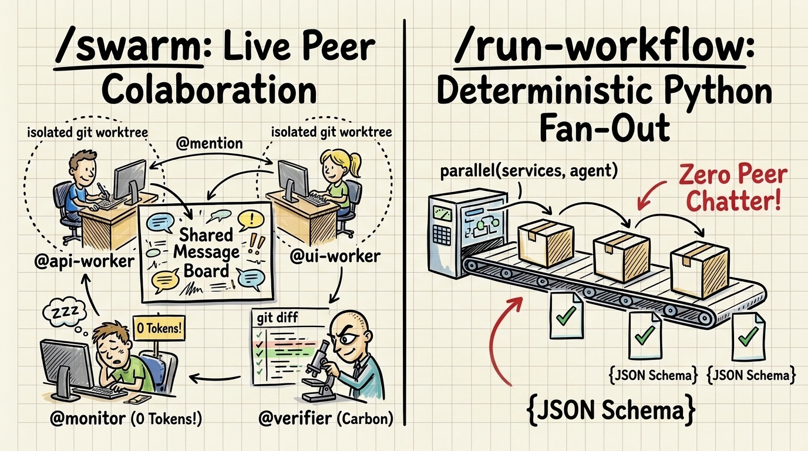
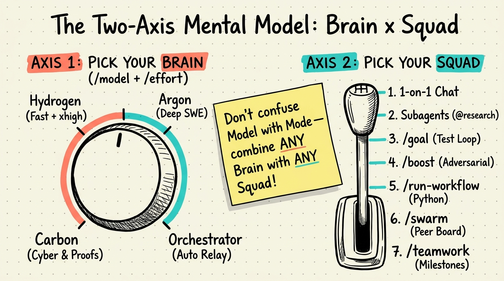

# Workshop: Application Development, Bug Forensics & Fleet Maintenance `[Level 200–400]`



## Workshop Overview

| Field | Details |
| :--- | :--- |
| **Focus** | Keeping mission-critical production applications healthy, bug-free, and modern: golden-file safety harnesses, cross-service `/boost` root-cause forensics, `/run-workflow` fleet upgrades, 12-factor refactoring, and overnight `/automation` sentinels |
| **Duration** | Flexible Modular Format: `4–6 hours` *(Full Day — All 3 Tracks)* • `3 hours` *(Half Day — Pick 2 Tracks)* • `90 min` *(Sampler — A1 + B1 + C1)* |
| **Audience** | Application Owners, Full-Stack & Backend Engineers, Sustaining Engineering Pods, and Modernization Leads |
| **Tracks** | **Track A:** Safe Feature & Schema Evolution • **Track B:** Cross-Service Bug & Race-Condition Forensics • **Track C:** Fleet Upgrades, Cloud-Native Refactor & Autonomous Sentinels |
| **Sandbox Target** | [`labs/sandbox-apps/pulsepay-legacy-ledger/`](../../../../labs/sandbox-apps/pulsepay-legacy-ledger/) |

---

## Storyline: Inheriting the Ledger That Pays the Bills

Greenfield apps are easy. **Production maintenance is where real engineering happens.**

**Alex**'s pod just inherited [`pulsepay-legacy-ledger`](../../../../labs/sandbox-apps/pulsepay-legacy-ledger/)—the five-year-old core settlement service processing millions of merchant payouts daily. On Day 1, the pager queue looks like a horror movie:
1. **Zero safety net**: Legacy payout calculations have undocumented rounding rules and zero characterization tests.
2. **A spooky cross-service bug**: Merchant confirmation receipts are rendering a `\$149.99` settlement as `\$1.50` after an event-schema handoff!
3. **Portfolio tech debt**: Twelve downstream webhook modules are pinned to an outdated client SDK, configuration secrets are hardcoded instead of externalized, and nobody notices Dependabot drift until Friday afternoon.

Instead of playing whack-a-mole one terminal tab at a time, **Alex**, **Priya**, and **Sam** use Google Antigravity's full toolkit—matching the right Gemini 4 brain and multi-agent topology to every phase of the application lifecycle!



### 💬 Fireside Chat: `/swarm` Peer Mesh vs. `/run-workflow` Map-Reduce

> **Alex (Dev Lead)**: *"Priya, we need to upgrade 12 merchant webhook modules from `ledger-sdk v1` to `v2`. I loved `/swarm` yesterday—should I spawn a 12-worker `/swarm`?"*
>
> **Priya (Architect)**: *"Stop right there! Ask yourself one question: **Does `merchant-billing` need to debate API field names with `merchant-reporting` while upgrading?**"*
>
> **Alex (Dev Lead)**: *"No, every module is completely independent—same upgrade recipe, run its tests, report pass or fail."*
>
> **Priya (Architect)**: *"Bingo! If you put 12 independent upgrades on a `/swarm` message board, peer chatter just wastes tokens. Use **`/run-workflow`** instead! Stage 1 fans out parallel **`gemini-4-hydrogen`** workers (`\$1.50/1M` input, `\$0.075/1M` cached), forces each worker to return a strict JSON verdict `{module, files_changed, tests_passed, error_summary}`, and escalates *only* the 1 or 2 tricky failures to a Stage 2 **`gemini-4-argon`** specialist. Save `/swarm` for when coupled layers actually need to talk!"*

---

## Table of Contents

- [Track A: Safe Feature & Schema Evolution (`Labs A1–A3`)](#track-a-safe-feature--schema-evolution-labs-a1a3)
- [Track B: Cross-Service Bug & Race-Condition Forensics (`Labs B1–B3`)](#track-b-cross-service-bug--race-condition-forensics-labs-b1b3)
- [Track C: Fleet Upgrades, Cloud-Native Refactor & Autonomous Sentinels (`Labs C1–C3`)](#track-c-fleet-upgrades-cloud-native-refactor--autonomous-sentinels-labs-c1c3)
- [🕵️ Be the Orchestrator: Triage Alex's Monday Pager Queue](#-be-the-orchestrator-triage-alexs-monday-pager-queue)
- [🧲 Prompt Magnets: Build a 2-Stage `/run-workflow` Pipeline](#-prompt-magnets-build-a-2-stage-run-workflow-pipeline)
- [Additional Challenges & Suggested Formats](#additional-challenges--suggested-formats)

---

## Track A: Safe Feature & Schema Evolution (`Labs A1–A3`)

Before changing legacy code, great maintainers build an unbreakable behavioral baseline.

### Lab A1 — Build a Golden-File Parity Harness *Before* Touching Legacy Code (`45 min`)
- **Atomic Module**: [Migration Test Harness](../../../../labs/migration-modernization/migration-test-harness.md)
- **Recommended Brain × Squad**: Read-only `@research` (`gemini-4-hydrogen`, `/effort low`) → `Orchestrator (Argon)` + `/goal`
- **Hands-On Flow**:
  1. **Delegate Discovery Without Context Bloat**: Spawn `@research` (*"Inspect `labs/sandbox-apps/pulsepay-legacy-ledger/`—do NOT modify any files. Map every batch settlement input/output format and rounding boundary with exact `file:///path#L10-L20` citations."*)
  2. **Generate Golden Snapshots & Reconciliation Checks**: Build deterministic golden JSON snapshots and reconciliation assertions (input record count = output count, integer-cents sum parity, fee balance invariants).
  3. **Lock with `/goal`**: Run `/goal` against your parity harness command until baseline verification exits `0`.
- **Target Outcomes**: `TEST_STRATEGY.md`, golden reference fixtures, runnable field-by-field parity checker passing `100%`.

### Lab A2 — Ship a New Endpoint Without Breaking Legacy Callers (`45 min`)
- **Atomic Modules**: [PRD to Clickable Prototype](../../../../labs/agentic-sdlc/prd-to-clickable-prototype.md) + [Parallel Full-Stack Swarm](../../../../labs/agentic-sdlc/parallel-fullstack-swarm.md)
- **Recommended Brain × Squad**: `/plan /grill-me` → `/swarm` (`Hydrogen` workers + `Carbon` `@verifier`)
- **Hands-On Flow**:
  1. Stack `/plan /grill-me` to design a backward-compatible **Merchant Settlement Hold API** on `pulsepay-legacy-ledger` without breaking v1 callers.
  2. Preview the Ops Hold view via `/generative_ui`, then implement in parallel via `/swarm` while keeping Lab A1's parity tests green!

### Lab A3 — Zero-Downtime Schema & Warehouse FinOps Evolution (`40 min`)
- **Scoped Rule Exercised**: [`_agents/rules/bigquery_finops.md`](../../../../_agents/rules/bigquery_finops.md) *(loaded automatically via `model_decision` only when SQL/warehouse files are touched!)*
- **Hands-On Flow**:
  1. Add a versioned expand-and-contract schema migration to split a legacy denormalized `merchant_address_blob` column into structured fields while preserving dual-read compatibility.
  2. Generate the downstream BigQuery settlement reconciliation view—and watch Antigravity automatically enforce partition filters, clustering keys, and zero `SELECT *` scans per `bigquery_finops.md`!

---

## Track B: Cross-Service Bug & Race-Condition Forensics (`Labs B1–B3`)

Stop guessing at production bugs with `print()` debugging—force hypotheses through adversarial proof.

### Lab B1 — Cross-Service Contract & Cents-vs-Dollars Bug Investigation (`45 min`)
- **Atomic Module**: [Cross-Service Bug Investigation](../../../../labs/migration-modernization/cross-service-bug-investigation.md)
- **Recommended Brain × Squad**: `@research` (`Hydrogen`) + `/boost` (`DeepInvestigator`)
- **The Symptom**: A merchant settles an order for `\$149.99`, but the downstream receipt notification renders **`\$1.50`**!
- **Hands-On Flow**:
  1. Launch a read-only `@research` trace across producer event payloads, shared contract schemas, and consumer formatters in `pulsepay-legacy-ledger` (*"Separate Verified Facts with line numbers from Hypotheses; do NOT modify files"*).
  2. Write a failing reproduction test proving the unit mismatch (integer cents `14999` vs. decimal dollars `149.99` divided by `100` twice!).
  3. Apply the minimal contract-faithful fix, verify via `/goal`, and run `/learn` to codify a `monetary-unit-contract` rule so unit-drift bugs never return.

### Lab B2 — Crushing Retry-Storm Race Conditions with `/boost` (`45 min`)
- **Recommended Brain × Squad**: `/boost` (`gemini-4-carbon` / adversarial challenge rounds)
- **Hands-On Flow**:
  1. Trigger `/boost` on duplicate webhook delivery retries in `pulsepay-legacy-ledger`:
     ```text
     /boost Concurrent duplicate settlement webhooks arriving within 20ms occasionally bypass the read-then-write status check in labs/sandbox-apps/pulsepay-legacy-ledger/ and credit a merchant twice. Prove the exact TOCTOU race condition, write a deterministic concurrent test that fails reliably before the fix, implement atomic idempotency locking, and prove 100/100 concurrent runs pass.
     ```
  2. Use `/btw` while `/boost` executes challenge rounds to explore optimistic vs. pessimistic locking trade-offs without polluting your trajectory.

### Lab B3 — Visual DOM & Console Regression Exorcism (`35 min`)
- **Atomic Module**: [Self-Healing QA & Browser E2E](../../../../labs/agentic-sdlc/self-healing-qa-and-browser.md)
- **Hands-On Flow**:
  1. Combine `/browser` and `/goal` to catch a silent UI bug that unit tests missed (broken filter state + unhandled promise rejection in browser console), repair it, and capture before/after screenshot artifacts.

---

## Track C: Fleet Upgrades, Cloud-Native Refactor & Autonomous Sentinels (`Labs C1–C3`)

Turn heroic weekend maintenance marathons into repeatable, automated platform engineering.

### Lab C1 — Repetitive Framework & SDK Upgrades at Scale via `/run-workflow` (`50 min`)
- **Atomic Module**: [Repetitive Framework Upgrades](../../../../labs/migration-modernization/repetitive-framework-upgrades.md)
- **Recommended Brain × Squad**: `/run-workflow` (`gemini-4-hydrogen` Stage 1 parallel fan-out → `gemini-4-argon` Stage 2 escalation)
- **Hands-On Flow**:
  1. Encode the upgrade checklist once, then launch `/run-workflow` across multiple modules/adapters simultaneously—returning schema-validated JSON `{target, breaking_changes_fixed, tests_passed}` rather than unstructured prose!
  2. Inspect `/context` to see how isolating each module in its own Hydrogen worker preserves lean context windows (`95%` implicit cache discount).

### Lab C2 — Twelve-Factor Cloud-Native Refactor & Monolith Strangler Extraction (`55 min`)
- **Atomic Modules**: [Cloud-Native Refactor](../../../../labs/migration-modernization/cloud-native-refactor.md) + [Legacy Monolith Decomposition](../../../../labs/migration-modernization/legacy-monolith-decomposition.md)
- **Workspace Skill Exercised**: [`_agents/skills/cloud-architecture-readiness/SKILL.md`](../../../../_agents/skills/cloud-architecture-readiness/SKILL.md)
- **Hands-On Flow**:
  1. Refactor `pulsepay-legacy-ledger` for Cloud Run / GKE readiness: `/healthz` + `/readyz` probes, structured JSON telemetry, graceful SIGTERM drain, multi-stage non-root `Dockerfile`, and zero hardcoded secrets (ADC / WIF ready).
  2. Run the Tier-3 executable readiness script inside `cloud-architecture-readiness` (`verify_release_readiness.py`) via `/goal`—notice how its 300 lines of Python run in bash without bloating your LLM context!
  3. *(Stretch)* Extract the fee-calculation domain into an isolated service boundary following [Legacy Monolith Decomposition](../../../../labs/migration-modernization/legacy-monolith-decomposition.md).

### Lab C3 — Zero-Laptop Issue-to-PR & `CRON_TZ` Hygiene Sentinels (`45 min`)
- **Atomic Module**: [GitHub Issue to Remote PR](../../../../labs/agentic-sdlc/github-issue-to-remote-pr.md)
- **Hands-On Flow**:
  1. Dispatch a maintenance GitHub Issue directly to a **Cloud Remote Agent** (`agy --remote-agent`) or run the keyless headless CLI (`agy -p --sandbox --output-format json --json-schema ...`) so maintenance keeps moving when your laptop lid closes.
  2. Run **`/automation`** to configure a weekday `08:00 America/New_York` (`CRON_TZ`) `sidecar.json` sentinel pinned to **`gemini-3.5-flash-lite`** (`\$0.25/1M` input, `\$0.025/1M` cached) that triages stale dependency advisories automatically!

---

## 🕵️ Be the Orchestrator: Triage Alex's Monday Pager Queue

Match each maintenance headache (`1–4`) with the **exact Antigravity tool** (`A–D`) that solves it with minimal quota burn:

1. **You broke an experimental refactor across 6 files over the last 3 turns and tests are red everywhere.**
2. **You want to check every Monday morning at `07:00` if any service Dockerfile reverted to running as `root`.**
3. **You need to close your laptop for a flight while Antigravity reproduces Issue `#209`, runs `pytest`, and opens a draft PR.**
4. **You want a deterministic guarantee that even in `Turbo` mode, no agent can ever edit `.env` or run `DROP TABLE`.**

- **A.** [`_agents/hooks.json`](../../../../_agents/hooks.json) + `gate.py` (`PreToolUse` non-LLM policy gate)
- **B.** `/rewind` (instant conversation + filesystem checkpoint restore)
- **C.** `/automation` `sidecar.json` pinned to `gemini-3.5-flash-lite`
- **D.** Cloud **Remote Agent** (`agy --remote-agent`) with `agy-plugin-proxy` OAuth handle injection

<details>
<summary><b>🔑 Click to check your answers!</b></summary>

- **1 → B (`/rewind`)**: Never argue with 3 turns of broken refactor diffs—snap straight back to the clean pre-experiment state!
- **2 → C (`/automation` + `gemini-3.5-flash-lite`)**: Scheduled hygiene sentinels cost fractions of a cent on `gemini-3.5-flash-lite` (`Minimal`/`Low` effort).
- **3 → D (Cloud Remote Agent)**: Runs in a Google-managed Debian 12 cloud VM completely independent of your laptop lid, with wire-level proxy auth! (Whereas `/remote-control` drives your *local* machine.)
- **4 → A (`hooks.json` + `gate.py`)**: Deterministic Python hooks execute outside the model on every tool call—100% immune to prompt drift.

</details>

---

## 🧲 Prompt Magnets: Build a 2-Stage `/run-workflow` Pipeline

Fill in the four missing pieces to build a FinOps-smart portfolio upgrade prompt:

```text
[ gemini-4-argon ]   [ strict JSON schema {module, tests_passed, error_summary} ]   [ Stage 1 parallel gemini-4-hydrogen workers ]   [ failed modules only ]
```

> `/run-workflow Upgrade all webhook adapters in labs/sandbox-apps/pulsepay-legacy-ledger/ to LedgerClient v2. Use ` **`[1]`** ` to patch and test each adapter independently, returning a ` **`[2]`** `. Escalate ` **`[3]`** ` to a Stage 2 ` **`[4]`** ` fixer.`

<details>
<summary><b>🔑 Solution</b></summary>

1. `Stage 1 parallel gemini-4-hydrogen workers`
2. `strict JSON schema {module, tests_passed, error_summary}`
3. `failed modules only`
4. `gemini-4-argon`

</details>

---

## 🙋 There Are No Dumb Questions

**Q: What's the difference between Cloud Remote Agents and `/remote-control` when I'm on call?**
> **A:** **Cloud Remote Agents** (`antigravity.google.com` or `agy --remote-agent`) run inside an ephemeral Google-managed Debian 12 VM—shut your laptop lid and they keep coding and opening PRs! **`/remote-control`** bridges your phone/browser to *your own local workstation* (great when you need local VPN/hardware access, as long as your workstation stays awake).

## 💥 Watch Out!

> [!CAUTION]
> **Never Refactor Legacy Calculations Before Capturing Golden Outputs!** Skipping Lab A1 ([Migration Test Harness](../../../../labs/migration-modernization/migration-test-harness.md)) and jumping straight into Track C refactoring is how subtle half-cent rounding regressions sneak into production!

---

## Additional Challenges & Suggested Formats

| Format | Duration | Recommended Track Combination |
| :--- | :--- | :--- |
| **Full-Day Sustaining Engineering Immersion** | `5–6 hours` | Track A (Morning) → Track B (Midday) → Track C (Afternoon) |
| **Half-Day Bug & Reliability Clinic** | `3 hours` | Lab A1 (Safety Harness) + Full Track B (Forensics & `/boost`) |
| **Half-Day Modernization & Platform Sprint** | `3 hours` | Lab A1 (Safety Harness) + Full Track C (`/run-workflow`, Cloud-Native & Remote PRs) |
| **90-Minute High-Impact Sampler** | `90 min` | Lab A1 + Lab B1 (Cross-Service Bug) + Lab C1 (`/run-workflow` Fleet Upgrade) |

---

## 📌 Bullet Points

- **Safety First**: Build golden-file characterization harnesses (`Lab A1`) *before* refactoring legacy modules.
- **Forensics Over Guessing**: Combine read-only `@research` isolation with `/boost` adversarial proofs (`Labs B1–B2`) for cross-service and concurrency bugs.
- **Scale Without Chatter**: Use `/run-workflow` (`Hydrogen` → `Argon`) for repetitive portfolio upgrades (`Lab C1`), and `/automation` (`gemini-3.5-flash-lite`) + Remote Agents (`Lab C3`) for continuous hands-free hygiene.

← Previous: [Feature Development](../feature-development/README.md) | Back to [Workshops Hub](../../../README.md) | Next Domain: [Agentic AI](../../../by-tech-domain/ai-and-automation/agentic-ai/README.md) →
