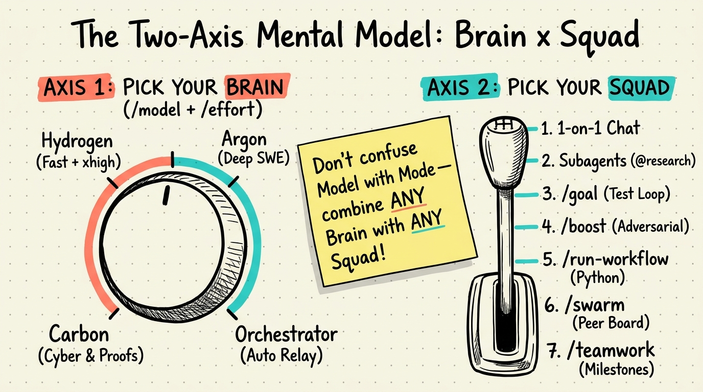

# Workshop: Full-Stack Feature Velocity — From Ambiguous PRD to Verified Release `[Level 200–300]`



## Workshop Overview

| Field | Details |
| :--- | :--- |
| **Focus** | Taking a real product feature from an underspecified request → zero-mutation `/plan` & clickable `/generative_ui` prototype → parallel full-stack `/swarm` build → `/goal` + `/browser` sign-off |
| **Duration** | `90–120 minutes` *(Standard Sprint)* or `3 hours` *(Extended Multi-Stack Deep Dive)* |
| **Audience** | Full-Stack Engineers, Backend/Frontend Developers, Product Engineers, and Tech Leads |
| **Recommended Brain × Squad** | **`Orchestrator (Argon)`** for solo flows; **`gemini-4-hydrogen`** workers + **`gemini-4-carbon`** `@verifier` inside `/swarm` |
| **Key Atomic Labs Composed** | [PRD to Clickable Prototype](../../../../labs/agentic-sdlc/prd-to-clickable-prototype.md) • [Parallel Full-Stack Swarm](../../../../labs/agentic-sdlc/parallel-fullstack-swarm.md) • [Self-Healing QA & Browser E2E](../../../../labs/agentic-sdlc/self-healing-qa-and-browser.md) |
| **Sandbox Target** | [`labs/sandbox-apps/pulsepay-legacy-ledger/`](../../../../labs/sandbox-apps/pulsepay-legacy-ledger/) *(isolated on branch `workshop-<your-handle>`)* |

---

## Storyline: Tuesday, 9:15 AM at PulsePay

**Maya** (Product Manager) rushes over to **Alex** (Dev Lead) and **Priya** (Staff Architect) with an urgent enterprise merchant request:

> *"Enterprise merchants need **Instant Refund Guard** in PulsePay before Friday's pilot! Refunds under `\$500` should auto-settle immediately, refunds `>= \$500` need a 24-hour velocity check plus a manual Ops Override drawer with an audit reason, and Finance wants zero double-refund bugs."*

In a traditional sprint, Alex would jump straight into editing code, discover halfway through Wednesday that nobody defined what happens when a merchant fires *three `\$400` partial refunds on a `\$1,000` capture in ten seconds*, and spend Friday afternoon debugging broken React state and integer-cents rounding errors.

In this workshop, you'll step into Maya, Priya, and Alex's shoes and ship the entire full-stack capability in **under two hours**—with higher test coverage and a frontier **Gemini 4 Carbon** security audit baked in!

### 💬 Fireside Chat: Jumping Straight to Code vs. Stacking `/plan /grill-me`

> **Impatient Developer**: *"Why waste 10 minutes in `/plan /grill-me`? Just tell `gemini-4-carbon` to 'build Instant Refund Guard' and let it rip!"*
>
> **Priya (Architect)**: *"Let's do the math! If you leave partial-refund splitting, currency rounding, and idempotency keys ambiguous, `Carbon` has to *guess* across 12 files. When you realize on Turn 14 that it used floating-point dollars instead of integer cents, you've already burned `\$2.50` in `Carbon` thinking tokens—and polluted your context window with wrong schemas."*
>
> **Impatient Developer**: *"Okay, fair. So what happens when I stack `/plan /grill-me` first?"*
>
> **Priya (Architect)**: *"First, `/plan` guarantees **zero code files are mutated** during alignment. Second, `/grill-me` silently reads `pulsepay-legacy-ledger` first so it never asks dumb questions code already answers, then grills you **one sharp edge-case question at a time** with its `(Recommended)` option listed first. Once you click Proceed on `implementation_plan.md`, fast **`gemini-4-hydrogen`** (`\$1.50/1M` input, `\$0.075/1M` cached!) executes the crystal-clear blueprint at blistering speed!"*

---

## Table of Contents

- [Lab 1 — Stress-Test the Spec & Spin Up a Clickable Prototype (`25 min`)](#lab-1--stress-test-the-spec--spin-up-a-clickable-prototype-25-min)
- [Lab 2 — Full-Stack Implementation: `Orchestrator` vs. Parallel `/swarm` (`45 min`)](#lab-2--full-stack-implementation-orchestrator-vs-parallel-swarm-45-min)
- [Lab 3 — Relentless Convergence, Live `/browser` Sign-Off & `/learn` (`30 min`)](#lab-3--relentless-convergence-live-browser-sign-off--learn-30-min)
- [🕵️ Be the Orchestrator: Mid-Feature Context Hygiene](#-be-the-orchestrator-mid-feature-context-hygiene)
- [🧲 Prompt Magnets: Wire the 4-Worker `/swarm`](#-prompt-magnets-wire-the-4-worker-swarm)
- [Dual-Layer Verification Rubric & Suggested Formats](#dual-layer-verification-rubric--suggested-formats)

---

## Lab 1 — Stress-Test the Spec & Spin Up a Clickable Prototype (`25 min`)

- **Atomic Lab Deep-Dive**: [PRD to Clickable Prototype](../../../../labs/agentic-sdlc/prd-to-clickable-prototype.md)
- **Target**: [`labs/sandbox-apps/pulsepay-legacy-ledger/`](../../../../labs/sandbox-apps/pulsepay-legacy-ledger/)
- **Recommended Brain**: `Orchestrator (Argon)` or `gemini-4-argon` (`Medium`/`High`) + `gemini-3.8-flash` for `/generative_ui`

### Step 1: Isolate Your Branch & Check Startup Context
Create your attendee branch inside the workspace and verify your startup context budget (`⛁`) is lean:

```bash
git checkout -b workshop-<your-handle>-refund-guard
```

Then run `/context` inside Antigravity CLI (or check the context meter in the App) to confirm `AGENTS.md` and `GEMINI.md` are loaded cleanly.

### Step 2: Run Zero-Mutation Discovery & Architecture Alignment (`/plan /grill-me`)
Paste this prompt to let Antigravity inspect `pulsepay-legacy-ledger` silently and grill you one question at a time:

```text
/plan /grill-me We are adding "Instant Refund Guard" to labs/sandbox-apps/pulsepay-legacy-ledger/:
- Refunds < $500 settle immediately if cumulative refunds on the parent capture stay <= 100% of captured integer cents.
- Refunds >= $500 (or high merchant velocity) enter HELD_FOR_REVIEW and require an Ops Override with an operator_id and reason_code.
Inspect the existing ledger models, routes, and tests first so you don't ask what the codebase already answers. Then grill me one question at a time on cumulative partial refunds, idempotency_key replay behavior, and integer-cents invariants—putting your (Recommended) option first—before writing implementation_plan.md.
```

### Step 3: Build a Clickable Stakeholder Prototype in 90 Seconds (`/generative_ui`)
Before writing production UI code, switch to (or stay in) the Antigravity App and generate an interactive HTML prototype Maya can validate immediately:

```text
/generative_ui Build a standalone interactive prototype of the "PulsePay Instant Refund Guard & Ops Override Drawer" matching our approved implementation_plan.md. Include:
1. A live refund request simulator (amount input, cumulative partial-refund meter against a $1,000 capture, idempotency_key toggle).
2. Real-time routing badge (AUTO_SETTLED vs. HELD_FOR_REVIEW) with integer-cents breakdown.
3. An Ops Override approval modal requiring MFA reason selection and previewing the exact JSON audit event payload.
```

---

## Lab 2 — Full-Stack Implementation: `Orchestrator` vs. Parallel `/swarm` (`45 min`)


- **Atomic Lab Deep-Dive**: [Parallel Full-Stack Swarm](../../../../labs/agentic-sdlc/parallel-fullstack-swarm.md)
- **Recommended Brain × Squad**:
  - **Solo Multi-File Track**: `Orchestrator (Argon)` *(plans on Argon ↔ executes edits/tests on Hydrogen, saving `24%` quota)*
  - **Parallel Pod Track**: `/swarm` with 3 `gemini-4-hydrogen` domain workers + 1 `gemini-4-carbon` `@verifier`

### Step 1: Launch Implementation (Pick Your Stack Option!)

Choose **Option A** (default runnable sandbox in this repo) or adapt the exact pattern to **Option B** (Backend API focus):

**Option A — Full-Stack Parallel `/swarm` on `pulsepay-legacy-ledger` (Recommended):**
```text
/swarm Implement our approved Instant Refund Guard implementation_plan.md inside labs/sandbox-apps/pulsepay-legacy-ledger/ using non-overlapping file scopes:
- @schema-worker (gemini-4-hydrogen, medium effort): Add integer-cents cumulative refund tracking, idempotency_key uniqueness, and HELD_FOR_REVIEW state transitions in the data/ledger storage layer.
- @api-worker (gemini-4-hydrogen, high effort): Implement POST /api/refunds and POST /api/refunds/:id/override with strict validation, cumulative over-refund prevention, and structured error codes.
- @ui-worker (gemini-4-hydrogen, medium effort): Build the Ops Held-Refund Queue & Override Action panel wired to the new API contracts.
- @verifier (pin to gemini-4-carbon, high effort): Do NOT modify production files—run the full test suite and audit all diffs for integer-cents rounding bugs, missing idempotency checks, and unauthorized override bypasses before Coordinator merges.
```

**Option B — Focused Backend TDD Flow with `Orchestrator`:**
```text
Using our approved implementation_plan.md in labs/sandbox-apps/pulsepay-legacy-ledger/, follow strict TDD:
1. First write failing unit and API integration tests covering: (a) < $500 auto-settle, (b) >= $500 HELD_FOR_REVIEW, (c) three $400 partial refunds on a $1,000 capture rejecting the third refund, and (d) duplicate idempotency_key returning the cached response without double-debiting.
2. Implement the ledger + route logic using integer cents only (zero floating-point math) until all new and existing tests pass.
```

### Step 2: Explore Without Polluting Trajectory (`/btw` + `Alt+S`)
While your `/swarm` workers coordinate (press **`Alt+S`** in the CLI to watch live peer messages on the Swarm Board, and press **`p`** to filter to `@verifier`'s Carbon security findings!), practice zero-pollution side research with **`/btw`**:

- `/btw Why do payment ledgers store amounts as integer minor units (cents) instead of IEEE-754 floats, and how does that interact with multi-currency 3-decimal currencies like JOD or KWD?`
- `/btw What happens to prompt cache hit rates when a /swarm worker sleeps in Waiting state waiting on @api-worker's schema message?` *(Spoiler: `Waiting` workers burn `0` tokens and keep their `95%` implicit prefix cache warm!)*

---

## Lab 3 — Relentless Convergence, Live `/browser` Sign-Off & `/learn` (`30 min`)

- **Atomic Lab Deep-Dive**: [Self-Healing QA & Browser E2E](../../../../labs/agentic-sdlc/self-healing-qa-and-browser.md)
- **Recommended Brain**: `gemini-4-hydrogen` (`Medium`/`High`) for `/goal` + `gemini-3.8-flash` / `Hydrogen` for `/browser`

### Step 1: Converge to 100% Green with `/goal`
Never settle for *"I think the tests pass."* Hand Antigravity an objective exit-code verification loop:

```text
/goal Run the complete test suite and linter inside labs/sandbox-apps/pulsepay-legacy-ledger/ and fix any failing edge cases, type errors, or regressions until the test command exits with code 0.
```

### Step 2: Live DOM, Network & Console Verification (`/browser`)
Start the sandbox app (using background daemon execution) and run **`/browser`** to verify real rendering—not just mocked unit tests:

```text
/browser Open the running PulsePay app, submit a $750 refund to trigger HELD_FOR_REVIEW, approve it from the Ops Override queue with reason "MERCHANT_VIP_VERIFIED", confirm the status badge updates to SETTLED with zero console errors or HTTP 500s, and capture a release-evidence screenshot artifact.
```

### Step 3: Turn Today's Win into Tomorrow's Immunity (`/learn`)
Lock your monetary ledger invariants into the workspace so every future agent inherits them automatically:

```text
/learn Codify our Instant Refund Guard conventions—integer-cents arithmetic only, mandatory idempotency_key replay safety, and cumulative partial-refund ceiling checks—into _agents/skills/pulsepay-monetary-safety/SKILL.md.
```

---

## 🕵️ Be the Orchestrator: Mid-Feature Context Hygiene

Halfway through Lab 2, Alex tries an experimental third-party decimal validation library. It throws cryptic dependency errors across **three consecutive turns**, adding `42,000` tokens of stack traces to `◉` in `/context`. What should Alex do *right now*?

- **Choice A**: Keep replying *"Still broken, try fixing the import path again"* in the main chat.
- **Choice B**: Run **`/rewind`** back to the clean pre-library checkpoint, or **`/fork`** when comparing two candidate libraries side-by-side.
- **Choice C**: Switch to `gemini-4-carbon` (`High`) and re-send the polluted 42k stack-trace history on every turn.

<details>
<summary><b>🔑 Click for the Staff-Engineer Move!</b></summary>

**Choice B (`/rewind` or `/fork`) wins every time!**
Continuing to argue in a poisoned trajectory (**Choice A**) biases attention toward broken code patterns and inflates every subsequent cached input turn. Escalating to `Carbon` on a polluted window (**Choice C**) just pays higher output/thinking rates to step over scrap metal. **`/rewind`** cleanly restores both your conversation history *and* filesystem to the pre-experiment checkpoint in one keystroke!

</details>

---

## 🧲 Prompt Magnets: Wire the 4-Worker `/swarm`

Arrange the scrambled fragments below to complete a well-governed **`@verifier`** assignment inside `/swarm` per [`AGENTS.md`](../../../../AGENTS.md) and [`GEMINI.md`](../../../../GEMINI.md):

```text
[ Do NOT modify production code files ]   [ pin to gemini-4-carbon ]   [ integer-cents overflow & IDOR bypasses ]   [ cite exact file:///path#L10-L20 lines ]
```

> `- @verifier (` **`[1]`** `): ` **`[2]`** `. Run the full test suite, audit every worker diff for ` **`[3]`** `, and ` **`[4]`** ` separating Verified Facts from Hypotheses.`

<details>
<summary><b>🔑 Solution</b></summary>

1. `pin to gemini-4-carbon` *(cross-model frontier verification catches subtle logic/security flaws Hydrogen workers might miss)*
2. `Do NOT modify production code files` *(strict read-only mutation boundary for audit agents)*
3. `integer-cents overflow & IDOR bypasses` *(specific domain security & business invariants)*
4. `cite exact file:///path#L10-L20 lines` *(actionable evidence contract)*

</details>

---

## 🙋 There Are No Dumb Questions

**Q: When should I just use single-agent `Orchestrator` instead of launching `/swarm`?**
> **A:** If your feature touches `1–4` tightly coupled files in a single stack, **`Orchestrator`** is lighter and faster—it plans on Carbon/Argon and executes on Hydrogen inside one thread with zero coordination overhead! Reach for **`/swarm`** when you have `3+` distinct modules (e.g., DB migration + Backend API + React UI + independent Security Verifier) that can move concurrently in isolated working copies.

**Q: Why did we write a `SKILL.md` in Lab 3 instead of pasting those rules into `AGENTS.md`?**
> **A:** `AGENTS.md` loads on *every single conversation* across the repo (`100 KB` cap). A 3-tier `SKILL.md` only loads `~100` tokens of YAML `name` + `description` at startup (`⛁`) and pulls in full monetary-ledger instructions **only** when a future task touches payment/refund logic!

## 💥 Watch Out!

> [!WARNING]
> **Floating-Point Money Is a Career-Limiting Bug!** Never approve a diff in Lab 2 that computes `0.1 + 0.2` or multiplies dollar floats (`149.99 * 100`) without exact integer minor units. Make sure `@verifier` (`gemini-4-carbon`) explicitly checks that every API boundary and ledger column enforces integer cents!

---

## Dual-Layer Verification Rubric & Suggested Formats

### Verification Rubric
1. **Deterministic `/goal` Gate (Pass/Fail)**:
   - Full sandbox unit + API test suite exits with code `0` (covering auto-settle `< \$500`, held `>= \$500`, cumulative partial-refund cap, and `idempotency_key` replay).
   - Zero `.env` or secret files staged (`gate.py` / `hooks.json` clean).
2. **Portfolio Deliverables**:
   - Approved `implementation_plan.md` + interactive `/generative_ui` Ops Override HTML prototype.
   - `/browser` release-evidence screenshot showing zero console errors.
   - Reusable monetary safety skill saved via `/learn`.

### Suggested Session Formats

| Format | Duration | Agenda Slice |
| :--- | :--- | :--- |
| **Lightning Lunch-and-Learn** | `60 min` | Lab 1 (`/plan /grill-me` + `/generative_ui`) + Facilitator live demo of Lab 2 `/swarm` (`Alt+S`) |
| **Standard Developer Cohort** | `90–120 min` | Lab 1 + Lab 2 (Option A or B) + Lab 3 (`/goal` + `/browser`) |
| **Extended Full-Stack Bootcamp** | `3 hours` | Complete Labs 1–3, then swap stacks in Lab 2 and compare `Orchestrator` vs. `/swarm` token burn in `/context` |

---

## 📌 Bullet Points

- **Align Before Mutating**: Stacking `/plan /grill-me` catches multi-refund and idempotency edge cases *before* a single line of code is written.
- **Show, Don't Describe**: `/generative_ui` gives PMs and stakeholders a clickable prototype in 90 seconds right from the spec.
- **Right-Size Your Squad**: Use `Orchestrator` for cohesive 2–4 file tasks, and `/swarm` (`Hydrogen` workers + `Carbon` `@verifier`) for parallel cross-stack builds.
- **Close Every Loop**: Combine `/goal` (deterministic CLI exit code `0`), `/browser` (live Chromium DOM/console proof), and `/learn` (permanent `SKILL.md` memory).

← Back to [Workshops Hub](../../../README.md) | Next up: [Application Development & Maintenance](../app-maintenance/README.md) →
